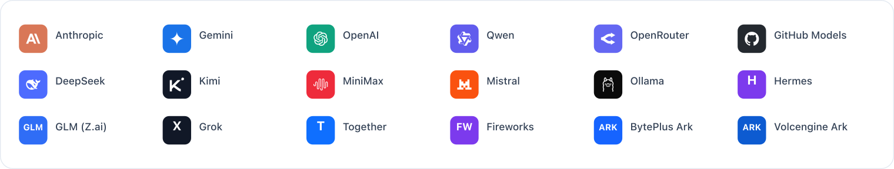
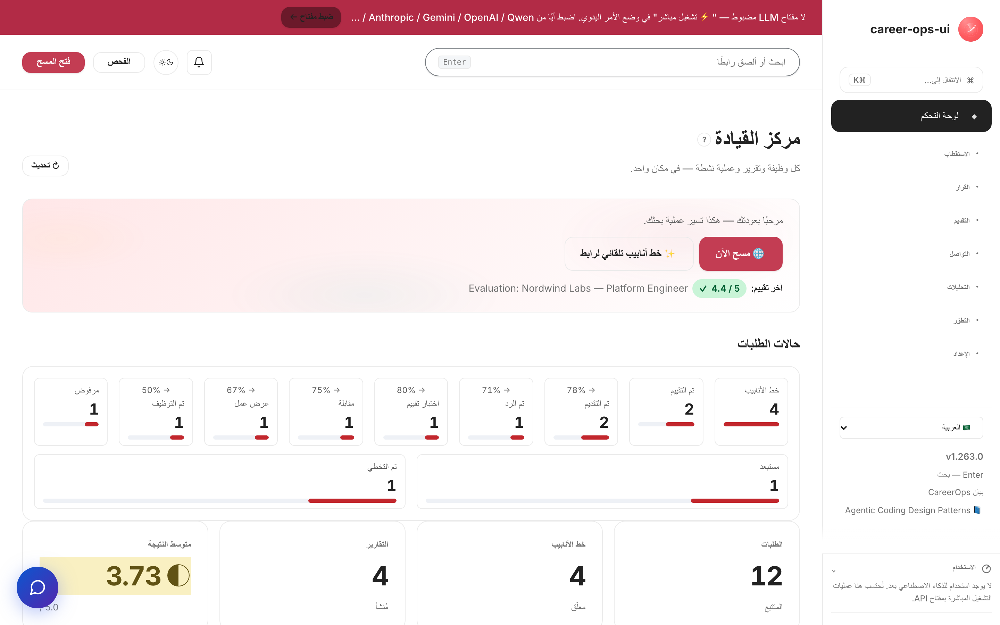
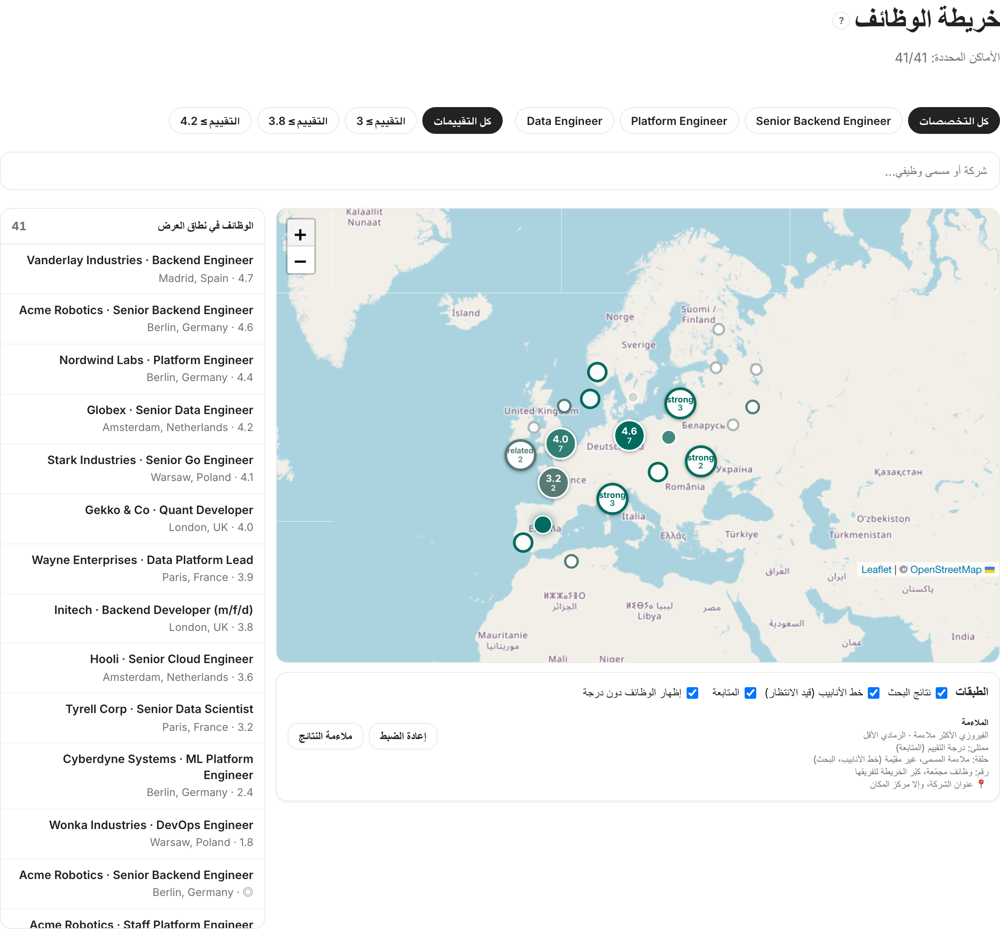

# career-ops-ui

> واجهة ويب أنيقة بأسلوب التوثيق التقني لخط أنابيب البحث عن عمل بالذكاء الاصطناعي — [career-ops](https://github.com/Fighter90/career-ops).
> ابحث عن الوظائف وقيّمها واستكشفها وقدّم طلباتك وتتبّع كل عرض من تبويب واحد في المتصفح — بدلاً من التنقل بين Claude Code والطرفية وملفات markdown.

[🇬🇧 English](README.md) | [🇪🇸 Español](README.es.md) | [🇧🇷 Português (Brasil)](README.pt-BR.md) | [🇰🇷 한국어](README.ko-KR.md) | [🇯🇵 日本語](README.ja.md) | [🇷🇺 Русский](README.ru.md) | [🇨🇳 简体中文](README.zh-CN.md) | [🇹🇼 繁體中文](README.zh-TW.md) | [🇫🇷 Français](README.fr.md) | [🇵🇱 Polski](README.pl.md) | [🇺🇦 Українська](README.uk.md) | [🇩🇰 Dansk](README.da.md) | **🇸🇦 العربية** | [🇩🇪 Deutsch](README.de.md) | [🇮🇹 Italiano](README.it.md) | [🇹🇷 Türkçe](README.tr.md) | [🇮🇳 हिन्दी](README.hi.md) | [🇱🇰 தமிழ்](README.ta.md) | [🇻🇳 Tiếng Việt](README.vi.md)

> ترجمات هذا الدليل موجودة في README لكل لغة:
> [🇬🇧 English](README.md) · [🇪🇸 Español](README.es.md) · [🇧🇷 Português (Brasil)](README.pt-BR.md) · [🇰🇷 한국어](README.ko-KR.md) · [🇯🇵 日本語](README.ja.md) · [🇷🇺 Русский](README.ru.md) · [🇨🇳 简体中文](README.zh-CN.md) · [🇹🇼 繁體中文](README.zh-TW.md) · [🇫🇷 Français](README.fr.md) · [🇵🇱 Polski](README.pl.md) · [🇺🇦 Українська](README.uk.md) · [🇩🇰 Dansk](README.da.md) · [🇩🇪 Deutsch](README.de.md) · [🇮🇹 Italiano](README.it.md) · [🇹🇷 Türkçe](README.tr.md) · [🇮🇳 हिन्दी](README.hi.md) · [🇱🇰 தமிழ்](README.ta.md) · [🇻🇳 Tiếng Việt](README.vi.md)

_واجهة غير رسمية — لا علاقة لها بـ career-ops / santifer ولا تحظى بموافقتهما._

[](#الاختبارات)
[](#الاختبارات)
[](#الاختبارات)
[](#المتطلبات)
[](LICENSE)
[](https://github.com/Fighter90/career-ops-ui/releases/tag/v1.269.2)
[](https://mokevnin.github.io/agentic-coding-design-patterns/en/)

<a href="https://www.producthunt.com/products/career-ops-ui?embed=true&amp;utm_source=badge-featured&amp;utm_medium=badge&amp;utm_campaign=badge-career-ops-ui" target="_blank" rel="noopener noreferrer"></a>

> **🆕 أحدث إصدار — v1.270.0** — ستة مصادر مسح جديدة — ALDI Nord، HiBob، HireHive، Factorial، Polymer، Remote (السجل **135 = 130 EN + 5 RU · 130 adapters**)؛ الماسح يقرأ اللوحات كاملة: Consider يجتاز كامل فهرسه عبر `meta.sequence` الخاص باللوحة مع إعادة محاولة لكل صفحة وتحذير حدّ أقصى صارم، يقبل عناوين الدول العالمية، `timeout_ms` لكل مدخل، `CAREER_OPS_HTTP_TIMEOUT_MS` لكل طلب، وتزامن مسح قابل للضبط (`CAREER_OPS_SCAN_CONCURRENCY` / `CAREER_OPS_SCAN_HOST_CONCURRENCY`، الافتراضات دون تغيير 32/10).
>
> **السابق — v1.269.2** — حفظ تقارير بلا سباق على كلا المسارين (المحاولة الأولى + إزالة التكرار باللاحق الحقبي، كلاهما حصري عبر `wx` في `server/lib/report-save.mjs::saveReportExclusive`)، وعقد السباق مثبت سلوكيًّا؛ يكتب `POST /api/reports` دون `overwrite` حصريًّا (`wx`، والـ 409 ذاته). الاختبارات 7699 → 7704.

<p align="center"></p>

>
> 📜 سجل الإصدارات الكامل: **[CHANGELOG.ar.md](CHANGELOG.ar.md)**.

[](https://youtu.be/LcVPUg9IsDk?si=mrx3oOmOpSAwabOz)

**[▶ مشاهدة المعاينة](https://youtu.be/LcVPUg9IsDk?si=mrx3oOmOpSAwabOz)**

<div dir="rtl">

### 🗺️ جديد: كل إعلان على خريطة

نتائج الفحص وخط المعالجة والمتتبّع على خريطة عالمية واحدة (`#/map`) — لترى أين تتجمّع العروض وأي المدن تستحق الانتقال إليها. العلامة المملوءة هي درجة تقييمك، والحلقة ملاءمة المسمّى قبل التقييم؛ وتُثبَّت الإعلانات على عنوان الشركة إن عُرف، وإلا فعلى مركز المدينة (ترميز جغرافي مجاني عبر OpenStreetMap، بلا مفاتيح).



</div>

<div dir="rtl">

## نبذة عن career-ops

[career-ops](https://career-ops.org) نظام مفتوح المصدر للبحث عن عمل يعمل على شكل أوامر slash داخل أي واجهة سطر أوامر للذكاء الاصطناعي (Claude Code وCursor وCodex وOpenCode وAntigravity CLI وGrok Build CLI وQwen Code وKimi وGitHub Copilot CLI وGemini CLI (legacy) — وتعمل واجهات CLI الأخرى المتوافقة مع Claude أيضاً). يقيّم كل وظيفة مقارنةً بسيرتك الذاتية وفق مقياس سداسي الأبعاد من 0,0 إلى 5,0، ويُنشئ ملفات PDF لسيرة ذاتية مخصّصة، ويتتبّع كل طلب محلياً — دون حسابات سحابية أو إرسال تلقائي أو جمع بيانات.

**هذا المستودع (career-ops-ui)** واجهة ويب متكاملة فوق career-ops. تظل واجهة CLI مسؤولة عن ملء النماذج (عبر Playwright MCP) وأوامر slash؛ أما تطبيق الصفحة الواحدة (SPA) فيمنحك سطحاً يشبه نظام CRM في المتصفح فوق نفس الملفات `cv.md` و`data/applications.md` و`reports/`. كلاهما يشتركان في البيانات ذاتها.

**عتبات الإجراء حسب النتيجة** (من [career-ops.org/docs](https://career-ops.org/docs)):

| النتيجة | الخطوة التالية |
|---|---|
| **≥ 4.5** | `/career-ops apply` — تطابق عالٍ، قدّم طلبك فوراً |
| **4.0 – 4.4** | تقديم الطلب أو `/career-ops contacto` للحصول على تزكية |
| **3.5 – 3.9** | `/career-ops deep` — ابحث أولاً عن الشركة |
| **< 3.5** | تجاهل ما لم يكن ثمة سبب محدد |

**الأدلة الرسمية** على [career-ops.org/docs](https://career-ops.org/docs):

- [ما هو career-ops](https://career-ops.org/docs/introduction/what-is-career-ops)
- [مسح بوابات الوظائف](https://career-ops.org/docs/introduction/guides/scan-job-portals)
- [التقديم على وظيفة](https://career-ops.org/docs/introduction/guides/apply-for-a-job)
- [التقييم الجماعي للعروض](https://career-ops.org/docs/introduction/guides/batch-evaluate-offers)
- [إعداد Playwright](https://career-ops.org/docs/introduction/guides/set-up-playwright)
- [كيف يقيّم career-ops الوظائف المُدرجة — المنهجية](https://career-ops.org/methodology)

## بيان CareerOps

career-ops هو أول تطبيق مرجعي [لبيان CareerOps](https://career-ops.org/manifesto) — ممارسة إدارة البحث عن عمل بالأدلة والانضباط وبأدوات في صف المرشّح على طاولة المفاوضات. اقرأه. وإن كان يعبّر عمّا تؤمن به، وقّعه — يصبح توقيعك التزاماً (commit). يربط التطبيق إليه من تذييل الشريط الجانبي.

التطبيق نفسه مبنيٌّ بوكلاء برمجة، اتّباعاً لكتالوج [Agentic Coding Design Patterns](https://mokevnin.github.io/agentic-coding-design-patterns/en/) ([بالروسية](https://mokevnin.github.io/agentic-coding-design-patterns/ru/)) — ضمانات تنفيذية، وسير عمل مُعلَّب، وقاموس نطاق، وسجلّات ADR، وتقييمات لسير العمل. وتراجع صفحة ويكي [Agentic Practices](https://github.com/Fighter90/career-ops-ui/wiki/Agentic-Practices) أيّ الأنماط مطبَّقة فعلاً.

## التشغيل عبر OpenWorker (زميل الذكاء الاصطناعي)

تفضّل زميل ذكاء اصطناعي على سطح المكتب بدلاً من المتصفح؟ ثمة **[زميل OpenWorker](https://github.com/andrewyng/openworker)** يقود خط الأنابيب كاملاً عنك — يمسح لوحات الوظائف، ويقيّم الملاءمة مقابل سيرتك الذاتية، ويصوغ سيرة ذاتية + رسالة تغطية ذاتَي أساس، ويتتبع الطلبات، ويسودّ رسائل المتابعة، بل و**يشغّل لوحة التحكم هذه** — كل ذلك من تطبيق OpenWorker مفتوح المصدر من Andrew Ng.

→ **[Fighter90/career-ops-coworker](https://github.com/Fighter90/career-ops-coworker)** — زميل من ملف واحد، دون كود (تثبيت مُتحقَّق منه عبر مُحمِّل OpenWorker نفسه **وعبر مُثبِّت المستودع** الخاص به). الدليل الكامل بـ[17 لغة](https://github.com/Fighter90/career-ops-coworker/tree/main/help). انظر أيضًا [`docs/integrations/openworker.md`](docs/integrations/openworker.md).

**التثبيت** — أمر واحد يهيئ خط الأنابيب الذي يقوده الزميل (غير متكرر الأثر — يعيد استخدام `career-ops` / `web-ui` القائمة): `curl -fsSL https://raw.githubusercontent.com/Fighter90/career-ops-coworker/main/install.sh | bash`. ثم أضف الزميل من لوحة **Install a coworker** في OpenWorker — عبر **GitHub URL** (`https://github.com/Fighter90/career-ops-coworker`)، أو عبر **.zip** (من Releases)، أو **باستيراد** `career-ops.md` — الطرق الثلاث تعمل.

## تثبيت مساعد برمجة بالذكاء الاصطناعي (لأصل career-ops CLI)

يعمل career-ops على شكل أوامر slash **داخل** مساعد برمجة بالذكاء الاصطناعي — ثبّت **واحدًا** وسجّل الدخول قبل المتابعة ([الخطوات الأولى للأصل](https://career-ops.org/docs)):

| المساعد | التثبيت | المزوّد في `#/config` |
|---|---|---|
| **Claude Code** | [code.claude.com → Claude Code](https://code.claude.com/docs) | Anthropic (`ANTHROPIC_API_KEY`) |
| **Gemini CLI** | [github.com/google-gemini/gemini-cli](https://github.com/google-gemini/gemini-cli) | Gemini (`GEMINI_API_KEY`) |
| **Codex** | [github.com/openai/codex](https://github.com/openai/codex) | OpenAI (`OPENAI_API_KEY`) |
| **Qwen Code** | [github.com/QwenLM/qwen-code](https://github.com/QwenLM/qwen-code) | Qwen (`QWEN_API_KEY`) |
| **OpenCode** | [opencode.ai](https://opencode.ai) | أيٌّ / OpenRouter (`OPENROUTER_API_KEY`) |
| **GitHub Copilot CLI** | [github.com/github/gh-copilot](https://github.com/github/gh-copilot) | GitHub Models (`GITHUB_MODELS_API_KEY`) |
| **Antigravity CLI** | [antigravity.google](https://antigravity.google) | Gemini (`GEMINI_API_KEY`) |

> **واجهة web-ui هي البديل المستقل** — لا تحتاج أي CLI. ميزاتها ⚡ Run-live تستدعي واجهات المزوّد مباشرة؛ اضبط **أي مفتاح واحد** في `#/config` (أو `career-ops-ui init`) وستعمل دون واجهة. إن كنت تفضّل CLI، شغّل career-ops داخل مساعدك واستخدم web-ui لوحة تحكم فحسب فوق الملفات ذاتها.

## الميزات الرئيسية

| الصفحة | الوصف |
|---|---|
| **لوحة التحكم** | عدادات إجمالية، متوسط النتائج، آخر الطلبات والتقارير |
| **المسح** | زر 🌐 Scan يُشغّل جميع المصادر المُهيّأة (Greenhouse / Ashby / Lever / Workable / SmartRecruiters / Workday + hh.ru / Habr Career + قنوات تيليجرام العامة) في مرور واحد؛ نتائج فورية عبر SSE |
| **خط الأنابيب (Pipeline)** | إدارة `data/pipeline.md`؛ معاينة آمنة للروابط (حماية SSRF) |
| **التقييم** | الصق وصف الوظيفة ← نتيجة 0–5 عبر Anthropic أو Gemini؛ أو نموذج جاهز للنسخ |
| **البحث المعمّق** | استكشاف الشركة عبر Anthropic SDK؛ تُحفَظ النتائج في `interview-prep/` |
| **المتتبّع** | جدول مصفّى للطلبات فوق `data/applications.md` |
| **السيرة الذاتية (CV)** | محرر markdown مباشر مع معاينة جانبية وحماية XSS من جهة الخادم |
| **صحة النظام** | شارات حالة الإعداد؛ تشغيل `doctor.mjs` بنقرة واحدة |
| **المساعدة** | توثيق مدمج بـ 19 لغة (بما فيها العربية) |

## البداية السريعة

> **مهم — career-ops-ui لوحة تحكم *فوق* [`Fighter90/career-ops`](https://github.com/Fighter90/career-ops).** يعمل **داخل** مشروع career-ops بوصفه `career-ops/web-ui/` ويقرأ ملفات `cv.md` و`config/` و`data/` من المجلد الأصلي عبر `../`. **لا يعمل بشكل مستقل** — تحتاج أيضاً إلى مستودع career-ops الأصلي.

### الخيار 1 — أمر curl واحد (موصى به)

</div>

```bash
curl -fsSL https://raw.githubusercontent.com/Fighter90/career-ops-ui/main/bin/setup.sh | bash
```

<div dir="rtl">

يستنسخ **كلا** المستودعين، يُرتّب بنية `career-ops/web-ui/`، يثبّت التبعيات، يُشغّل التشخيص، ويبدأ الخادم على http://127.0.0.1:4317.

### الخيار 2 — إضافة الواجهة إلى مشروع career-ops موجود

</div>

```bash
cd career-ops
git clone https://github.com/Fighter90/career-ops-ui.git web-ui
cd web-ui
npm install
npm start
```

<div dir="rtl">

افتح http://127.0.0.1:4317 في متصفحك.

### أوامر CLI

</div>

```bash
career-ops-ui setup    # bootstrap: تثبيت التبعيات ← تشخيص ← تشغيل
career-ops-ui init     # اختيار مزوّد LLM ولصق مفتاح API (تفاعلي)
career-ops-ui doctor   # التحقق من Node / المشروع / المفاتيح / Playwright
career-ops-ui run      # تشغيل الخادم على http://127.0.0.1:4317
career-ops-ui open     # فتح تبويب لوحة التحكم وإحضاره للأمام
career-ops-ui help     # عرض قائمة جميع الأوامر
```

<div dir="rtl">

### اختيار مزوّد LLM

`init` معالج اختيار المزوّد — اختر **Claude / Claude Code** (`ANTHROPIC_API_KEY`)، أو **Codex / OpenCode** (`OPENAI_API_KEY`)، أو **Qwen Code** (`QWEN_API_KEY`)، أو **Auto** (Anthropic ← Gemini احتياطياً). يمكن ضبط المفاتيح يدوياً:

</div>

```bash
echo "ANTHROPIC_API_KEY=sk-ant-..." >> career-ops/.env
```

<div dir="rtl">

أو من تبويب **إعدادات التطبيق** (`#/config`) في الواجهة — دون إعادة تشغيل الخادم.

### إذا لم يعمل `init`

إن فشل `career-ops-ui init` أو لم يُعثر على الأمر (شائع بعد `git pull` مباشرة):

</div>

```bash
cd career-ops/web-ui
npm install
npx career-ops-ui init        # يشغّل npx الملف التنفيذي المحلي حتى دون `npm link`
```

<div dir="rtl">

## لماذا؟

[career-ops](https://github.com/Fighter90/career-ops) نظام قوي للبحث عن عمل يقوده Claude Code: الصق وصفًا وظيفيًا → تحصل على نتيجة 0–5، وملف PDF مُحسَّن لنظم تتبع المتقدمين (ATS)، وسجل في المتتبع. يعمل بشكل رائع داخل Claude Code، لكن البيانات مبعثرة بين `cv.md` و`data/applications.md` و`reports/*.md` و`data/pipeline.md` و`portals.yml` و`config/profile.yml` — يسهل فقدانها ويصعب تصفحها.

`career-ops-ui` يضيف واجهة أنيقة فوق ذلك:

- **خط الأنابيب التلقائي** — الصق رابط وظيفة واحدة في `#/auto`، نقرة واحدة: تحقق ← جلب ← تقييم ← حفظ التقرير ← إضافة إلى المتتبع، مع متتبِّع خطوات حي متوافق مع إمكانية الوصول وروابط مباشرة إلى المخرجات.
- **تصفّح** المتتبع والتقارير وخط الأنابيب كأنها نظام CRM.
- **شغّل** المسح (Greenhouse / Ashby / Lever / Workable / SmartRecruiters / Workday **و** hh.ru / Habr Career / Trudvsem / GetMatch / GeekJob) وشاهد سجلات SSE الحية.
- **قيّم** وصفًا وظيفيًا مباشرة عبر Anthropic (المفضَّل) أو Gemini، أو خذ موجِّهًا جاهزًا للنسخ إلى Claude Code إن لم يوجد مفتاح.
- **ابحث** عن الشركات مباشرة عبر Anthropic SDK مع تضمين ملفات cv / profile / modes تلقائيًا.
- **حرّر** `cv.md` بمعاينة markdown جانبية وتنقية XSS من جهة الخادم.
- **صانُ** النظام: doctor وverify وnormalize وdedup وmerge — نقرة واحدة لكل منها.

إنه إضافي بحت: لا يتغيّر شيء داخل `career-ops/`. جميع تخصيصاتك تبقى لك.

## أول تشغيل — حالة نظيفة

يأتي `career-ops/data/pipeline.md` مع رابطي فكساتر اختبار (`example.com/qa-fixture-*`) حتى يعمل مجموعة الاختبارات معزولًا. في نسخة مستنسخة جديدة سترى Pipeline يعرض `2 pending` — هذه ليست وظائف حقيقية. نظّفها قبل أول مسح:

</div>

```bash
make clean-test-fixtures        # يزيل صفوف الفكساتر من pipeline.md وصفوف qa-fixture-* من applications.md
npm start
```

<div dir="rtl">

افتح http://127.0.0.1:4317. على العدّاد أن يعرض `0 pending`. ملف Makefile غير متكرر الأثر — إعادة تشغيله على شجرة نظيفة لا تُغيّر شيئًا.

## المتطلبات

| | |
|---|---|
| **Node.js** | ≥ 18 (نظام `fetch` الأصلي و`node:test`) |
| **career-ops** | مستنسَخ ومُهيَّأ (انظر أعلاه) |
| **اختياري** | `ANTHROPIC_API_KEY` أو `GEMINI_API_KEY` في `.env` للمشروع الأصلي، لتقييم الوظائف بنقرة واحدة |

## المسح

مسح بوابات الوظائف دون أي رمز، يعيد وظائف فعلًا. **زر 🌐 Scan واحد** في الواجهة يشغّل جميع المصادر المُهيّأة في مرور واحد:

- **Greenhouse / Ashby / Lever / Workable / SmartRecruiters / Workday** — واجهات boards-api العامة لكل شركة في `portals.yml::tracked_companies` بنمط ATS معروف. القائمة المرفقة تغطي Stripe وGitLab وVercel وCloudflare وDatadog وDiscord وElastic وما يقارب 120 مصدرًا آخر — وسّعها أو قلّصها بحرية.
- **لوحات RSS** — أي لوحة وظائف تنشر feed RSS/Atom (LaraJobs وWeWorkRemotely وRemoteOK وغيرها). أضف `provider: rss` + رابط الـfeed إلى `portals.yml` — دون أي تغيير في الكود.
- **قنوات تيليجرام العامة** — أي قناة **عامة** مذكورة في كتلة `telegram_channels:` تُقرأ من معاينتها الشبكية `t.me/s/<channel>`: دون رمز بوت ودون مفتاح API. منشور القناة نثرٌ لا سجلُّ وظيفة: تأتي الشركة والموقع من تسميات صريحة فقط، وفصل الإعلانات عن الوظائف الحقيقية عملُ `title_filter` لديك. تعامل معها بوصفها خيوطًا للتحقيق لا وظائف مضمونة.
- **hh.ru / Habr Career** — كشط HTML لـ`hh.ru/search/vacancy` و`career.habr.com/vacancies`. يعمل من أي IP، بلا مفاتيح.

### محوّل RSS

</div>

```yaml
tracked_companies:
  - name: LaraJobs
    provider: rss
    rss: https://larajobs.com/feed
    enabled: true
```

<div dir="rtl">

تمرّ جميع المصادر في خط أنابيب واحد: normalize ← مرشِّح (`title_filter.positive` / `title_filter.negative`) ← إزالة تكرار مقابل `data/scan-history.tsv` + `data/pipeline.md` + `data/applications.md` ← إلحاق بـ`data/pipeline.md` ← حفظ مجموعة النتائج الكاملة في `data/last-scan.json` لجدول الواجهة القابل للترشيح.

الإعداد عبر `portals.yml`:

</div>

```yaml
title_filter:
  positive: [backend, engineer, senior, tech lead, golang, php]
  negative: [junior, intern, frontend, ios, android]
tracked_companies:
  - { name: Stripe, enabled: true, careers_url: https://job-boards.greenhouse.io/stripe }
  - { name: Linear, enabled: true, careers_url: https://jobs.ashbyhq.com/linear }
russian_portals:
  sources: ["hh", "habr"]   # واحد أو كلاهما
  area: 113                  # 1=موسكو، 2=SPb، 113=روسيا، 1001=عن بُعد
  per_page: 50
  queries: ["Senior PHP", "Senior Go", "Tech Lead"]
```

<div dir="rtl">

تغذي جميع المصادر نقطة نهاية SSE واحدة: `/api/stream/scan?source=ats|regional|both`. يستدعي زر **🌐 Scan** القيمة `source=both` ليعمل جميع المحوّلات عبر اتصال واحد. يحترم `AbortSignal` عند انقطاع العميل — لا طلبات يتيمة.

## البنية المعمارية باختصار

</div>

```
career-ops/
├─ cv.md
├─ portals.yml
├─ config/
├─ data/
└─ web-ui/          ← هذا المستودع
   ├─ server/       # Express + 15 وحدة مسارات
   ├─ public/       # vanilla JS SPA — بدون bundler
   └─ tests/        # 7243 unit + 176 Playwright + 23/23 e2e:full + 21 e2e:smoke (baseline @ v1.267.2)
```

<div dir="rtl">

للخادم تبعيتان إنتاجيتان فقط: `express` و`js-yaml`. لا transpile، لا bundler — حجم الواجهة بالكامل أقل من 30 كيلوبايت.

## مرجع API

جميع نقاط النهاية تحت `/api/*`. JSON في الداخل / JSON في الخارج ما لم يُذكر خلاف ذلك. المجموعات الرئيسية:

| الطريقة | المسار | الغرض |
|---|---|---|
| GET | `/api/health` | فحوصات الحالة، الإصدار، التحذيرات |
| GET | `/api/dashboard` | عدّادات مجمّعة، متوسط النتائج، آخر الطلبات |
| GET/POST | `/api/tracker` | صفوف `data/applications.md`؛ POST مع مراعاة إزالة التكرار |
| GET/POST/DELETE | `/api/pipeline` | إدارة CRUD فوق `data/pipeline.md` |
| GET | `/api/pipeline/preview?url=…` | وسيط جلب من جهة الخادم (فحص SSRF لكل قفزة، ≤3 تحويلات، حد 8 KB) |
| GET | `/api/reports` · `/api/reports/:slug` | قائمة التقارير / محتواها |
| GET/PUT | `/api/cv` | قراءة / كتابة `cv.md` (تنقية XSS، حد 1 MB) |
| POST | `/api/run/doctor` … | تشغيلات مُخزَّنة لـ`doctor` / `verify` / `normalize` / `dedup` / `merge` (سقف 60 ثانية) |
| GET | `/api/stream/scan` | ماسح SSE الموحّد (`source=ats\|regional\|both`) |
| GET | `/api/stream/liveness` · `/api/stream/pdf` | وسيط SSE لـ`check-liveness.mjs` / `generate-pdf.mjs` |
| POST | `/api/evaluate` | تقييم الوظيفة (أقسام A–G وفق `oferta.md`) |
| POST | `/api/deep` | بحث معمّق عن الشركة |
| POST | `/api/mode/:slug` | الأوضاع المسموحة: `batch` و`contacto` و`followup` و`interview-prep` و`patterns` و`project` و`training` |
| GET | `/api/scan-results` | آخر مسح (`en` / `ru`) |

القائمة الكاملة مع أشكال الطلبات/الاستجابات في [README.md](README.md) الإنجليزي (قسم «API reference»).

## تشغيل المنظومة كاملةً في السحابة

يعمل career-ops على أفضل نحو حين يكون **دائم التشغيل** — يمسح بينما تنام، ويمكن الوصول إليه من أي متصفح. لوضع المنظومة كاملةً على خادم صغير — خط الأنابيب الأصل **career-ops**، وهذا العارض **career-ops-ui**، و**المحرّك** الذي يشغّل الذكاء الاصطناعي (**اشتراك Claude** عبر واجهة Claude Code، أو بوابة **Hermes** محلية، أو مفاتيح API) — جهّز خادمًا افتراضيًا (Node ≥ 18)، وثبّت الأصل + هذا المستودع، واختر محرّكك، واعرض العارض خلف **بروكسي عكسي HTTPS مع مصادقة** مع بقاء ثوابت الأمان (CSP، حارس SSRF، حدّ XSS، لا أسرار في السجلات) سليمة.

📖 تشرح **المساعدة §31** داخل التطبيق («تشغيل المنظومة كاملةً في السحابة») الخطوات بالتفصيل بجميع اللغات الـ19؛ قائمة المشغّل هي [`docs/integrations/HERMES.md`](docs/integrations/HERMES.md)، وتحتوي [صفحة ويكي النشر السحابي](https://github.com/Fighter90/career-ops-ui/wiki/Cloud-Deployment) على جداول مرجعية.

## وكيل Hermes + تيليجرام

**[Hermes](https://hermes-agent.nousresearch.com/docs)** من Nous Research وكيلٌ ذاتي مفتوح (استدعاء أدوات، مهارات، أكثر من 20 قناة مراسلة). يمكنك إبقاء career-ops-ui على **خادم سحابي** وجسْ أحداثه — مسح مكتمل، تقرير جديد، متابعة عاجلة — إلى **تيليجرام عبر وكيل Hermes**، ليصل خط الأنابيب إليك حيث تكون أصلًا.

> **موصولٌ فعلاً (v1.151.0).** Hermes بوصفه *مزوّد LLM* يعمل: شغّل API Server الخاص به المتوافق مع OpenAI (`hermes gateway`) واضبط `HERMES_API_KEY` في **إعدادات التطبيق** — سيجري career-ops-ui التقييمات المباشرة عبر Hermes المحلي لديك (الأخير في ترتيب المزوّدات التلقائي).

📖 **الدليل الكامل:** [`docs/integrations/HERMES.md`](docs/integrations/HERMES.md) — شكلا التكامل، النشر على خادم سحابي، تيليجرام-عبر-Hermes، وقائمة «ما لا يجب كشفه».

---

## التوثيق الكامل

التوثيق الشامل متاح باللغة الإنجليزية فقط: **[🇬🇧 README.md](README.md)**

يتضمن توصيفات تفصيلية لـ:
- REST API الكامل (جميع نقاط النهاية `/api/*`)
- إعداد ماسح بوابات الوظائف (Greenhouse وAshby وLever وWorkable وhh.ru وHabr Career وRSS)
- جميع متغيرات البيئة
- مبادئ الأمان (SSRF وXSS وتحديد معدل الطلبات)
- دليل البنية المعمارية (SDD والاتفاقيات)

الموقع الرسمي: [career-ops.org](https://career-ops.org) · التوثيق: [career-ops.org/docs](https://career-ops.org/docs)

## التعريب (Localization)

تحمل الواجهة **19 لغة** — `en` و`es` و`pt-BR` و`ko` و`ja` و`ru` و`zh-CN` و`zh-TW` و`fr` و`pl` و`uk` و`da` و`ar` و`de` و`it` و`tr` و`hi` و`ta` و`vi`. منذ **v1.60.0 (I18N-SPLIT)** تعيش الترجمات **في ملف واحد لكل لغة** تحت [`public/js/lib/locales/`](public/js/lib/locales/) — `i18n-dict.<lang>.js`، جدول مسطح من `مفتاح → نص` — إضافة إلى `i18n-dict.aliases.js` المشترك. يجمعها [`i18n-dict.js`](public/js/lib/i18n-dict.js) في `window.__I18N_DICT`؛ ويحلّ [`i18n.js`](public/js/lib/i18n.js) النداء `t('مفتاح', 'fallback')`. دون خطوة بناء ودون fetch وقت التشغيل — يعدّل المترجم ملف لغة واحدة.

**إضافة سلسلة أو تغييرها:** أضف المفتاح نفسه إلى ملفات اللغات الـ19 كلها (يُراقَب التكافؤ عبر الاختبارات)، واستخدمه عبر `data-i18n="scan.newButton"` في الترميز أو `t('scan.newButton')` في JS، ثم شغّل `npm test`.

</div>

```js
// public/js/lib/locales/i18n-dict.en.js   →   'scan.newButton': 'Run scan',
// public/js/lib/locales/i18n-dict.es.js   →   'scan.newButton': 'Ejecutar búsqueda',
// …أضف المفتاح نفسه إلى ملفات اللغات الـ19 كلها (التكافؤ تحت بوابة)
```

<div dir="rtl">

📖 **الدليل الكامل:** [`docs/LOCALIZATION.md`](docs/LOCALIZATION.md) — تخطيط اللغات، آلية `@alias`، إضافة لغة جديدة خطوة بخطوة، وكل بوابات i18n في CI.

## الاختبارات

</div>

```bash
npm test                    # 7243 اختبار وحدة وتكامل
npm run test:e2e            # 21 اختبار e2e دخاني
npm run test:e2e:full       # 23 اختبار e2e شامل
npm run test:e2e:browser    # 176 اختبار Playwright
npm run test:coverage       # مثل npm test + تغطية V8
```

<div dir="rtl">

## الإعدادات

متغيرات البيئة (تُقرأ عند بدء الخادم؛ كلها اختيارية عدا المذكور منها):

| المتغير | الافتراضي | الغرض |
|---|---|---|
| `PORT` | `4317` | منفذ ربط Express |
| `HOST` | `127.0.0.1` | مضيف ربط Express؛ تُرفق CSP خارج loopback |
| `CAREER_OPS_ROOT` | `..` | أين يوجد `cv.md` و`data/` و`portals.yml` و`modes/` |
| `ANTHROPIC_API_KEY` | غير مضبوط | يُفعّل `/api/evaluate` و`/api/deep` و`/api/mode/:slug` مباشرة |
| `GEMINI_API_KEY` | غير مضبوط | البديل الاحتياطي لـ`/api/evaluate` |
| `OPENAI_API_KEY` | غير مضبوط | تقييم مباشر دون واجهة (الثالث في الترتيب التلقائي) + مسار Codex/OpenAI CLI |
| `QWEN_API_KEY` / `OPENROUTER_API_KEY` | غير مضبوط | الرابع والخامس في الترتيب التلقائي |

امتداد `portals.yml` الذي تتعرف عليه هذه الواجهة — انظر قسم «المسح» أعلاه؛ الكتل الجاهزة للصق لأكثر من 24 شركة مُتحقَّق منها في [`docs/portals-examples.md`](docs/portals-examples.md).

## ملاحظات أمنية

- الخادم يستمع إلى `127.0.0.1` افتراضيًا — لا تكشفه أبدًا للإنترنت دون `HOST=0.0.0.0` صريح.
- **تعقيم المسارات (v1.21.0)**: كل معامل مسار `:name` / `:slug` يمر عبر `sanitizePathName()` في `server/lib/security.mjs` — تُزال الرموز غير المسموحة، وتُطوى متتاليات النقاط، وسقف 200 حرف.
- **الدفاع ضد DNS-rebind (v1.21.0)**: يمرّ `/api/pipeline/preview` و`/api/auto-pipeline` عبر `server/lib/safe-fetch.mjs::safeGet` — استعلام DNS واحد، اتصال TCP مثبَّت، وإعادة التحقق من التحويلات.
- **ميوتكس الكتابة المتزامنة (v1.21.0)**: عمليات القراءة-التعديل-الكتابة في المتتبع وخط الأنابيب ملفوفة في `withFileLock(path, fn)` — طلبات POST المتزامنة لم تعد تُسقط الصفوف.
- **تحديد معدل LLM (v1.21.0)**: `/api/evaluate` و`/api/deep` و`/api/mode/:slug` و`/api/auto-pipeline` تحمل `llmRateLimit` — بلا أثر على loopback؛ 10 req/min/IP عند `HOST=0.0.0.0`؛ 429 + `Retry-After`.
- **تنقية XSS للسيرة (v1.22.0)**: يعرف `stripDangerousMarkdown` كيانات HTML — لا يعبر `&lt;script&gt;` ولا `java&#115;cript:`.
- تُشغَّل العمليات الفرعية عبر `spawn` بمصفوفات وسائط — **بدون استيفاء shell، دائمًا**.
- نقاط النهاية المتدفقة تقتل العملية الفرعية عند انقطاع العميل — لا ماسحات يتيمة.
- نقاط النهاية الكاتبة تلمس مسارات career-ops المعروفة فقط: `data/` و`jds/` و`cv.md` و`config/` و`portals.yml` و`output/` و`reports/` و`interview-prep/` و`modes/_profile.md`.

## القيود

الأوضاع المدارة بالكامل عبر LLM (`oferta` و`deep` و`contacto` و`apply` و`batch` و`patterns` و`followup`) تحتاج LLM لتعمل فعلًا. تختار web-ui المزوّد من الترتيب التلقائي **Anthropic ← Gemini ← OpenAI ← Qwen ← OpenRouter ← GitHub Models ← Hermes ← DeepSeek ← GLM (Z.ai) ← Kimi (Moonshot) ← MiniMax ← Mistral ← Grok (xAI) ← Together ← Fireworks ← Ollama ← BytePlus Ark ← Volcengine Ark** (أو ما ثبّته `LLM_PROVIDER`):

1. **Anthropic (المفضَّل)** — اضبط `ANTHROPIC_API_KEY` في `.env` للمشروع الأصلي؛ تُضمَّن `cv.md` و`config/profile.yml` و`modes/_shared.md` تلقائيًا.
2. **`gemini-eval.mjs` بوصفه بديلاً** — يعمل فورًا عندما لا يوجد سوى `GEMINI_API_KEY`.
3. **OpenAI / Qwen / OpenRouter** — عملاء متوافقون مع OpenAI دون تبعيات. **OpenRouter** الأكثر مرونة: مفتاح `OPENROUTER_API_KEY` واحد يفتح أكثر من 300 نموذج، وتتغذى قائمة النماذج في `#/config` مباشرة من `GET /api/openrouter/models`.
4. **موجِّه جاهز للنسخ** — عندما لا يوجد أي مفتاح، تُنشئ الواجهة موجِّهًا جاهزًا لـClaude Code / ChatGPT / Gemini Web.

يبقى مسار `/career-ops apply` الموجود (تعبئة النماذج عبر Playwright) داخل Claude Code الطريق الوحيد لتعبئة نماذج التقديم فعليًا — *Apply helper* في الواجهة يُنشئ قائمة تحقق بدلاً من ذلك.

## 📘 كيف بُني هذا المستودع بوكلاء البرمجة

معظم هذا المشروع مكتوبٌ بوكلاء برمجة. وهذه ممارسة لها أنماط فشلها الخاصة، لذا تُدار
عمداً، اتّباعاً لكتالوج
[**Agentic Coding Design Patterns**](https://mokevnin.github.io/agentic-coding-design-patterns/en/)
لمؤلّفه كيريل موكيفنين (Kirill Mokevnin)
([النسخة الروسية](https://mokevnin.github.io/agentic-coding-design-patterns/ru/)).
والملفات أدناه هي تجسيدٌ لتلك الممارسة. لا يؤثّر أيٌّ منها على التطبيق قيد التشغيل —
فهي موجودة لكي تلتقط جلسةٌ جديدة العمل من حيث تركته الجلسة السابقة، بدلاً من إعادة
الاستنتاج وإعادة القرار وإعادة إفساد الأمور ذاتها.

| الملف | ما هو | متى تقرؤه |
|---|---|---|
| **[`CONTEXT.md`](CONTEXT.md)** | قاموس النطاق: اسمٌ واحد مقبول لكل مفهوم، مع تعليم البدائل المرفوضة بـ*لا تُستخدم*. | **أولاً.** فهو يحسم الالتباسات التي يدفع ثمنها هذا المستودع فعلياً — `source` مقابل `adapter` (123 مقابل 118، ولماذا كلاهما صحيح)، و`mirror` مقابل `relay`، و`telegram` مقابل `telegram-channel`. |
| **[`PROGRESS.md`](PROGRESS.md)** | حالة العمل: ما أُنجز، والخطوة التالية، والمشكلات المعروفة، و**المقاربات المهجورة**. | في بداية أي جلسة. يُظهر Git ما تغيّر؛ أما هذا الملف فيقول أين وصل العمل وما جُرِّب بالفعل ورُفض. |
| **[`docs/adr/`](docs/adr/)** | سجلّات قرارات مرقّمة — السياق، والقرار، والعواقب، وما الذي قد يدفعنا لإعادة النظر. | قبل تغيير أي شيء يغطّيه سجلّ. السجلّ هو من يقرّر، لا الإصدار الحالي. |
| **[`CLAUDE.md`](CLAUDE.md)** | فهرس بشاشة واحدة يشير إلى الملفات الثلاثة أعلاه. | تلقائياً، بواسطة الوكيل. وهو عمداً *ليس* قاعدة معرفة — فالملف الطويل يُتصفَّح سريعاً ثم يُهمَل. |
| **[`evals/workflow/`](evals/workflow/)** | مجموعة مهام ثابتة بمقيِّمين يتحقّقون من سلوك *خط الأنابيب*، لا سلوك المنتج. | قبل تغيير مهارة (skill) أو موجِّه (prompt) أو أداة، وبعده. |
| **[`.claude/skills/`](.claude/skills/)** | سير عمل مُعلَّب. يُنفِّذ `parent-sync` إصدار تكافؤ كاملاً على تسع مراحل محروسة. | بدلاً من ارتجال إصدار. |
| **[`.githooks/pre-commit`](.githooks/pre-commit)** | ضمانات تنفيذية — أرضيةٌ حتمية تفشل فشلاً صريحاً، مع طبقة ذكاء اصطناعي استشارية لا تحجب أبداً. | تعمل من تلقاء نفسها. |

### استخدامها

لا تحتاج المستندات إلى أي إعداد — فهي Markdown عادي، تقرؤه أنت والوكيل. وثمّة أمران
موصولان يستحقّان المعرفة:

</div>

```bash
# الضمانات: خطّافات (hooks) يملكها المستودع، فتنطبق الفحوصات على الجميع، لا على جهازك فقط.
git config core.hooksPath .githooks

# تقييمات سير العمل: تقيّم حالة المستودع مقابل القواعد في docs/adr/ وPROGRESS.md.
node evals/workflow/run.mjs              # جميع المقيِّمين
node evals/workflow/run.mjs --task qa-prompt-mandatory
```

<div dir="rtl">

يقابل كل مقيِّم في `evals/workflow/tasks.yml` خطأً صدر مرة واحدة — نسبة تاريخية
مطموسة، أو بناء موقع نُفِّذ في منتصف عملية fan-out، أو no-port فائت. وتُقيَّم النتيجة
والمسار كلٌّ على حدة، والمقيِّم الذي يتعذّر البتّ فيه اعتماداً على المستودع يُبلِغ
بـ`SKIP` بدلاً من أن ينجح بصمت: فالفحص الذي لا يمكنه العمل يجب ألّا يبدو أخضر أبداً.

### الحفاظ على صدقها

القاموس البالي أسوأ من غيابه، لذا فإنّ كتابة هذه المستندات جزءٌ من الإصدار نفسه —
تُحمِّلها المرحلة 0 من `parent-sync`، وتُعيد المرحلة 8 توجيه ما تعلّمناه إليها. أضِف
مصطلحاً إلى `CONTEXT.md` في الالتزام ذاته الذي يقدّم المفهوم؛ وافتح ADR حين يبدو خيارٌ
ما اعتباطياً خلال ستة أشهر؛ وسجِّل مقاربةً مرفوضة في `PROGRESS.md` لحظة رفضها.

وتُراجَع الأنماط المطبَّقة فعلياً من الكتاب هنا — وتلك غير المطبَّقة — على صفحة ويكي
[Agentic Practices](https://github.com/Fighter90/career-ops-ui/wiki/Agentic-Practices).

## المساهمة

Issues وPR مرحَّب بهما. قواعد المنزل:

- شغّل `npm test` قبل الدفع — **7243 فحصًا أخضر** هو السقف المطلوب (زائد 176 اختبار Playwright إن لمست الواجهة).
- التغييرات غير البسيطة تمر عبر خط أنابيب GSD: [`docs/sdd/SDD-GUIDE.md`](docs/sdd/SDD-GUIDE.md).
- لا تعدّل شيئًا في مشروع `career-ops/` الأصلي من داخل هذا المستودع — جوهر الفكرة أنه طبقة إضافية غير متطفلة. القواعد الصارمة في [`CLAUDE.md`](CLAUDE.md).
- Commitات تقليدية: `feat` و`fix` و`refactor` و`docs` و`test` و`chore` و`perf` و`ci`. نطاق اختياري: `feat(scan):`. تغيير كاسر: `feat!:`.
- الاختبارات يجب أن تكون معزولة في CI — بُنِ الفكساتر عبر `mkdtempSync` أو `CAREER_OPS_ROOT=$(mktemp -d)`.

تقود المستودع من CLI غير Claude (Codex أو Aider أو Cursor أو Gemini)؟ اقرأ [`AGENTS.md`](AGENTS.md) أو [`GEMINI.md`](GEMINI.md) — كلاهما يشير إلى `CLAUDE.md` القانوني.

## 🌍 البدء — الخطوات الأولى بعد التثبيت

بعد التثبيت بأمر واحد لديك نسختا استنساخ فارغتان مزوّدتان بـ`cv.md` و`config/profile.yml` و`portals.yml` و`data/applications.md` و`data/pipeline.md` الافتتاحية بعلامات **EDIT ME**. صفحة Health يجب أن تكون خضراء بالكامل عند الإطلاق الأول. استبدل العناصر المؤقتة ببياناتك الحقيقية:

### 1. أنشئ سيرتك الذاتية (`cv.md`)

- **الخيار أ — الصق سيرة موجودة:** افتح `career-ops/cv.md` واستبدل علامات EDIT-ME بسيرتك الحقيقية في markdown نظيف (الأقسام: Summary وExperience وProjects وEducation وSkills). كلما كان أبسط كان أفضل — يقرأه career-ops نصًا عاديًا.
- **الخيار ب — ارفعها من الواجهة:** الشريط الجانبي ← **CV** ← **📁 Upload CV** ← اختر ملف `.md` / `.txt` ← راجع المعاينة ← **💾 Save**.
- **الخيار ج — أعطِ رابط LinkedIn إلى Claude Code:** افتح Claude Code في `career-ops/`، نفّذ `/career-ops`، الصق رابطك واطلب: *«استخرج سيرتي الذاتية واكتبها في cv.md»*.

اجعل كل مقياس محددًا («خفّضت زمن p99 بنسبة 38%» لا «حسّنت الأداء») — خط أنابيب التقييم يقرأ المقاييس مباشرة من هذا الملف.

### 2. عدّل ملفك الشخصي (`config/profile.yml`)

</div>

```bash
$EDITOR career-ops/config/profile.yml
```

<div dir="rtl">

استبدل العناصر المؤقتة: الاسم الكامل، البريد، الموقع، LinkedIn، الأدوار المستهدفة، الأنماط (archetypes)، الراتب المستهدف. **الأنماط** أهم حقل — بها يُطابَق كل وصف وظيفي معك.

### 3. اضبط الماسح (`portals.yml`)

</div>

```bash
$EDITOR career-ops/portals.yml
```

<div dir="rtl">

اضبط `title_filter.positive` (مثل `"PHP"` و`"Go"` و`"Backend"` و`"Senior"`) و`title_filter.negative` (`"Junior"` و`"Java"` و`"iOS"`) وفق مجموعتك ومستواك. كتل جاهزة لأكثر من 24 شركة في [`docs/portals-examples.md`](docs/portals-examples.md). لمسح hh.ru / Habr Career أضف استعلاماتك إلى كتلة `russian_portals:`.

### 4. (اختياري) مفاتيح LLM API

</div>

```bash
# Anthropic (المفضَّل)
echo "ANTHROPIC_API_KEY=sk-ant-..." >> career-ops/.env
# Gemini (البديل الاحتياطي)
echo "GEMINI_API_KEY=AIza..." >> career-ops/.env
```

<div dir="rtl">

أو من صفحة **إعدادات التطبيق** (`/#/config`) — الملف نفسه، مقنَّع عند القراءة، ويُطبَّق فورًا.

### 5. تحقق وابدأ العمل

حدّث صفحة Health — كل الفحوصات المطلوبة خضراء. ثم:

1. **🌐 Scan** ← خلال ~5 ثوانٍ تظهر وظائف Greenhouse / Ashby / Lever / Workable / SmartRecruiters / Workday + hh.ru / Habr Career في الجدول.
2. انقر أي عنوان ← يُفتح الإعلان الأصلي في تبويب جديد.
3. رشّح برقائق المجموعة (PHP / Go / Backend / Senior) حتى يظهر شيء واعد.
4. انسخ الرابط ← الصقه في **Pipeline** ← **Evaluate** لترى نتيجة 0–5 مباشرة (Anthropic / Gemini) أو موجِّهًا يدويًا.
5. التقارير تهبط في `reports/`، والمتتبع في `data/applications.md`، والبحوث المباشرة في `interview-prep/`. كله مرئي في الواجهة.

## الرخصة

MIT. التفاصيل: [LICENSE](LICENSE).

مبني على [career-ops](https://github.com/Fighter90/career-ops) بقلم [santifer](https://santifer.io).

## المساهمون

شكرًا لكل من يساعد في بناء career-ops-ui. المشروع يقوده [Fighter90](https://github.com/Fighter90) ويتحسّن بمساهمات المجتمع — القائمة الكاملة على [رسم المساهمين](https://github.com/Fighter90/career-ops-ui/graphs/contributors).

<p>
  <a href="https://github.com/Fighter90" title="Fighter90"></a>
  <a href="https://github.com/Alien10140" title="Alien10140"></a>
  <a href="https://github.com/vignyl" title="vignyl"></a>
  <a href="https://github.com/bracketouverte" title="bracketouverte"></a>
  <a href="https://github.com/bullitt186" title="bullitt186"></a>
  <a href="https://github.com/goldbillka" title="goldbillka"></a>
</p>

**[كل المساهمين ←](https://github.com/Fighter90/career-ops-ui/graphs/contributors)**

</div>

<div align="center">

<div style="font-family: -apple-system, BlinkMacSystemFont, &quot;Segoe UI&quot;, Roboto, &quot;Helvetica Neue&quot;, Arial, sans-serif; border: 1px solid rgb(224, 224, 224); border-radius: 12px; padding: 20px; max-width: 500px; background: rgb(255, 255, 255); box-shadow: rgba(0, 0, 0, 0.05) 0px 2px 8px;"><div style="display: flex; align-items: center; gap: 12px; margin-bottom: 12px;"><div style="flex: 1 1 0%; min-width: 0px;"><h3 style="margin: 0px; font-size: 18px; font-weight: 600; color: rgb(26, 26, 26); line-height: 1.3; overflow: hidden; text-overflow: ellipsis; white-space: nowrap;">career-ops-ui</h3><p style="margin: 4px 0px 0px; font-size: 14px; color: rgb(102, 102, 102); line-height: 1.4; overflow: hidden; text-overflow: ellipsis; display: -webkit-box; -webkit-line-clamp: 2; -webkit-box-orient: vertical;">The open-source job search command center</p></div></div><a href="https://www.producthunt.com/products/career-ops-ui?embed=true&amp;utm_source=embed&amp;utm_medium=post_embed" target="_blank" rel="noopener" style="display: inline-flex; align-items: center; gap: 4px; margin-top: 12px; padding: 8px 16px; background: rgb(255, 97, 84); color: rgb(255, 255, 255); text-decoration: none; border-radius: 8px; font-size: 14px; font-weight: 600;">Check it out on Product Hunt →</a></div>

</div>
