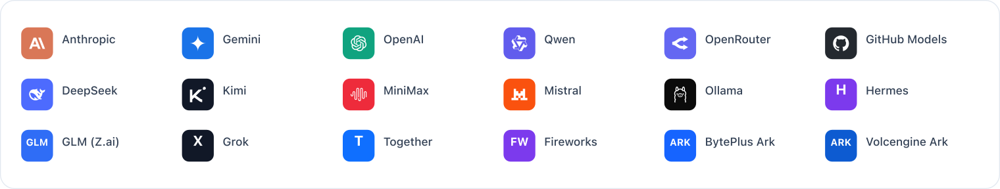
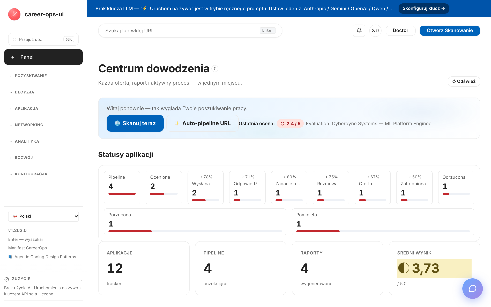
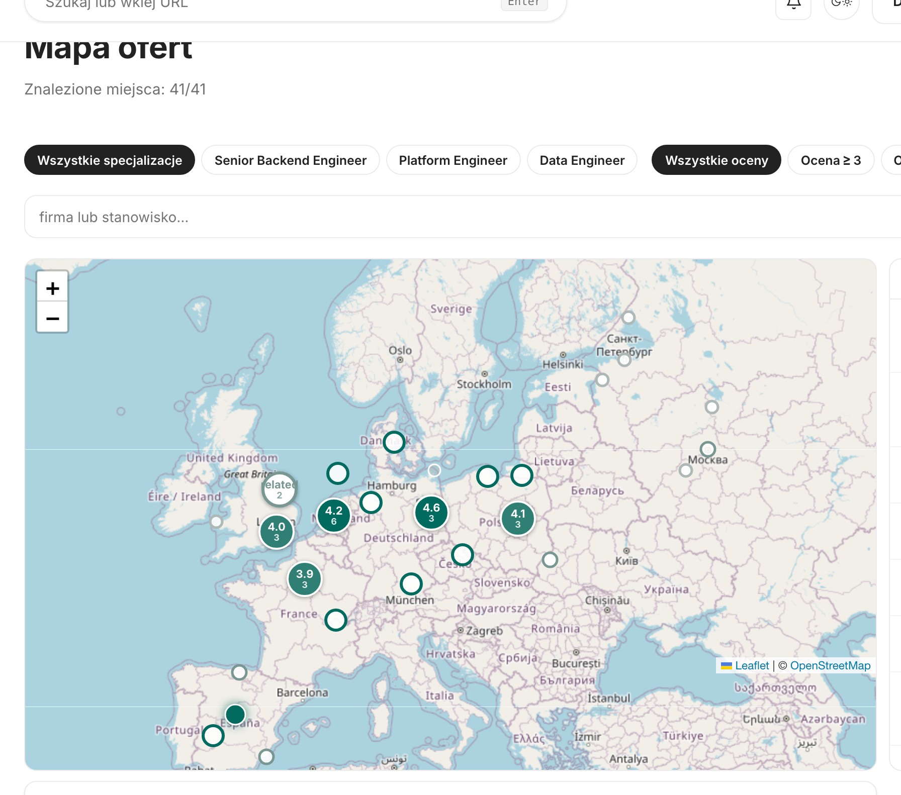

# career-ops-ui

> Przejrzysty interfejs webowy w stylu dokumentacji technicznej dla potoku wyszukiwania pracy opartego na AI — [career-ops](https://github.com/Fighter90/career-ops).
> Przeglądaj oferty, oceniaj je, analizuj szczegółowo, aplikuj i śledź każdą ofertę z jednej karty przeglądarki — zamiast przeskakiwać między Claude Code, terminalem a plikami markdown.

[🇬🇧 English](README.md) | [🇪🇸 Español](README.es.md) | [🇧🇷 Português (Brasil)](README.pt-BR.md) | [🇰🇷 한국어](README.ko-KR.md) | [🇯🇵 日本語](README.ja.md) | [🇷🇺 Русский](README.ru.md) | [🇨🇳 简体中文](README.zh-CN.md) | [🇹🇼 繁體中文](README.zh-TW.md) | [🇫🇷 Français](README.fr.md) | **🇵🇱 Polski** | [🇺🇦 Українська](README.uk.md) | [🇩🇰 Dansk](README.da.md) | [🇸🇦 العربية](README.ar.md) | [🇩🇪 Deutsch](README.de.md) | [🇮🇹 Italiano](README.it.md) | [🇹🇷 Türkçe](README.tr.md) | [🇮🇳 हिन्दी](README.hi.md) | [🇱🇰 தமிழ்](README.ta.md) | [🇻🇳 Tiếng Việt](README.vi.md)

> Tłumaczenia tego przewodnika znajdują się w README dla każdego języka:
> [🇬🇧 English](README.md) · [🇪🇸 Español](README.es.md) · [🇧🇷 Português (Brasil)](README.pt-BR.md) · [🇰🇷 한국어](README.ko-KR.md) · [🇯🇵 日本語](README.ja.md) · [🇷🇺 Русский](README.ru.md) · [🇨🇳 简体中文](README.zh-CN.md) · [🇹🇼 繁體中文](README.zh-TW.md) · [🇫🇷 Français](README.fr.md) · [🇺🇦 Українська](README.uk.md) · [🇩🇰 Dansk](README.da.md) · [🇸🇦 العربية](README.ar.md) · [🇩🇪 Deutsch](README.de.md) · [🇮🇹 Italiano](README.it.md) · [🇹🇷 Türkçe](README.tr.md) · [🇮🇳 हिन्दी](README.hi.md) · [🇱🇰 தமிழ்](README.ta.md) · [🇻🇳 Tiếng Việt](README.vi.md)

_Nieoficjalny interfejs — niepowiązany z career-ops / santifer ani przez nich nieautoryzowany._

[](#testy)
[](#testy)
[](#testy)
[](#wymagania)
[](LICENSE)
[](https://github.com/Fighter90/career-ops-ui/releases/tag/v1.271.7)
[](https://mokevnin.github.io/agentic-coding-design-patterns/en/)

<a href="https://www.producthunt.com/products/career-ops-ui?embed=true&amp;utm_source=badge-featured&amp;utm_medium=badge&amp;utm_campaign=badge-career-ops-ui" target="_blank" rel="noopener noreferrer"></a>

> **🆕 Najnowsze wydanie — v1.271.7** — źródło skanowania Apple przechodzi teraz przez całą tablicę ofert Apple zamiast tylko najnowszej strony, dzięki czemu starsze, ale wciąż otwarte oferty pojawiają się w skanach; rozszerzone testy źródła blokują ten nowy sposób przechodzenia.
>
> **Poprzednie wydanie — v1.271.6** — fala skanerów z parent-sync: wykrywanie repostów scala regionalne warianty tytułów, skany ponownie przyjmują obejrzane oferty po upływie okna `recheck_after_days`, zapisy reverse-pipeline zyskują współdzieloną blokadę, a encje HTML są dekodowane w trybie atrybutów dzięki nowej wspólnej tabeli encji.

<p align="center"></p>

>
> 📜 Pełna historia wydań: **[CHANGELOG.pl.md](CHANGELOG.pl.md)**.

[](https://youtu.be/LcVPUg9IsDk?si=mrx3oOmOpSAwabOz)

**[▶ Zobacz zapowiedź](https://youtu.be/LcVPUg9IsDk?si=mrx3oOmOpSAwabOz)**

### 🗺️ Nowość: każda oferta na mapie

Wyniki skanowania, pipeline i tracker na jednej mapie świata (`#/map`) — zobacz, gdzie skupiają się oferty i do których miast warto się przeprowadzić. Wypełniony znacznik to twoja ocena, pierścień to dopasowanie tytułu przed oceną; oferty są przypinane do adresu firmy, gdy jest znany, a w przeciwnym razie do centrum miasta (bezpłatne geokodowanie OpenStreetMap, bez kluczy).



## O projekcie career-ops

[career-ops](https://career-ops.org) to system wyszukiwania pracy o otwartym kodzie źródłowym działający jako zestaw poleceń slash wewnątrz dowolnego CLI dla programistów korzystającego z AI (Claude Code, Cursor, Codex, OpenCode, Antigravity CLI, Grok Build CLI, Qwen Code, Kimi, GitHub Copilot CLI, Gemini CLI (legacy) — inne CLI kompatybilne z Claude również działają). Niezależny od modelu. Ocenia każdą ofertę pracy względem Twojego CV w sześciowymiarowej skali 0,0–5,0, generuje dopasowane pliki PDF z CV i śledzi każde zgłoszenie lokalnie — bez kont w chmurze, telemetrii ani automatycznego składania aplikacji.

**Ten repozytoria (career-ops-ui)** to dopracowany interfejs webowy zbudowany na jego bazie. CLI nadal obsługuje wypełnianie formularzy (przez Playwright MCP) i tryby poleceń slash; SPA oferuje powierzchnię w stylu CRM w przeglądarce opartą na tych samych plikach `cv.md` / `data/applications.md` / `reports/`. Oba współdzielą te same dane.

**Progi działania według wyniku** (z [career-ops.org/docs](https://career-ops.org/docs)):

| Wynik | Następny krok |
|---|---|
| **≥ 4,5** | `/career-ops apply` — wysokie dopasowanie, aplikuj od razu |
| **4,0 – 4,4** | aplikuj lub `/career-ops contacto` dla ciepłego wprowadzenia |
| **3,5 – 3,9** | `/career-ops deep` — najpierw zbadaj firmę |
| **< 3,5** | pomiń, chyba że masz konkretny powód |

**Przewodniki kanoniczne** na [career-ops.org/docs](https://career-ops.org/docs):

- [Czym jest career-ops](https://career-ops.org/docs/introduction/what-is-career-ops)
- [Skanowanie portali pracy](https://career-ops.org/docs/introduction/guides/scan-job-portals)
- [Składanie aplikacji](https://career-ops.org/docs/introduction/guides/apply-for-a-job)
- [Masowa ocena ofert](https://career-ops.org/docs/introduction/guides/batch-evaluate-offers)
- [Konfiguracja Playwright](https://career-ops.org/docs/introduction/guides/set-up-playwright)
- [Jak career-ops ocenia oferty pracy — metodologia](https://career-ops.org/methodology)

## Uruchom z OpenWorkera (AI-współpracownik)

Wolisz desktopowego AI-współpracownika zamiast przeglądarki? Jest **[współpracownik OpenWorker](https://github.com/andrewyng/openworker)**, który poprowadzi za Ciebie cały ten potok — skanuje tablice ofert, ocenia dopasowanie względem Twojego CV, przygotowuje ugruntowane CV + list motywacyjny, prowadzi rejestr aplikacji, szkicuje follow-upy, a nawet **uruchamia ten panel** — wszystko z otwartego aplikacji OpenWorker Andrew Nga.

→ **[Fighter90/career-ops-coworker](https://github.com/Fighter90/career-ops-coworker)** — współpracownik z jednego pliku, bez kodu (zweryfikowana instalacja zarówno przez loader OpenWorkera, **jak i przez jego repo-installer**). Pełny przewodnik w [17 językach](https://github.com/Fighter90/career-ops-coworker/tree/main/help). Zobacz też [`docs/integrations/openworker.md`](docs/integrations/openworker.md).

**Instalacja** — jedno polecenie konfiguruje potok, którym steruje współpracownik (idempotentne — ponownie używa istniejących `career-ops` / `web-ui`): `curl -fsSL https://raw.githubusercontent.com/Fighter90/career-ops-coworker/main/install.sh | bash`. Potem dodaj współpracownika w panelu **Install a coworker** OpenWorkera — przez **GitHub URL** (`https://github.com/Fighter90/career-ops-coworker`), przez **.zip** (z Releases) albo przez **import** `career-ops.md` — wszystkie trzy sposoby działają.

## Manifest CareerOps

career-ops to pierwsza referencyjna implementacja [Manifestu CareerOps](https://career-ops.org/manifesto) — praktyki prowadzenia poszukiwań pracy z dowodami, dyscypliną i narzędziami po stronie kandydata. Przeczytaj go. Jeśli mówi to, w co wierzysz, podpisz go — Twój podpis staje się commitem. Aplikacja linkuje do niego ze stopki paska bocznego.

Sama aplikacja jest budowana przez agentów kodujących, zgodnie z katalogiem [Agentic Coding Design Patterns](https://mokevnin.github.io/agentic-coding-design-patterns/en/) ([ru](https://mokevnin.github.io/agentic-coding-design-patterns/ru/)) — egzekwowalne zabezpieczenia, zapakowane przepływy pracy, słownik domenowy, ADR-y i ewaluacje przepływów pracy. Strona wiki [Agentic Practices](https://github.com/Fighter90/career-ops-ui/wiki/Agentic-Practices) audytuje, które wzorce są faktycznie wdrożone.

## Zainstaluj asystenta kodującego AI (dla nadrzędnego CLI career-ops)

career-ops działa jako polecenia slash **wewnątrz** asystenta kodującego AI — zainstaluj **jednego** i zaloguj się przed kontynuacją ([Quick Start rodzica](https://career-ops.org/docs)):

| Asystent | Instalacja | Dostawca w `#/config` |
|---|---|---|
| **Claude Code** | [code.claude.com → Claude Code](https://code.claude.com/docs) | Anthropic (`ANTHROPIC_API_KEY`) |
| **Gemini CLI** | [github.com/google-gemini/gemini-cli](https://github.com/google-gemini/gemini-cli) | Gemini (`GEMINI_API_KEY`) |
| **Codex** | [github.com/openai/codex](https://github.com/openai/codex) | OpenAI (`OPENAI_API_KEY`) |
| **Qwen Code** | [github.com/QwenLM/qwen-code](https://github.com/QwenLM/qwen-code) | Qwen (`QWEN_API_KEY`) |
| **OpenCode** | [opencode.ai](https://opencode.ai) | dowolny / OpenRouter (`OPENROUTER_API_KEY`) |
| **GitHub Copilot CLI** | [github.com/github/gh-copilot](https://github.com/github/gh-copilot) | GitHub Models (`GITHUB_MODELS_API_KEY`) |
| **Antigravity CLI** | [antigravity.google](https://antigravity.google) | Gemini (`GEMINI_API_KEY`) |

> **web-ui to samodzielna alternatywa** — nie wymaga żadnego CLI. Jego funkcje ⚡ Run-live wołają API dostawców bezpośrednio; ustaw **dowolny jeden** klucz w `#/config` (lub `career-ops-ui init`) i działa headless. Jeśli wolisz CLI, uruchamiaj career-ops w swoim asystencie, a web-ui traktuj czysto jako panel nad tymi samymi plikami.

## Kluczowe funkcje

| Strona | Opis |
|---|---|
| **Panel główny** | Liczniki zbiorcze, średni wynik, ostatnie aplikacje i raporty |
| **Skanowanie** | Przycisk 🌐 Scan uruchamia wszystkie skonfigurowane źródła (Greenhouse / Ashby / Lever / Workable / SmartRecruiters / Workday + hh.ru / Habr Career + publiczne kanały Telegrama) jednym kliknięciem; wyniki w czasie rzeczywistym przez SSE |
| **Pipeline** | Zarządzanie `data/pipeline.md`; bezpieczny podgląd URL (ochrona przed SSRF) |
| **Ocena** | Wklej opis stanowiska → wynik 0–5 przez Anthropic lub Gemini; fallback na gotowy prompt |
| **Głęboka analiza** | Badanie firmy przez Anthropic SDK; wyniki zapisywane w `interview-prep/` |
| **Tracker** | Filtrowana tabela aplikacji nad `data/applications.md` |
| **CV** | Edytor markdown na żywo z podglądem bocznym i ochroną XSS |
| **Zdrowie systemu** | Odznaki stanu konfiguracji; uruchamianie `doctor.mjs` jednym kliknięciem |
| **Pomoc** | Wbudowana dokumentacja w 19 językach (włącznie z polskim) |
| **Raporty** | Przeglądanie każdego raportu z `reports/` z rozparsowanym nagłówkiem (Score / Legitimacy / URL) |
| **Statystyki** | Wielozakładkowe `#/stats`: raport AI o rynku, analityka własnego potoku, trendy po rolach, wzorce odrzuceń, lifetime + salary-gap, **lejek i szybkość**, **„czego się uczyć dalej”**. Eksport Markdown / PDF / DOCX |
| **CV Studio** | `#/cv-studio` — humanize (voice-match), dopasowane CV + list motywacyjny, panel skill-gap, deterministyczna ocena CV, maskowanie PII w przeglądarce, bramka prawdziwości faktów |
| **Two-pager** | `#/two-pager` — dwustronnik kandydata (`config/two-pager.yml`) wstawiany do promptów oceniających; szkic AI + odznaka `◎` na skanie |
| **Mock-rozmowa** | `#/mock-interview` — trening ruch po ruchu z zapisem / sesjami; cotygodniowy digest bez LLM na `#/interview-digest` |
| **Networking** | `#/networking` — autor planu networkingu oparty na AI (zapisuje do `networking/`) |
| **O-mnie** | `#/memory` — notatka o Tobie (`config/memory.md`) wstawiana do każdego żądania AI |
| **Plan kariery** | `#/career-plan` — plan rozwoju od AI (`config/career-plan.md`) wg horyzontu i fokusa |
| **Orientacja** | `#/orientation` — profil orientacji kariery od AI (wektory archetypów, role, mocne strony) |
| **Zadania kariery** | `#/tasks` — osobisty kanban w grupie Rozwój na Twoją własną pracę nad karierą (przygotowanie do rozmów, nauka, networking), oddzielony od trackera aplikacji: kolumny **Backlog / In Progress / Done**, w których przeciągnięcie TO zmiana statusu (jeden kanoniczny ruch przez API, optymistycznie z cofnięciem), klawiatura ←/→ + Enter, selektor statusu na karcie w wersji mobilnej, szybkie dodawanie w każdej kolumnie i okno szczegółów (notatki / priorytet / tagi). Dane leżą lokalnie, w `data/career-tasks.json`. |
| **Użycie** | `#/usage` — tokeny + szacunek w USD per dostawca za 24h / 7d / 30d / wszystko; live HUD kosztów w pasku bocznym |
| **Portale** | `#/portals` — włączanie / wyłączanie śledzonych tablic + bezpieczne-SSRF sondy zdrowia każdego `careers_url` |
| **Ustawienia aplikacji** | Edytor kluczy `.env` rodzica w UI: `ANTHROPIC_API_KEY`, `GEMINI_API_KEY`, nadpisania modeli, port / host. Sekrety maskowane przy odczycie |
| **Dziennik aktywności** | Ślad audytowy każdego żądania zmieniającego stan (zapisy, uruchomienia, skany). Sekrety zredagowane |
| **Powiadomienia** 🔔 | Dzwoneczek w górnym pasku z czerwoną plakietką nieprzeczytanych; wysuwana szuflada z ostatnimi 50 toastami |

## Szybki start

> **Ważne — career-ops-ui to panel *nadbudowany na* [`Fighter90/career-ops`](https://github.com/Fighter90/career-ops).** Działa **wewnątrz** projektu career-ops jako `career-ops/web-ui/` i odczytuje pliki `cv.md`, `config/`, `data/` z folderu nadrzędnego przez `../`. **Nie działa samodzielnie** — potrzebujesz również nadrzędnego repozytorium career-ops.

### Opcja 1 — jedno polecenie curl (zalecane)

```bash
curl -fsSL https://raw.githubusercontent.com/Fighter90/career-ops-ui/main/bin/setup.sh | bash
```

Klonuje **oba** repozytoria, organizuje strukturę `career-ops/web-ui/`, instaluje zależności, uruchamia diagnostykę i startuje serwer pod adresem http://127.0.0.1:4317.

### Opcja 2 — dodaj UI do istniejącego projektu career-ops

```bash
cd career-ops
git clone https://github.com/Fighter90/career-ops-ui.git web-ui
cd web-ui
npm install
npm start
```

Otwórz http://127.0.0.1:4317 w przeglądarce.

### Polecenia CLI

```bash
career-ops-ui setup    # bootstrap: instalacja zależności → diagnostyka → uruchomienie
career-ops-ui init     # wybór dostawcy LLM i wklejenie klucza API (interaktywne)
career-ops-ui doctor   # weryfikacja Node / projektu / kluczy / Playwright
career-ops-ui run      # uruchomienie serwera na http://127.0.0.1:4317
career-ops-ui open     # otwarcie i wyeksponowanie karty panelu w przeglądarce
career-ops-ui help     # lista wszystkich poleceń
```

### Wybór dostawcy LLM

`init` to kreator konfiguracji dostawcy — wybierz **Claude / Claude Code** (`ANTHROPIC_API_KEY`), **Codex / OpenCode** (`OPENAI_API_KEY`), **Qwen Code** (`QWEN_API_KEY`) lub **Auto** (Anthropic → fallback Gemini). Klucze można też ustawić ręcznie:

```bash
echo "ANTHROPIC_API_KEY=sk-ant-..." >> career-ops/.env
```

Lub przez zakładkę **Ustawienia aplikacji** (`#/config`) w interfejsie — bez restartu serwera.

### Gdy `init` nie działa

Jeśli `career-ops-ui init` pada albo polecenia nie ma (typowe tuż po `git pull`):

```bash
cd career-ops/web-ui
npm install
npx career-ops-ui init        # npx uruchamia lokalny bin nawet bez `npm link`
```

## Dlaczego?

[career-ops](https://github.com/Fighter90/career-ops) to potężny system wyszukiwania pracy sterowany przez Claude Code: wklej JD → dostajesz wynik 0–5, PDF zoptymalizowany pod ATS i wpis w trackerze. Świetnie działa wewnątrz Claude Code, ale dane leżą rozproszone między `cv.md`, `data/applications.md`, `reports/*.md`, `data/pipeline.md`, `portals.yml`, `config/profile.yml` — łatwo je zgubić, trudno przejrzeć.

`career-ops-ui` dokłada dopracowany interfejs na wierzchu:

- **Auto-pipeline** — wklej jeden URL oferty na `#/auto`, jedno kliknięcie: walidacja → pobranie → ocena → zapis raportu → dodanie do trackera, z żywym a11y-stepperem i linkami do artefaktów.
- **Przeglądaj** tracker, raporty i pipeline jak CRM.
- **Uruchamiaj** skany (Greenhouse / Ashby / Lever / Workable / SmartRecruiters / Workday **oraz** hh.ru / Habr Career / Trudvsem / GetMatch / GeekJob) i oglądaj logi SSE na żywo.
- **Oceniaj** JD na żywo przez Anthropic (preferowany) albo Gemini, albo otrzymaj prompt do skopiowania do Claude Code, jeśli nie ma klucza.
- **Badaj** firmy na żywo przez Anthropic SDK — cv / profile / pliki trybów wstawiane automatycznie.
- **Edytuj** `cv.md` z podglądem markdown obok i oczyszczaniem XSS po stronie serwera.
- **Utrzymuj** system: doctor, verify, normalize, dedup, merge — po jednym kliknięciu.

To czysto dodatkowa warstwa: wewnątrz `career-ops/` nic się nie zmienia. Wszystkie Twoje dostosowania pozostają Twoje.

## Pierwsze uruchomienie — czysty stan

`career-ops/data/pipeline.md` jest dostarczany z dwoma URL-ami fiksatur QA (`example.com/qa-fixture-*`), żeby zestaw testów działał hermetycznie. Na świeżym klonie Pipeline pokaże `2 pending` — to nie są prawdziwe oferty. Wyczyść je przed pierwszym skanem:

```bash
make clean-test-fixtures        # usuwa wiersze fiksatur z pipeline.md + wiersze qa-fixture-* z applications.md
npm start
```

Otwórz http://127.0.0.1:4317. Licznik Pipeline powinien pokazywać `0 pending`. Makefile jest idempotentny — ponowne uruchomienie na czystym drzewie to no-op.

## Wymagania

| | |
|---|---|
| **Node.js** | ≥ 18 (natywne `fetch` i `node:test`) |
| **career-ops** | sklonowane i skonfigurowane (patrz wyżej) |
| **Opcjonalnie** | `ANTHROPIC_API_KEY` lub `GEMINI_API_KEY` w `.env` projektu nadrzędnego dla oceny JD jednym kliknięciem |

## Skanowanie

Skanowanie portali bez żadnego tokena, które naprawdę zwraca oferty. **Jeden przycisk 🌐 Scan** w UI uruchamia wszystkie skonfigurowane źródła w jednym przebiegu:

- **Greenhouse / Ashby / Lever / Workable / SmartRecruiters / Workday** — publiczne boards-api dla każdej firmy w `portals.yml::tracked_companies` z rozpoznawalnym wzorcem ATS. Wbudowana lista obejmuje Stripe, GitLab, Vercel, Cloudflare, Datadog, Discord, Elastic i ~120 źródeł więcej — rozszerzaj lub przycinaj swobodnie.
- **Tablice RSS** — dowolna tablica ofert z feedem RSS/Atom (LaraJobs, WeWorkRemotely, RemoteOK, …). Dodaj `provider: rss` + URL feedu do `portals.yml` — bez zmian w kodzie.
- **Publiczne kanały Telegrama** — dowolny **publiczny** kanał z bloku `telegram_channels:` jest czytany z jego podglądu web `t.me/s/<channel>`: bez tokenu bota i klucza API. Post kanału to proza, a nie rekord oferty: firma i lokalizacja biorą się tylko z jawnych etykiet, a odsiewanie reklam to zadanie Twojego `title_filter`. Traktuj je jako tropy, nie jako oferty.
- **hh.ru / Habr Career** — skrobak HTML `hh.ru/search/vacancy` i `career.habr.com/vacancies`. Działa z dowolnego IP, bez kluczy.

### Adapter RSS

```yaml
tracked_companies:
  - name: LaraJobs
    provider: rss
    rss: https://larajobs.com/feed
    enabled: true
```

Wszystkie źródła przechodzą przez jeden potok: normalize → filtr (`title_filter.positive` / `title_filter.negative`) → dedup względem `data/scan-history.tsv` + `data/pipeline.md` + `data/applications.md` → dopisanie do `data/pipeline.md` → zapis pełnego zestawu wyników do `data/last-scan.json` dla filtrowanej tabeli UI.

Konfiguracja przez `portals.yml`:

```yaml
title_filter:
  positive: [backend, engineer, senior, tech lead, golang, php]
  negative: [junior, intern, frontend, ios, android]
tracked_companies:
  - { name: Stripe, enabled: true, careers_url: https://job-boards.greenhouse.io/stripe }
  - { name: Linear, enabled: true, careers_url: https://jobs.ashbyhq.com/linear }
russian_portals:
  sources: ["hh", "habr"]   # jedno lub oba
  area: 113                  # 1=Moskwa, 2=SPb, 113=Rosja, 1001=remote
  per_page: 50
  queries: ["Senior PHP", "Senior Go", "Tech Lead"]
```

Wszystkie źródła zasilają jeden endpoint SSE: `/api/stream/scan?source=ats|regional|both`. Przycisk **🌐 Scan** woła `source=both`, żeby wszystkie adaptery pracowały na jednym połączeniu. Respektuje `AbortSignal` przy rozłączeniu klienta — żadnych sierot po żądaniach.

## Architektura w skrócie

```
career-ops/
├─ cv.md
├─ portals.yml
├─ config/
├─ data/
└─ web-ui/          ← to repozytorium
   ├─ server/       # Express + 15 modułów tras
   ├─ public/       # vanilla JS SPA, bez bundlera
   └─ tests/        # 7243 testów jednostkowych + 176 Playwright + 23/23 e2e:full + 21 e2e:smoke (podstawa @ v1.267.2)
```

Serwer ma dwie zależności produkcyjne: `express` i `js-yaml`. Brak transpilacji, brak bundlera — cały interfejs to mniej niż 30 KB zminifikowanego kodu.

## Dokumentacja API

Wszystkie endpointy pod `/api/*`. JSON na wejściu / JSON na wyjściu, chyba że zaznaczono inaczej. Główne grupy:

| Metoda | Ścieżka | Do czego |
|---|---|---|
| GET | `/api/health` | kontrole stanu, wersja, ostrzeżenia |
| GET | `/api/dashboard` | liczniki zbiorcze, średni wynik, ostatnie aplikacje |
| GET/POST | `/api/tracker` | wiersze `data/applications.md`; POST z dedupem |
| GET/POST/DELETE | `/api/pipeline` | CRUD nad `data/pipeline.md` |
| GET | `/api/pipeline/preview?url=…` | proxy pobierania po stronie serwera (kontrola SSRF na każdym hopie, ≤3 przekierowania, limit 8 KB) |
| GET | `/api/reports` · `/api/reports/:slug` | lista / treść raportów |
| GET/PUT | `/api/cv` | odczyt / zapis `cv.md` (strip XSS, limit 1 MB) |
| POST | `/api/run/doctor` … | buforowane uruchomienia `doctor` / `verify` / `normalize` / `dedup` / `merge` (limit 60 s) |
| GET | `/api/stream/scan` | skonsolidowany skaner SSE (`source=ats\|regional\|both`) |
| GET | `/api/stream/liveness` · `/api/stream/pdf` | proxy SSE dla `check-liveness.mjs` / `generate-pdf.mjs` |
| POST | `/api/evaluate` | ocena JD (sekcje A–G wg `oferta.md`) |
| POST | `/api/deep` | pogłębione badanie firmy |
| POST | `/api/mode/:slug` | dozwolone tryby: `batch`, `contacto`, `followup`, `interview-prep`, `patterns`, `project`, `training` |
| GET | `/api/scan-results` | ostatni skan (`en` / `ru`) |

Pełną listę endpointów z kształtem żądań/odpowiedzi znajdziesz w angielskim [README.md](README.md) (sekcja „API reference”).

## Uruchom cały stack w chmurze

career-ops działa najlepiej **zawsze włączony** — skanuje, gdy śpisz, dostępny z dowolnej przeglądarki. Aby umieścić cały stack na małym serwerze — nadrzędny pipeline **career-ops**, tę przeglądarkę **career-ops-ui** oraz **silnik** uruchamiający AI (Twoja **subskrypcja Claude** przez CLI Claude Code, lokalna brama **Hermes**, lub klucze API) — postaw VPS (Node ≥ 18), zainstaluj rodzica + to repo, wybierz silnik i wystaw przeglądarkę za **odwrotnym proxy HTTPS z uwierzytelnianiem**, zachowując nienaruszone niezmienniki bezpieczeństwa (CSP, guard SSRF, granica XSS, brak sekretów w logach).

📖 Wbudowana **Pomoc §31** („Uruchom cały stack w chmurze”) prowadzi krok po kroku we wszystkich 19 językach; lista kontrolna operatora to [`docs/integrations/HERMES.md`](docs/integrations/HERMES.md), a [wiki wdrożenia w chmurze](https://github.com/Fighter90/career-ops-ui/wiki/Cloud-Deployment) zawiera tabele referencyjne.

## Agent Hermes + Telegram

**[Hermes](https://hermes-agent.nousresearch.com/docs)** od Nous Research to otwarty autonomiczny agent (wywoływanie narzędzi, skille, 20+ kanałów komunikatorów). Możesz trzymać career-ops-ui na **serwerze w chmurze** i mostkować jego zdarzenia — zakończony skan, nowy raport, pilny follow-up — do **Telegrama przez agenta Hermes**, żeby potok docierał do Ciebie tam, gdzie już jesteś.

> **Już spięte (v1.151.0).** Hermes jako *dostawca LLM* działa: uruchom jego API Server zgodny z OpenAI (`hermes gateway`) i ustaw `HERMES_API_KEY` w **Ustawieniach aplikacji** — career-ops-ui będzie wykonywał oceny na żywo przez Twojego lokalnego Hermesa (ostatni w automatycznej kolejności dostawców).

📖 **Pełny przewodnik:** [`docs/integrations/HERMES.md`](docs/integrations/HERMES.md) — dwa kształty integracji, wdrożenie na serwerze w chmurze, Telegram-przez-Hermes i lista „czego NIE wystawiać”.

---

## Pełna dokumentacja

Kompletna dokumentacja jest dostępna wyłącznie w wersji angielskiej: **[🇬🇧 README.md](README.md)**

Zawiera szczegółowe opisy:
- Pełnego API REST (wszystkie endpointy `/api/*`)
- Konfiguracji skanera portali (Greenhouse, Ashby, Lever, Workable, hh.ru, Habr Career, RSS)
- Wszystkich zmiennych środowiskowych
- Zasad bezpieczeństwa (SSRF, XSS, rate limiting)
- Przewodnika po architekturze (SDD, konwencje)

Oficjalna strona: [career-ops.org](https://career-ops.org) · Dokumentacja: [career-ops.org/docs](https://career-ops.org/docs)

## Lokalizacja

Interfejs ma **19 lokalizacji** — `en`, `es`, `pt-BR`, `ko`, `ja`, `ru`, `zh-CN`, `zh-TW`, `fr`, `pl`, `uk`, `da`, `ar`, `de`, `it`, `tr`, `hi`, `ta`, `vi`. Od **v1.60.0 (I18N-SPLIT)** tłumaczenia leżą **po jednym pliku na język** w [`public/js/lib/locales/`](public/js/lib/locales/) — `i18n-dict.<lang>.js`, płaska tabela `klucz → string` — plus wspólny `i18n-dict.aliases.js`. [`i18n-dict.js`](public/js/lib/i18n-dict.js) składa je w `window.__I18N_DICT`; [`i18n.js`](public/js/lib/i18n.js) rozwiązuje `t('klucz', 'fallback')`. Bez kroku build, bez fetch — tłumacz edytuje jeden plik języka.

**Dodać lub zmienić napis:** dodaj ten sam klucz do wszystkich 19 plików lokalizacji (paritet jest pod bramką), użyj przez `data-i18n="scan.newButton"` albo `t('scan.newButton')` w JS i uruchom `npm test`. Żeby dodać zupełnie nowy język, zarejestruj go w `i18n.js` (`LANGS` + `detect()`), assemblerze, `index.html` i narzędziach liczących lokalizacje.

📖 **Pełny przewodnik:** [`docs/LOCALIZATION.md`](docs/LOCALIZATION.md) — układ wg lokalizacji, mechanizm `@alias`, dodawanie nowej lokalizacji krok po kroku i wszystkie bramki i18n CI.

## Testy

```bash
npm test                    # 7243 testów jednostkowych/integracyjnych
npm run test:e2e            # 21 smoke e2e
npm run test:e2e:full       # 23 comprehensive e2e
npm run test:e2e:browser    # 176 testów Playwright
npm run test:coverage       # jak npm test + pokrycie V8
```

## Konfiguracja

Zmienne środowiskowe (czytane przy starcie serwera; wszystkie opcjonalne poza wskazanymi):

| Zmienna | Domyślnie | Do czego |
|---|---|---|
| `PORT` | `4317` | port bind Expressa |
| `HOST` | `127.0.0.1` | host bind Expressa; CSP dołączane poza loopbackiem |
| `CAREER_OPS_ROOT` | `..` | gdzie szukać `cv.md`, `data/`, `portals.yml`, `modes/` |
| `ANTHROPIC_API_KEY` | nieustawione | włącza `/api/evaluate`, `/api/deep`, `/api/mode/:slug` na żywo |
| `GEMINI_API_KEY` | nieustawione | fallback dla `/api/evaluate` |
| `OPENAI_API_KEY` | nieustawione | ocena na żywo headless (3. w kolejności `auto`) + ścieżka Codex/OpenAI CLI |
| `QWEN_API_KEY` / `OPENROUTER_API_KEY` | nieustawione | 4. i 5. w kolejności `auto` |

Rozszerzenie `portals.yml`, które rozpoznaje to UI — patrz sekcja „Skanowanie” wyżej; gotowe bloki dla 24 zweryfikowanych firm są w [`docs/portals-examples.md`](docs/portals-examples.md).

## Uwagi o bezpieczeństwie

- Serwer domyślnie nasłuchuje na `127.0.0.1` — nigdy nie wystawiaj go do internetu bez jawnego `HOST=0.0.0.0`.
- **Sanityzacja ścieżek (v1.21.0)**: każdy parametr trasy `:name` / `:slug` przechodzi przez `sanitizePathName()` w `server/lib/security.mjs` — niedozwolone znaki usuwane, sekwencje kropek zwijane, limit 200 znaków.
- **Obrona przed DNS-rebind (v1.21.0)**: `/api/pipeline/preview` i `/api/auto-pipeline` idą przez `server/lib/safe-fetch.mjs::safeGet` — jedno zapytanie DNS, przypięte połączenie TCP, przekierowania weryfikowane ponownie.
- **Mutex zapisów współbieżnych (v1.21.0)**: odczyt–modyfikacja–zapis w trackerze i pipeline opakowane w `withFileLock(path, fn)` — równoległe POST już nie gubią wierszy.
- **Rate-limit dla LLM (v1.21.0)**: `/api/evaluate`, `/api/deep`, `/api/mode/:slug`, `/api/auto-pipeline` noszą `llmRateLimit` — no-op na loopbacku, 10 req/min/IP przy `HOST=0.0.0.0`, 429 + `Retry-After`.
- **Strip XSS dla CV (v1.22.0)**: `stripDangerousMarkdown` zna encje HTML — `&lt;script&gt;` i `java&#115;cript:` nie przechodzą.
- Procesy potomne uruchamiane przez `spawn` z tablicami argumentów — **bez interpolacji powłoki, nigdy**.
- Endpointy strumieniowe zabijają proces potomny przy rozłączeniu klienta — żadnych sierot-skanerów.
- Endpointy zapisu dotykają tylko znanych ścieżek career-ops: `data/`, `jds/`, `cv.md`, `config/`, `portals.yml`, `output/`, `reports/`, `interview-prep/`, `modes/_profile.md`.

## Ograniczenia

Tryby w pełni sterowane LLM (`oferta`, `deep`, `contacto`, `apply`, `batch`, `patterns`, `followup`) potrzebują LLM, żeby faktycznie zadziałać. web-ui wybiera dostawcę z kolejności `auto` **Anthropic → Gemini → OpenAI → Qwen → OpenRouter → GitHub Models → Hermes → DeepSeek → GLM (Z.ai) → Kimi (Moonshot) → MiniMax → Mistral → Grok (xAI) → Together → Fireworks → Ollama → BytePlus Ark → Volcengine Ark** (albo to, co przypiął `LLM_PROVIDER`):

1. **Anthropic (preferowany)** — ustaw `ANTHROPIC_API_KEY` w `.env` projektu nadrzędnego; `cv.md` / `config/profile.yml` / `modes/_shared.md` wstawiane automatycznie.
2. **`gemini-eval.mjs` jako fallback** — działa od razu, gdy ustawiony jest tylko `GEMINI_API_KEY`.
3. **OpenAI / Qwen / OpenRouter** — klienci bez zależności, zgodni z OpenAI. **OpenRouter** jest najbardziej elastyczny: jeden `OPENROUTER_API_KEY` otwiera 300+ modeli, a lista modeli w `#/config` napełnia się na żywo z `GET /api/openrouter/models`.
4. **Prompt do skopiowania** — gdy nie ma żadnego klucza, UI generuje gotowy prompt dla Claude Code / ChatGPT / Gemini Web.

Istniejący przepływ `/career-ops apply` (wypełnianie formularzy Playwright) wewnątrz Claude Code pozostaje jedynym sposobem realnego autowypełniania formularzy — *Apply helper* w UI generuje w zamian checklistę.

## 📘 Jak to repozytorium jest budowane przez agentów kodujących

Większość tego projektu jest pisana przez agentów kodujących. To praktyka z własnymi
trybami awarii, więc jest prowadzona świadomie, zgodnie z katalogiem
[**Agentic Coding Design Patterns**](https://mokevnin.github.io/agentic-coding-design-patterns/en/)
autorstwa Kirilla Mokevnina ([wydanie rosyjskie](https://mokevnin.github.io/agentic-coding-design-patterns/ru/)).
Poniższe pliki są tą praktyką sprowadzoną do konkretu. Żaden z nich nie wpływa na działającą
aplikację — istnieją po to, by nowa sesja podejmowała pracę tam, gdzie skończyła się poprzednia,
zamiast na nowo wyprowadzać wnioski, podejmować te same decyzje i psuć te same rzeczy.

| Plik | Czym jest | Kiedy go czytać |
|---|---|---|
| **[`CONTEXT.md`](CONTEXT.md)** | Słownik domenowy: jedna zaakceptowana nazwa na pojęcie, z odrzuconymi wariantami oznaczonymi jako *nie używać*. | **Najpierw.** Rozstrzyga nieporozumienia, za które to repozytorium faktycznie płaci — `source` kontra `adapter` (123 vs 118, i dlaczego oba są poprawne), `mirror` kontra `relay`, `telegram` kontra `telegram-channel`. |
| **[`PROGRESS.md`](PROGRESS.md)** | Stan prac: co jest zrobione, kolejny krok, znane problemy oraz **porzucone podejścia**. | Na początku każdej sesji. Git pokazuje, co się zmieniło; ten plik mówi, na jakim etapie jest praca i co już wypróbowano i odrzucono. |
| **[`docs/adr/`](docs/adr/)** | Numerowane rejestry decyzji — kontekst, decyzja, konsekwencje oraz co skłoniłoby nas do ponownego rozważenia. | Przed zmianą czegokolwiek, co obejmuje dany rejestr. To rejestr decyduje, nie bieżące wydanie. |
| **[`CLAUDE.md`](CLAUDE.md)** | Indeks na jeden ekran, wskazujący na trzy powyższe pliki. | Automatycznie, przez agenta. Celowo *nie* jest bazą wiedzy — długi plik jest tylko przeglądany pobieżnie, a potem ignorowany. |
| **[`evals/workflow/`](evals/workflow/)** | Stały zestaw zadań z ewaluatorami sprawdzającymi zachowanie *potoku*, a nie produktu. | Przed i po zmianie skilla, prompta lub narzędzia. |
| **[`.claude/skills/`](.claude/skills/)** | Zapakowane przepływy pracy. `parent-sync` przeprowadza całe wydanie parytetowe w dziewięciu bramkowanych fazach. | Zamiast improwizować wydanie. |
| **[`.githooks/pre-commit`](.githooks/pre-commit)** | Wykonywalne zabezpieczenia — deterministyczna podłoga, która twardo kończy się błędem, plus doradcza warstwa AI, która nigdy nie blokuje. | Uruchamia się sama. |

### Jak z nich korzystać

Dokumenty nie wymagają żadnej konfiguracji — to zwykły Markdown, czytany przez Ciebie
i przez agenta. Dwie rzeczy są spięte i warto je znać:

```bash
# Zabezpieczenia: hooki należące do repozytorium, więc kontrole obowiązują wszystkich, nie tylko Twoją maszynę.
git config core.hooksPath .githooks

# Ewaluacje przepływu pracy: oceniają stan repozytorium względem reguł w docs/adr/ i PROGRESS.md.
node evals/workflow/run.mjs              # wszystkie ewaluatory
node evals/workflow/run.mjs --task qa-prompt-mandatory
```

Każdy ewaluator w `evals/workflow/tasks.yml` odpowiada błędowi, który kiedyś trafił na
produkcję — nadpisanej historycznej atrybucji, budowie strony uruchomionej w trakcie
fan-out, pominiętego no-port. Wynik i przebieg są oceniane osobno, a ewaluator, którego
nie da się rozstrzygnąć na podstawie repozytorium, zgłasza `SKIP` zamiast po cichu
przechodzić: kontrola, która nie może zostać uruchomiona, nigdy nie powinna wyglądać
jak zielona.

### Dbanie, by pozostały prawdziwe

Nieaktualny słownik jest gorszy niż jego brak, więc praca nad pisaniem tych dokumentów
jest częścią samego wydania — Faza 0 `parent-sync` je wczytuje, a Faza 8 kieruje z
powrotem do nich to, czego się nauczono. Dodaj termin do `CONTEXT.md` w tym samym
commicie, który wprowadza dane pojęcie; otwórz ADR, gdy decyzja wyglądałaby na dowolną
za sześć miesięcy; zapisz odrzucone podejście w `PROGRESS.md` w chwili, gdy zostaje
odrzucone.

Które wzorce z książki są tu faktycznie wdrożone — a które nie — jest audytowane na
stronie wiki [Agentic Practices](https://github.com/Fighter90/career-ops-ui/wiki/Agentic-Practices).

## Współtworzenie

Issues i PR mile widziane. Zasady domu:

- Uruchom `npm test` przed pushem — **7243 zielone kontrole** to poprzeczka (plus 176 Playwright, jeśli dotykasz UI).
- Zmiany nietrywialne przechodzą przez potok GSD: [`docs/sdd/SDD-GUIDE.md`](docs/sdd/SDD-GUIDE.md).
- Nie modyfikuj niczego w nadrzędnym projekcie `career-ops/` z wnętrza tego repo — cała idea polega na tym, że to nieinwazyjna nakładka. Twarde zasady w [`CLAUDE.md`](CLAUDE.md).
- Conventional commits: `feat`, `fix`, `refactor`, `docs`, `test`, `chore`, `perf`, `ci`. Opcjonalny scope: `feat(scan):`. Zmiana łamiąca: `feat!:`.
- Testy muszą być CI-isolated — fiksatury przez `mkdtempSync` albo `CAREER_OPS_ROOT=$(mktemp -d)`.

Prowadzisz repo z CLI innego niż Claude (Codex, Aider, Cursor, Gemini)? Przeczytaj [`AGENTS.md`](AGENTS.md) albo [`GEMINI.md`](GEMINI.md) — oba shimują się do kanonicznego `CLAUDE.md`.

## 🌍 Pierwsze kroki — co po instalacji

Po instalacji jednym poleceniem masz dwa puste klony git, zaopatrzone w startowe `cv.md`, `config/profile.yml`, `portals.yml`, `data/applications.md` i `data/pipeline.md` z markerami **EDIT ME**. Strona Health powinna być już w całości zielona przy pierwszym uruchomieniu. Zamień placeholdery na prawdziwe dane:

### 1. Utwórz CV (`cv.md`)

- **Wariant A — wklej istniejące CV:** otwórz `career-ops/cv.md` i zamień placeholdery EDIT-ME na prawdziwe CV w czystym markdownie (sekcje: Summary, Experience, Projects, Education, Skills). Im prościej, tym lepiej — career-ops czyta je jako zwykły tekst.
- **Wariant B — wgraj z UI:** pasek boczny → **CV** → **📁 Upload CV** → wybierz plik `.md` / `.txt` → obejrzyj podgląd → **💾 Save**.
- **Wariant C — daj Claude Code URL LinkedIna:** otwórz Claude Code w `career-ops/`, wykonaj `/career-ops`, wklej URL i poproś: *„wyciągnij moje CV i zapisz je do cv.md”*.

Każdą metrykę rób konkretną („skróciłem p99 o 38%”, a nie „poprawiłem wydajność”) — potok oceniania czyta metryki prosto z tego pliku.

### 2. Edytuj profil (`config/profile.yml`)

```bash
$EDITOR career-ops/config/profile.yml
```

Zamień placeholdery: imię i nazwisko, e-mail, lokalizacja, LinkedIn, role docelowe, archetypy, docelowe wynagrodzenie. **Archetypy** to najważniejsze pole — tak każda JD jest dopasowywana do Ciebie.

### 3. Skonfiguruj skaner (`portals.yml`)

```bash
$EDITOR career-ops/portals.yml
```

Ustaw `title_filter.positive` (np. `"PHP"`, `"Go"`, `"Backend"`, `"Senior"`) i `title_filter.negative` (`"Junior"`, `"Java"`, `"iOS"`) pod swój stack i staż. Gotowe bloki dla 24+ firm są w [`docs/portals-examples.md`](docs/portals-examples.md). Dla hh.ru / Habr Career dopisz swoje zapytania do bloku `russian_portals:`.

### 4. (Opcjonalnie) Klucze API LLM

```bash
# Anthropic (preferowany)
echo "ANTHROPIC_API_KEY=sk-ant-..." >> career-ops/.env
# Gemini (fallback)
echo "GEMINI_API_KEY=AIza..." >> career-ops/.env
```

Albo przez **Ustawienia aplikacji** (`/#/config`) — ten sam plik, maskowanie przy odczycie, stosowane natychmiast.

### 5. Zweryfikuj i zacznij pracę

Odśwież stronę Health — wszystkie wymagane kontrole zielone. Dalej:

1. **🌐 Scan** → po ~5 sekundach oferty Greenhouse / Ashby / Lever / Workable / SmartRecruiters / Workday + hh.ru / Habr Career lądują w tabeli.
2. Kliknij dowolny tytuł → oryginalne ogłoszenie otworzy się w nowej karcie.
3. Filtruj chipami stacku (PHP / Go / Backend / Senior), aż zobaczysz coś obiecującego.
4. Skopiuj URL → wklej do **Pipeline** → **Evaluate** — wynik 0–5 na żywo (Anthropic / Gemini) albo ręczny prompt.
5. Raporty lądują w `reports/`, tracker w `data/applications.md`, badania na żywo w `interview-prep/`. Wszystko widoczne w UI.

## Licencja

MIT. Szczegóły: [LICENSE](LICENSE).

Zbudowane na bazie [career-ops](https://github.com/Fighter90/career-ops) autorstwa [santifer](https://santifer.io).

## Współtwórcy

Dziękujemy wszystkim, którzy pomagają budować career-ops-ui. Projekt utrzymuje [Fighter90](https://github.com/Fighter90), a rozwijają go wkłady społeczności — pełną listę znajdziesz na [grafie współtwórców](https://github.com/Fighter90/career-ops-ui/graphs/contributors).

<p>
  <a href="https://github.com/Fighter90" title="Fighter90"></a>
  <a href="https://github.com/Alien10140" title="Alien10140"></a>
  <a href="https://github.com/vignyl" title="vignyl"></a>
  <a href="https://github.com/bracketouverte" title="bracketouverte"></a>
  <a href="https://github.com/bullitt186" title="bullitt186"></a>
  <a href="https://github.com/goldbillka" title="goldbillka"></a>
</p>

**[Wszyscy współtwórcy →](https://github.com/Fighter90/career-ops-ui/graphs/contributors)**

<div align="center">

<div style="font-family: -apple-system, BlinkMacSystemFont, &quot;Segoe UI&quot;, Roboto, &quot;Helvetica Neue&quot;, Arial, sans-serif; border: 1px solid rgb(224, 224, 224); border-radius: 12px; padding: 20px; max-width: 500px; background: rgb(255, 255, 255); box-shadow: rgba(0, 0, 0, 0.05) 0px 2px 8px;"><div style="display: flex; align-items: center; gap: 12px; margin-bottom: 12px;"><div style="flex: 1 1 0%; min-width: 0px;"><h3 style="margin: 0px; font-size: 18px; font-weight: 600; color: rgb(26, 26, 26); line-height: 1.3; overflow: hidden; text-overflow: ellipsis; white-space: nowrap;">career-ops-ui</h3><p style="margin: 4px 0px 0px; font-size: 14px; color: rgb(102, 102, 102); line-height: 1.4; overflow: hidden; text-overflow: ellipsis; display: -webkit-box; -webkit-line-clamp: 2; -webkit-box-orient: vertical;">The open-source job search command center</p></div></div><a href="https://www.producthunt.com/products/career-ops-ui?embed=true&amp;utm_source=embed&amp;utm_medium=post_embed" target="_blank" rel="noopener" style="display: inline-flex; align-items: center; gap: 4px; margin-top: 12px; padding: 8px 16px; background: rgb(255, 97, 84); color: rgb(255, 255, 255); text-decoration: none; border-radius: 8px; font-size: 14px; font-weight: 600;">Check it out on Product Hunt →</a></div>

</div>
