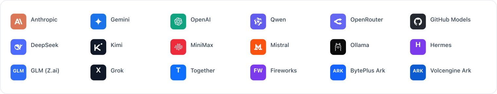
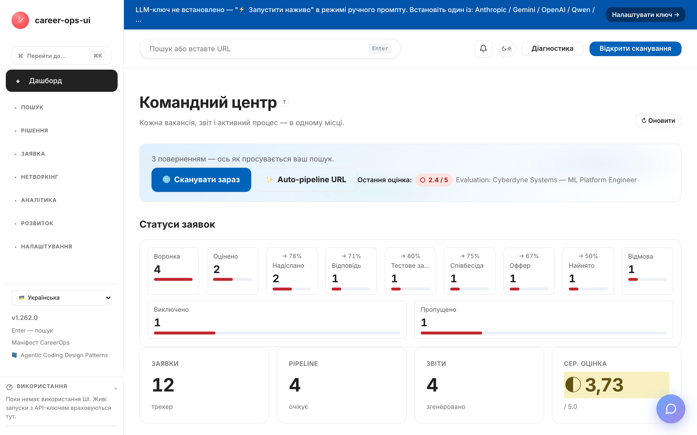
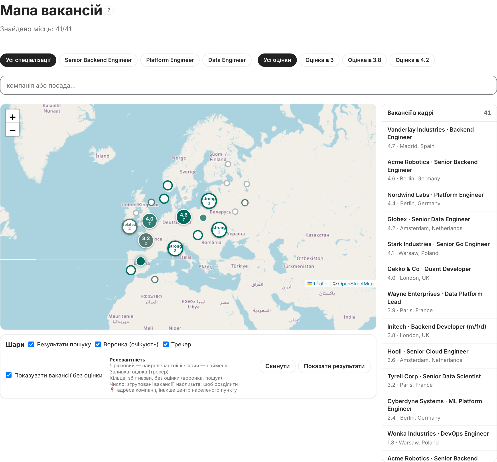

# career-ops-ui

> Лаконічний веб-інтерфейс у стилі технічної документації для AI-конвеєра пошуку роботи [career-ops](https://github.com/Fighter90/career-ops).
> Шукайте вакансії, оцінюйте їх, досліджуйте компанії, подавайте заявки та відстежуйте кожну пропозицію з однієї вкладки браузера — замість перемикання між Claude Code, терміналом і markdown-файлами.

[🇬🇧 English](README.md) | [🇪🇸 Español](README.es.md) | [🇧🇷 Português (Brasil)](README.pt-BR.md) | [🇰🇷 한국어](README.ko-KR.md) | [🇯🇵 日本語](README.ja.md) | [🇷🇺 Русский](README.ru.md) | [🇨🇳 简体中文](README.zh-CN.md) | [🇹🇼 繁體中文](README.zh-TW.md) | [🇫🇷 Français](README.fr.md) | [🇵🇱 Polski](README.pl.md) | **🇺🇦 Українська** | [🇩🇰 Dansk](README.da.md) | [🇸🇦 العربية](README.ar.md) | [🇩🇪 Deutsch](README.de.md) | [🇮🇹 Italiano](README.it.md) | [🇹🇷 Türkçe](README.tr.md) | [🇮🇳 हिन्दी](README.hi.md) | [🇱🇰 தமிழ்](README.ta.md) | [🇻🇳 Tiếng Việt](README.vi.md)

> Переклади цього посібника живуть у README кожною мовою:
> [🇬🇧 English](README.md) · [🇪🇸 Español](README.es.md) · [🇧🇷 Português (Brasil)](README.pt-BR.md) · [🇰🇷 한국어](README.ko-KR.md) · [🇯🇵 日本語](README.ja.md) · [🇷🇺 Русский](README.ru.md) · [🇨🇳 简体中文](README.zh-CN.md) · [🇹🇼 繁體中文](README.zh-TW.md) · [🇫🇷 Français](README.fr.md) · [🇵🇱 Polski](README.pl.md) · [🇩🇰 Dansk](README.da.md) · [🇸🇦 العربية](README.ar.md) · [🇩🇪 Deutsch](README.de.md) · [🇮🇹 Italiano](README.it.md) · [🇹🇷 Türkçe](README.tr.md) · [🇮🇳 हिन्दी](README.hi.md) · [🇱🇰 தமிழ்](README.ta.md) · [🇻🇳 Tiếng Việt](README.vi.md)

_Неофіційний інтерфейс — не пов'язаний із career-ops / santifer і не схвалений ними._

[](#тести)
[](#тести)
[](#тести)
[](#вимоги)
[](LICENSE)
[](https://github.com/Fighter90/career-ops-ui/releases/tag/v1.271.12)
[](https://mokevnin.github.io/agentic-coding-design-patterns/en/)

<a href="https://www.producthunt.com/products/career-ops-ui?embed=true&amp;utm_source=badge-featured&amp;utm_medium=badge&amp;utm_campaign=badge-career-ops-ui" target="_blank" rel="noopener noreferrer"></a>

> **🆕 Останній реліз — v1.271.12** — **прискорення сторінки пошуку**: дані таблиці сканувань тепер обмежені на боці сервера — канал перестав передавати описи, які інтерфейс і так відсікає, а кластеризацію репостів тепер запущено лише раз на зміну історії сканувань, тож сторінка, що чекала ~6,5 с часу API на кожне відкриття, тепер завантажується за частки секунди. Тести: 8312.
>
> **Попередній реліз — v1.271.11** — **хвиля liveness**: норвезький банер закриття більше не дає хибних спрацювань на елементах сторінок живих вакансій, а виправлення коректності сканера (#6757, #6784, #6779) тримають історію сканувань чесною. Тести: 8302.

<p align="center"></p>

>
> 📜 Повна історія релізів: **[CHANGELOG.uk.md](CHANGELOG.uk.md)**.

[](https://youtu.be/LcVPUg9IsDk?si=mrx3oOmOpSAwabOz)

**[▶ Дивитися прев'ю](https://youtu.be/LcVPUg9IsDk?si=mrx3oOmOpSAwabOz)**

### 🗺️ Нове: усі вакансії на мапі

Результати сканування, pipeline і трекер на одній мапі світу (`#/map`) — видно, де скупчуються пропозиції і до яких міст варто переїжджати. Зафарбований маркер — ваша оцінка, кільце — відповідність назви до оцінювання; вакансії ставляться на адресу компанії, якщо вона відома, інакше в центр міста (безкоштовне геокодування OpenStreetMap, без ключів).



## Про проєкт career-ops

[career-ops](https://career-ops.org) — це система пошуку роботи з відкритим кодом, що працює як набір slash-команд усередині будь-якого AI-CLI для програмістів (Claude Code, Cursor, Codex, OpenCode, Antigravity CLI, Grok Build CLI, Qwen Code, Kimi, GitHub Copilot CLI, Gemini CLI (legacy) — інші CLI, сумісні з Claude, також підтримуються через той самий інтерфейс slash-команд). Незалежна від моделі. Оцінює кожну вакансію відносно вашого CV за шестивимірною шкалою 0,0–5,0, генерує індивідуалізовані PDF-резюме та веде локальний трекер заявок — без хмарних акаунтів, телеметрії та автоматичного надсилання.

**Це репозиторій (career-ops-ui)** — доопрацьований веб-інтерфейс поверх career-ops. CLI і надалі відповідає за заповнення форм (через Playwright MCP) та slash-команди; SPA додає CRM-подібну браузерну поверхню над тими самими файлами `cv.md` / `data/applications.md` / `reports/`. Обидва спільно використовують одні й ті самі дані.

**Порогові значення за оцінкою** (з [career-ops.org/docs](https://career-ops.org/docs)):

| Оцінка | Наступний крок |
|---|---|
| **≥ 4,5** | `/career-ops apply` — висока відповідність, надсилайте одразу |
| **4,0 – 4,4** | подавайте або `/career-ops contacto` для теплого знайомства |
| **3,5 – 3,9** | `/career-ops deep` — спочатку дослідіть компанію |
| **< 3,5** | пропустіть, якщо немає конкретної причини |

**Канонічні посібники** на [career-ops.org/docs](https://career-ops.org/docs):

- [Що таке career-ops](https://career-ops.org/docs/introduction/what-is-career-ops)
- [Сканування порталів вакансій](https://career-ops.org/docs/introduction/guides/scan-job-portals)
- [Подання заявки](https://career-ops.org/docs/introduction/guides/apply-for-a-job)
- [Пакетна оцінка пропозицій](https://career-ops.org/docs/introduction/guides/batch-evaluate-offers)
- [Налаштування Playwright](https://career-ops.org/docs/introduction/guides/set-up-playwright)
- [Як career-ops оцінює вакансії — методологія](https://career-ops.org/methodology)

## Запуск через OpenWorker (AI-колега)

Віддаєте перевагу десктопному AI-колезі замість браузера? Є **[OpenWorker-колега](https://github.com/andrewyng/openworker)**, яка веде весь цей конвеєр за вас — сканує борди вакансій, оцінює відповідність проти вашого CV, готує обґрунтовані CV + супровідний лист, веде трекер заявок, чернетку follow-up-ів і навіть **запускає цей дашборд** — усе з відкритого застосунку OpenWorker від Andrew Ng.

→ **[Fighter90/career-ops-coworker](https://github.com/Fighter90/career-ops-coworker)** — колега з одного файлу, без коду (перевірена встановлюваність і через завантажувач OpenWorker, **і через його repo-installer**). Повний посібник [17 мовами](https://github.com/Fighter90/career-ops-coworker/tree/main/help). Дивіться також [`docs/integrations/openworker.md`](docs/integrations/openworker.md).

**Встановлення** — одна команда налаштовує конвеєр, яким керує колега (ідемпотентна — використовує наявні `career-ops` / `web-ui`): `curl -fsSL https://raw.githubusercontent.com/Fighter90/career-ops-coworker/main/install.sh | bash`. Потім додайте колегу в панель **Install a coworker** OpenWorker — через **GitHub URL** (`https://github.com/Fighter90/career-ops-coworker`), через **.zip** (з Releases) або **імпортом** `career-ops.md` — усі три способи працюють.

## Маніфест CareerOps

career-ops — перша еталонна реалізація [Маніфесту CareerOps](https://career-ops.org/manifesto) — практики ведення пошуку роботи з доказами, дисципліною та інструментами на боці кандидата за столом переговорів. Прочитайте його. Якщо він говорить те, у що ви вірите, підпишіть — ваш підпис стає комітом. Застосунок посилається на нього з футера бічної панелі.

Сам застосунок побудований агентами кодування за каталогом [Agentic Coding Design Patterns](https://mokevnin.github.io/agentic-coding-design-patterns/en/) ([ru](https://mokevnin.github.io/agentic-coding-design-patterns/ru/)) — виконувані запобіжники, запаковані робочі процеси, предметний словник, ADR та оцінювання робочих процесів. Сторінка вікі [Agentic Practices](https://github.com/Fighter90/career-ops-ui/wiki/Agentic-Practices) перевіряє, які практики застосовано насправді.

## Встановлення AI-асистента для програмування (для батьківського career-ops CLI)

career-ops працює як slash-команди **всередині** AI-асистента — встановіть **один** і залогіньтеся перед продовжженням ([Quick Start батька](https://career-ops.org/docs)):

| Асистент | Встановлення | Провайдер у `#/config` |
|---|---|---|
| **Claude Code** | [code.claude.com → Claude Code](https://code.claude.com/docs) | Anthropic (`ANTHROPIC_API_KEY`) |
| **Gemini CLI** | [github.com/google-gemini/gemini-cli](https://github.com/google-gemini/gemini-cli) | Gemini (`GEMINI_API_KEY`) |
| **Codex** | [github.com/openai/codex](https://github.com/openai/codex) | OpenAI (`OPENAI_API_KEY`) |
| **Qwen Code** | [github.com/QwenLM/qwen-code](https://github.com/QwenLM/qwen-code) | Qwen (`QWEN_API_KEY`) |
| **OpenCode** | [opencode.ai](https://opencode.ai) | будь-який / OpenRouter (`OPENROUTER_API_KEY`) |
| **GitHub Copilot CLI** | [github.com/github/gh-copilot](https://github.com/github/gh-copilot) | GitHub Models (`GITHUB_MODELS_API_KEY`) |
| **Antigravity CLI** | [antigravity.google](https://antigravity.google) | Gemini (`GEMINI_API_KEY`) |

> **web-ui — самостійна альтернатива** — CLI не потрібен. Його ⚡ Run-live-функції викликають API провайдерів безпосередньо; задайте **будь-який один** ключ у `#/config` (або `career-ops-ui init`) — і працює headless. Якщо ви надаєте перевагу CLI, запускайте career-ops у своєму асистенті, а web-ui використовуйте як дашборд над тими самими файлами.

## Ключові можливості

| Сторінка | Призначення |
|---|---|
| **Дашборд** | Зведені лічильники, середній бал, останні заявки та звіти |
| **Сканування** | Кнопка 🌐 Scan запускає всі налаштовані джерела (Greenhouse / Ashby / Lever / Workable / SmartRecruiters / Workday + hh.ru / Habr Career + публічні Telegram-канали) за один прохід; результати в реальному часі через SSE |
| **Pipeline** | Управління `data/pipeline.md`; безпечний прев'ю URL (захист від SSRF) |
| **Оцінка** | Вставте опис вакансії → оцінка 0–5 через Anthropic або Gemini; fallback на готовий промпт |
| **Глибокий аналіз** | Дослідження компанії через Anthropic SDK; результати зберігаються в `interview-prep/` |
| **Трекер** | Фільтрована таблиця заявок над `data/applications.md` |
| **CV** | Live-редактор markdown із бічним прев'ю та серверним захистом від XSS |
| **Здоров'я системи** | Значки стану конфігурації; запуск `doctor.mjs` одним кліком |
| **Допомога** | Вбудована документація у 19 мовах (включно з українською) |
| **Звіти** | Перегляд кожного звіту з `reports/` із розібраним заголовком (Score / Legitimacy / URL) |
| **Статистика** | Багатовкладковий `#/stats`: AI-звіт про ринок, аналітика власного конвеєра, тренди за ролями, патерни відмов, lifetime + salary-gap, **воронка й швидкість**, **«чого навчитися далі»**. Експорт Markdown / PDF / DOCX |
| **CV Studio** | `#/cv-studio` — humanize (voice-match), tailored CV + супровідний лист, skill-gap-панель, детермінована оцінка резюме, PII-маскування в браузері, ворота правдивості фактів |
| **Two-pager** | `#/two-pager` — кандидаторський two-pager (`config/two-pager.yml`), вбудований у промпти оцінювання; AI-чернетка + значок `◎` на скануванні |
| **Mock-інтерв'ю** | `#/mock-interview` — практика хід за ходом зі збереженням / сесіями; нульовий-LLM тижневий дайджест на `#/interview-digest` |
| **Networking** | `#/networking` — AI-письменник мережевого плану (зберігає в `networking/`) |
| **Про-мене** | `#/memory` — нотатка про вас (`config/memory.md`), вбудована в кожен AI-запит |
| **Кар'єрний план** | `#/career-plan` — AI-план розвитку (`config/career-plan.md`) за горизонтом і фокусом |
| **Орієнтація** | `#/orientation` — AI-профіль кар'єрної орієнтації (вектори архетипів, ролі, сильні сторони) |
| **Кар'єрні завдання** | `#/tasks` — особистий канбан у групі Зростання для вашої власної кар'єрної роботи (підготовка до співбесід, навчання, нетворкінг), окремо від трекера відгуків: колонки **Backlog / In Progress / Done**, де перетягування і є зміною статусу (один канонічний перенос через API, оптимістично з відкатом), клавіатура ←/→ + Enter, перемикач статусу на картці в мобільному, швидке додавання в кожній колонці та вікно деталей (нотатки / пріоритет / теги). Дані лежать локально, у `data/career-tasks.json`. |
| **Використання** | `#/usage` — токени + оцінка в USD за провайдером за 24h / 7d / 30d / все; живий HUD витрат у бічній панелі |
| **Портали** | `#/portals` — увімкнення / вимкнення відстежуваних бордів + SSRF-безпечні перевірки здоров'я кожного `careers_url` |
| **Налаштування застосунку** | Вбудований редактор ключів `.env` батька: `ANTHROPIC_API_KEY`, `GEMINI_API_KEY`, перевизначення моделей, порт / хост. Секрети замасковані при читанні |
| **Журнал активності** | Аудит-слід кожного змінюючого-стан запиту (записи, запуски, сканування). Секрети видалені |
| **Сповщення** 🔔 | Дзвіночок у верхній панелі з червоною міткою непрочитаних; висувна шухляда з останніми 50 тостами |

## Швидкий старт

> **Важливо — career-ops-ui — це дашборд *поверх* [`Fighter90/career-ops`](https://github.com/Fighter90/career-ops).** Він працює **всередині** проєкту career-ops як `career-ops/web-ui/` і зчитує файли `cv.md`, `config/`, `data/` з батьківської папки через `../`. **Не працює автономно** — вам також потрібен батьківський репозиторій career-ops.

### Варіант 1 — одна команда curl (рекомендовано)

```bash
curl -fsSL https://raw.githubusercontent.com/Fighter90/career-ops-ui/main/bin/setup.sh | bash
```

Клонує **обидва** репозиторії, організовує структуру `career-ops/web-ui/`, встановлює залежності, запускає діагностику та стартує сервер на http://127.0.0.1:4317.

### Варіант 2 — додати UI до наявного проєкту career-ops

```bash
cd career-ops
git clone https://github.com/Fighter90/career-ops-ui.git web-ui
cd web-ui
npm install
npm start
```

Відкрийте http://127.0.0.1:4317 у браузері.

### CLI-команди

```bash
career-ops-ui setup    # bootstrap: встановлення залежностей → діагностика → запуск
career-ops-ui init     # вибір постачальника LLM та вставлення ключа API (інтерактивно)
career-ops-ui doctor   # перевірка Node / проєкту / ключів / Playwright
career-ops-ui run      # запуск сервера на http://127.0.0.1:4317
career-ops-ui open     # відкриття та виведення на передній план вкладки дашборду
career-ops-ui help     # список усіх команд
```

### Вибір постачальника LLM

`init` — це майстер налаштування постачальника: виберіть **Claude / Claude Code** (`ANTHROPIC_API_KEY`), **Codex / OpenCode** (`OPENAI_API_KEY`), **Qwen Code** (`QWEN_API_KEY`) або **Auto** (Anthropic → fallback Gemini). Ключі можна також задати вручну:

```bash
echo "ANTHROPIC_API_KEY=sk-ant-..." >> career-ops/.env
```

Або через вкладку **Налаштування застосунку** (`#/config`) в UI — без перезапуску сервера.

### Якщо `init` не працює

Якщо `career-ops-ui init` падає або команду не знайдено (типово одразу після `git pull`):

```bash
cd career-ops/web-ui
npm install
npx career-ops-ui init        # npx запускає локальний bin навіть без `npm link`
```

## Чому?

[career-ops](https://github.com/Fighter90/career-ops) — потужна система пошуку роботи під керуванням Claude Code: вставте JD → отримайте оцінку 0–5, ATS-оптимізований PDF і запис у трекері. Усе чудово працює всередині Claude Code, але дані розкидані між `cv.md`, `data/applications.md`, `reports/*.md`, `data/pipeline.md`, `portals.yml`, `config/profile.yml` — їх легко втратити й важко переглянути.

`career-ops-ui` додає довершений UI зверху:

- **Auto-pipeline** — вставте одну URL-вакансію на `#/auto`, один клік: перевірка → завантаження → оцінка → збереження звіту → додавання до трекера, із живим a11y-степером і посиланнями на артефакти.
- **Переглядайте** трекер, звіти та pipeline як CRM.
- **Запускайте** сканування (Greenhouse / Ashby / Lever / Workable / SmartRecruiters / Workday **та** hh.ru / Habr Career / Trudvsem / GetMatch / GeekJob) і дивіться живі SSE-логи.
- **Оцінюйте** JD наживо через Anthropic (пріоритетно) або Gemini, або отримайте промпт для копіювання в Claude Code, якщо ключа немає.
- **Досліджуйте** компанії наживо через Anthropic SDK — cv / profile / mode-файли вбудовуються автоматично.
- **Редагуйте** `cv.md` з бічним markdown-прев'ю та серверним очищенням від XSS.
- **Підтримуйте** систему: doctor, verify, normalize, dedup, merge — по одному кліку на кожну.

Це суто доповнення: всередині `career-ops/` нічого не змінюється. Усі ваші кастомізації залишаються вашими.

## Перший запуск — чистий стан

`career-ops/data/pipeline.md` постачається з двома QA-фікстурними URL (`example.com/qa-fixture-*`), щоб тестовий набір запускався герметично. На свіжому клоні Pipeline покаже `2 pending` — це не справжні вакансії. Очистіть їх перед першим скануванням:

```bash
make clean-test-fixtures        # видаляє fixture-рядки pipeline.md + qa-fixture-* рядки applications.md
npm start
```

Відкрийте http://127.0.0.1:4317. Лічильник Pipeline має показувати `0 pending`. Makefile ідемпотентний — повторний запуск на чистому дереві — no-op.

## Вимоги

| | |
|---|---|
| **Node.js** | ≥ 18 (нативні `fetch` та `node:test`) |
| **career-ops** | клонований та налаштований (дивіться вище) |
| **Опціонально** | `ANTHROPIC_API_KEY` або `GEMINI_API_KEY` у `.env` батьківського проєкту для оцінки JD одним кліком |

## Сканування

Сканування порталів без жодного токена, яке справді повертає вакансії. **Одна кнопка 🌐 Scan** в UI запускає всі налаштовані джерела за один прохід:

- **Greenhouse / Ashby / Lever / Workable / SmartRecruiters / Workday** — публічні boards-api для кожної компанії в `portals.yml::tracked_companies` з розпізнаваним ATS-патерном. Вбудований список охоплює Stripe, GitLab, Vercel, Cloudflare, Datadog, Discord, Elastic і ще ~120 джерел — розширюйте або скорочуйте вільно.
- **RSS-борди** — будь-яка дошка вакансій з RSS/Atom-фідом (LaraJobs, WeWorkRemotely, RemoteOK, …). Додайте `provider: rss` + URL фіда в `portals.yml` — без змін коду.
- **Публічні Telegram-канали** — будь-який **публічний** канал у блоці `telegram_channels:` читається з його веб-прев'ю `t.me/s/<channel>`: без bot-токена й API-ключа. Пост каналу — це проза, а не запис вакансії: компанія й локація беруться лише з явних міток, а відсіювати рекламу — робота вашого `title_filter`. Ставтеся до них як до лідів, а не як до вакансій.
- **hh.ru / Habr Career** — HTML-скрейп `hh.ru/search/vacancy` і `career.habr.com/vacancies`. Працює з будь-якого IP, без ключів.

### RSS-адаптер

```yaml
tracked_companies:
  - name: LaraJobs
    provider: rss
    rss: https://larajobs.com/feed
    enabled: true
```

Усі джерела проходять один конвеєр: normalize → фільтр (`title_filter.positive` / `title_filter.negative`) → дедуплікація проти `data/scan-history.tsv` + `data/pipeline.md` + `data/applications.md` → додавання в `data/pipeline.md` → збереження повного набору результатів у `data/last-scan.json` для фільтрованої таблиці UI.

Налаштування через `portals.yml`:

```yaml
title_filter:
  positive: [backend, engineer, senior, tech lead, golang, php]
  negative: [junior, intern, frontend, ios, android]
tracked_companies:
  - { name: Stripe, enabled: true, careers_url: https://job-boards.greenhouse.io/stripe }
  - { name: Linear, enabled: true, careers_url: https://jobs.ashbyhq.com/linear }
russian_portals:
  sources: ["hh", "habr"]   # одне або обидва
  area: 113                  # 1=Москва, 2=СПб, 113=Росія, 1001=remote
  per_page: 50
  queries: ["Senior PHP", "Senior Go", "Tech Lead"]
```

Усі джерела живлять один SSE-ендпоінт: `/api/stream/scan?source=ats|regional|both`. Кнопка **🌐 Scan** викликає `source=both`, щоб усі адаптери відпрацювали в одному з'єднанні. Підтримує `AbortSignal` при від'єднанні клієнта — жодних осиротілих запитів.

## Архітектура в короткому викладі

```
career-ops/
├─ cv.md
├─ portals.yml
├─ config/
├─ data/
└─ web-ui/          ← це репозиторій
   ├─ server/       # Express + 15 модулів маршрутів
   ├─ public/       # vanilla JS SPA, без бандлера
   └─ tests/        # 7243 unit + 176 Playwright + 23/23 e2e:full + 21 e2e:smoke (baseline @ v1.267.2)
```

Сервер має дві виробничі залежності: `express` та `js-yaml`. Жодного transpile, жодного бандлера — весь UI займає менше 30 KB у мінімізованому вигляді.

## API-довідник

Усі ендпоінти під `/api/*`. JSON на вході / JSON на виході, якщо не зазначено інше. Основні групи:

| Метод | Шлях | Призначення |
|---|---|---|
| GET | `/api/health` | перевірки стану, версія, попередження |
| GET | `/api/dashboard` | зведені лічильники, середній бал, останні заявки |
| GET/POST | `/api/tracker` | рядки `data/applications.md`; POST — дедуп-обізнане додавання |
| GET/POST/DELETE | `/api/pipeline` | CRUD над `data/pipeline.md` |
| GET | `/api/pipeline/preview?url=…` | серверний проксі завантаження (SSRF-перевірка на кожен хоп, ≤3 редиректи, 8 KB) |
| GET | `/api/reports` · `/api/reports/:slug` | список / вміст звітів |
| GET/PUT | `/api/cv` | читання / запис `cv.md` (XSS-очищення, ≤1 MB) |
| POST | `/api/run/doctor` … | буферизовані запуски `doctor` / `verify` / `normalize` / `dedup` / `merge` (стеля 60 с) |
| GET | `/api/stream/scan` | консолідований SSE-сканер (`source=ats\|regional\|both`) |
| GET | `/api/stream/liveness` · `/api/stream/pdf` | SSE-проксі `check-liveness.mjs` / `generate-pdf.mjs` |
| POST | `/api/evaluate` | оцінка JD (секції A–G за `oferta.md`) |
| POST | `/api/deep` | глибоке дослідження компанії |
| POST | `/api/mode/:slug` | дозволені режими: `batch`, `contacto`, `followup`, `interview-prep`, `patterns`, `project`, `training` |
| GET | `/api/scan-results` | останній скан (`en` / `ru`) |

Повний список ендпоінтів із формами запитів/відповідей — в англійському [README.md](README.md) (розділ «API reference»).

## Запуск усього стеку в хмарі

career-ops найкраще працює **завжди увімкненим** — сканує, поки ви спите, доступний з будь-якого браузера. Щоб розмістити весь стек на невеликому сервері — батьківський пайплайн **career-ops**, цей переглядач **career-ops-ui** та **рушій**, що виконує ШІ (ваша **підписка Claude** через CLI Claude Code, локальний шлюз **Hermes**, або ключі API) — підніміть VPS (Node ≥ 18), встановіть батька + цей репозиторій, оберіть рушій і виставте переглядач за **HTTPS зворотним проксі з автентифікацією**, зберігши інваріанти безпеки (CSP, SSRF-guard, межа XSS, жодних секретів у логах).

📖 Вбудована **Довідка §31** («Запуск усього стеку в хмарі») проводить крок за кроком усіма 19 мовами; чек-лист оператора — [`docs/integrations/HERMES.md`](docs/integrations/HERMES.md), а на [вікі-сторінці хмарного розгортання](https://github.com/Fighter90/career-ops-ui/wiki/Cloud-Deployment) є довідкові таблиці.

## Hermes-агент + Telegram

**[Hermes](https://hermes-agent.nousresearch.com/docs)** від Nous Research — відкритий автономний агент (виклик інструментів, скіли, 20+ каналів месенджерів). Ви можете тримати career-ops-ui на **хмарному сервері** та містити його події — завершене сканування, новий звіт, терміновий follow-up — у **Telegram через Hermes-агента**, щоб конвеєр знаходив вас там, де ви вже є.

> **Уже підключено (v1.151.0).** Hermes як *LLM-провайдер* працює: запустіть його OpenAI-сумісний API Server (`hermes gateway`) і задайте `HERMES_API_KEY` у **Налаштуваннях застосунку** — career-ops-ui виконуватиме живі оцінки через ваш локальний Hermes (останній в авто-порядку провайдерів).

📖 **Повний посібник:** [`docs/integrations/HERMES.md`](docs/integrations/HERMES.md) — дві форми інтеграції, розгортання на хмарному сервері, Telegram-через-Hermes і список «чого НЕ виставляти назовні».

---

## Повна документація

Вичерпна документація доступна лише англійською мовою: **[🇬🇧 README.md](README.md)**

Вона містить докладні описи:
- Повного REST API (всі ендпоінти `/api/*`)
- Налаштування сканера порталів (Greenhouse, Ashby, Lever, Workable, hh.ru, Habr Career, RSS)
- Усіх змінних оточення
- Принципів безпеки (SSRF, XSS, rate limiting)
- Архітектурного посібника (SDD, конвенції)

Офіційний сайт: [career-ops.org](https://career-ops.org) · Документація: [career-ops.org/docs](https://career-ops.org/docs)

## Тести

```bash
npm test                    # 7243 unit/integration-тестів
npm run test:e2e            # 21 smoke e2e
npm run test:e2e:full       # 23 comprehensive e2e
npm run test:e2e:browser    # 176 тестів Playwright
npm run test:coverage       # те саме + покриття V8
```

## Конфігурація

Змінні середовища (читаються на старті сервера; усе опціональне, крім зазначеного):

| Змінна | Типово | Призначення |
|---|---|---|
| `PORT` | `4317` | порт Express |
| `HOST` | `127.0.0.1` | хост Express; CSP додається поза loopback |
| `CAREER_OPS_ROOT` | `..` | де шукати `cv.md`, `data/`, `portals.yml`, `modes/` |
| `ANTHROPIC_API_KEY` | не задано | увімкнює живі `/api/evaluate`, `/api/deep`, `/api/mode/:slug` |
| `GEMINI_API_KEY` | не задано | fallback для `/api/evaluate` |
| `OPENAI_API_KEY` | не задано | жива оцінка без UI (3-й в авто-порядку) + потік Codex/OpenAI CLI |
| `QWEN_API_KEY` / `OPENROUTER_API_KEY` | не задано | 4-й і 5-й в авто-порядку |

Розширення `portals.yml`, яке розпізнає цей UI, — дивіться розділ «Сканування» вище; готові блоки для 24 перевірених компаній — у [`docs/portals-examples.md`](docs/portals-examples.md).

## Примітки щодо безпеки

- Сервер слухає `127.0.0.1` за замовчуванням — ніколи не виставляйте його в інтернет без явного `HOST=0.0.0.0`.
- **Санітизація шляхів (v1.21.0)**: кожен параметр маршруту `:name` / `:slug` проходить `sanitizePathName()` у `server/lib/security.mjs` — неприпустимі символи видаляються, крапкові послідовності згортаються, стеля 200 символів.
- **Захист від DNS-rebind (v1.21.0)**: `/api/pipeline/preview` і `/api/auto-pipeline` йдуть через `server/lib/safe-fetch.mjs::safeGet` — один DNS-запит, закріплене TCP-з'єднання, повторна перевірка редиректів.
- **М'ютекс конкурентних записів (v1.21.0)**: читання-зміна-запис у трекері та pipeline загорнуті в `withFileLock(path, fn)` — паралельні POST більше не гублять рядки.
- **Rate-limit для LLM (v1.21.0)**: `/api/evaluate`, `/api/deep`, `/api/mode/:slug`, `/api/auto-pipeline` носять `llmRateLimit` — no-op на loopback, 10 req/min/IP на `HOST=0.0.0.0`, 429 + `Retry-After`.
- **XSS-очищення CV (v1.22.0)**: `stripDangerousMarkdown` знає HTML-ентітіси — `&lt;script&gt;` і `java&#115;cript:` не проходять.
- Дочірні процеси запускаються через `spawn` з масивами аргументів — **без shell-інтерполяції, завжди**.
- Стримінгові ендпоінти вбивають дочірній процес при від'єднанні клієнта — жодних осиротілих сканерів.
- Ендпоінти запису торкаються лише відомих шляхів career-ops: `data/`, `jds/`, `cv.md`, `config/`, `portals.yml`, `output/`, `reports/`, `interview-prep/`, `modes/_profile.md`.

## Обмеження

Повністю LLM-режими (`oferta`, `deep`, `contacto`, `apply`, `batch`, `patterns`, `followup`) потребують LLM для реального запуску. web-ui обирає провайдера з авто-порядку **Anthropic → Gemini → OpenAI → Qwen → OpenRouter → GitHub Models → Hermes → DeepSeek → GLM (Z.ai) → Kimi (Moonshot) → MiniMax → Mistral → Grok (xAI) → Together → Fireworks → Ollama → BytePlus Ark → Volcengine Ark** (або те, що зафіксував `LLM_PROVIDER`):

1. **Anthropic (пріоритетний)** — задайте `ANTHROPIC_API_KEY` у `.env` батьківського проєкту; `cv.md` / `config/profile.yml` / `modes/_shared.md` вбудовуються автоматично.
2. **`gemini-eval.mjs` як fallback** — працює «з коробки», коли задано лише `GEMINI_API_KEY`.
3. **OpenAI / Qwen / OpenRouter** — клієнти без залежностей, сумісні з OpenAI. **OpenRouter** — найгнучкіший: один `OPENROUTER_API_KEY` відкриває 300+ моделей, а випадаючий список моделей у `#/config` наповнюється наживо з `GET /api/openrouter/models`.
4. **Промпт для копіювання** — коли ключів немає, UI генерує готовий промпт для Claude Code / ChatGPT / Gemini Web.

Наявний потік `/career-ops apply` (заповнення форм Playwright) усередині Claude Code залишається єдиним способом справді автозаповнювати форми — *Apply helper* в UI генерує чекліст натомість.

## Локалізація

Інтерфейс підтримує **19 локалей** — `en`, `es`, `pt-BR`, `ko`, `ja`, `ru`, `zh-CN`, `zh-TW`, `fr`, `pl`, `uk`, `da`, `ar`, `de`, `it`, `tr`, `hi`, `ta`, `vi`. З **v1.60.0 (I18N-SPLIT)** переклади зберігаються **по одному файлу на мову** у [`public/js/lib/locales/`](public/js/lib/locales/) — `i18n-dict.<lang>.js`, плоска таблиця `ключ → рядок` — плюс спільний `i18n-dict.aliases.js`. [`i18n-dict.js`](public/js/lib/i18n-dict.js) збирає їх у `window.__I18N_DICT`; [`i18n.js`](public/js/lib/i18n.js) розв'язує `t('ключ', 'fallback')`. Без збірки і без fetch — перекладач править один файл мови.

**Додати або змінити рядок:** додайте той самий ключ до всіх 19 файлів локалей (паритет перевіряється тестами), використайте через `data-i18n="scan.newButton"` або `t('scan.newButton')` і запустіть `npm test`.

```js
// public/js/lib/locales/i18n-dict.en.js   →   'scan.newButton': 'Run scan',
// public/js/lib/locales/i18n-dict.es.js   →   'scan.newButton': 'Ejecutar búsqueda',
// …додайте той самий ключ до всіх 19 файлів локалей (паритет під гейтом)
```

📖 **Повний посібник:** [`docs/LOCALIZATION.md`](docs/LOCALIZATION.md) — розкладка за локалями, механізм `@alias`, додавання нової локалі покроково та всі i18n-перевірки CI.

---

## 📘 Як цей репозиторій будується агентами кодування

Більшість цього проєкту написана агентами кодування. Це практика з власними режимами
відмов, тож вона проводиться свідомо, за каталогом
[**Agentic Coding Design Patterns**](https://mokevnin.github.io/agentic-coding-design-patterns/en/)
Кирила Мокевніна (Kirill Mokevnin) ([російське видання](https://mokevnin.github.io/agentic-coding-design-patterns/ru/)).
Файли нижче — це втілення цієї практики. Жоден з них не впливає на роботу застосунку —
вони існують для того, щоб нова сесія продовжувала з того місця, де закінчилась
попередня, замість того щоб заново виводити висновки, ухвалювати ті самі рішення і
ламати ті самі речі.

| Файл | Що це | Коли його читати |
|---|---|---|
| **[`CONTEXT.md`](CONTEXT.md)** | Предметний словник: одна прийнята назва на поняття, з відхиленими варіантами, позначеними як *не використовувати*. | **Спершу.** Він знімає плутанину, за яку це репозиторій справді розплачується — `source` проти `adapter` (123 проти 118, і чому обидва мають рацію), `mirror` проти `relay`, `telegram` проти `telegram-channel`. |
| **[`PROGRESS.md`](PROGRESS.md)** | Робочий стан: що зроблено, наступний крок, відомі проблеми та **відкинуті підходи**. | На початку будь-якої сесії. Git показує, що змінилося; цей файл каже, на якому етапі перебуває робота і що вже було випробувано й відхилено. |
| **[`docs/adr/`](docs/adr/)** | Пронумеровані записи рішень — контекст, рішення, наслідки та що змусило б нас переглянути його. | Перед тим як змінювати щось, охоплене записом. Рішення ухвалює запис, а не поточний реліз. |
| **[`CLAUDE.md`](CLAUDE.md)** | Індекс на один екран, що вказує на три файли вище. | Автоматично, агентом. Свідомо *не* база знань — довгий файл переглядають побіжно, а потім ігнорують. |
| **[`evals/workflow/`](evals/workflow/)** | Фіксований набір задач з оцінювачами, що перевіряють поведінку *конвеєра*, а не продукту. | До і після зміни скіла, промпту чи інструмента. |
| **[`.claude/skills/`](.claude/skills/)** | Запаковані робочі процеси. `parent-sync` проводить цілий паритетний реліз у дев'яти захищених фазах. | Замість імпровізації релізу. |
| **[`.githooks/pre-commit`](.githooks/pre-commit)** | Виконувані запобіжники — детермінована підлога, що жорстко провалюється, плюс дорадчий AI-шар, який ніколи не блокує. | Запускається сам. |

### Як ними користуватися

Документи не потребують жодного налаштування — це звичайний Markdown, який читаєте
ви й агент. Дві речі підключені, і про них варто знати:

```bash
# Запобіжники: хуки, що належать репозиторію, тож перевірки застосовуються до всіх, а не лише до вашої машини.
git config core.hooksPath .githooks

# Оцінювання робочого процесу: оцінює стан репозиторію за правилами в docs/adr/ і PROGRESS.md.
node evals/workflow/run.mjs              # усі оцінювачі
node evals/workflow/run.mjs --task qa-prompt-mandatory
```

Кожен оцінювач у `evals/workflow/tasks.yml` відповідає помилці, яку колись випустили —
знищеній історичній атрибуції, збірці сайту, запущеній посеред fan-out, пропущеному
no-port. Результат і траєкторію оцінюють окремо, а оцінювач, який не може бути
вирішений на основі репозиторію, повідомляє `SKIP`, а не мовчки проходить: перевірка,
яка не може виконатися, ніколи не повинна виглядати зеленою.

### Підтримка їх правдивими

Застарілий словник гірший за його відсутність, тож робота над написанням цих
документів — частина самого релізу: Фаза 0 `parent-sync` завантажує їх, а Фаза 8
повертає туди те, що було засвоєно. Додавайте термін до `CONTEXT.md` в тому самому
коміті, що вводить поняття; відкривайте ADR, коли рішення виглядатиме довільним через
шість місяців; фіксуйте відхилений підхід у `PROGRESS.md` в момент його відхилення.

Які патерни з книги тут справді впроваджено — а які ні — перевіряється на сторінці
вікі [Agentic Practices](https://github.com/Fighter90/career-ops-ui/wiki/Agentic-Practices).

## Участь у розробці

Issues та PR вітаються. Домашні правила:

- Запускайте `npm test` перед push — **7243 зелені перевірки** — це планка (плюс 176 Playwright, якщо торкаєтеся UI).
- Нетривіальні зміни йдуть через GSD-конвеєр: [`docs/sdd/SDD-GUIDE.md`](docs/sdd/SDD-GUIDE.md).
- Не змінюйте нічого в батьківському `career-ops/` із цього репозиторію — уся суть у тому, що це неінвазивна надбудова. Жорсткі правила у [`CLAUDE.md`](CLAUDE.md).
- Conventional commits: `feat`, `fix`, `refactor`, `docs`, `test`, `chore`, `perf`, `ci`. Опційний scope: `feat(scan):`. Breaking-зміна: `feat!:`.
- Тести мають бути CI-ізольованими — фікстури через `mkdtempSync` або `CAREER_OPS_ROOT=$(mktemp -d)`.

Керуєте репозиторієм із не-Claude CLI (Codex, Aider, Cursor, Gemini)? Читайте [`AGENTS.md`](AGENTS.md) або [`GEMINI.md`](GEMINI.md) — обидва шиміться до канонічного `CLAUDE.md`.

## 🌍 Початок роботи — перші кроки після встановлення

Після встановлення однією командою у вас два порожні git-клони зі стартовими `cv.md`, `config/profile.yml`, `portals.yml`, `data/applications.md` і `data/pipeline.md` з маркерами **EDIT ME**. Сторінка Health має бути повністю зеленою вже при першому запуску. Замініть заглушки на справжні дані:

### 1. Створіть CV (`cv.md`)

- **Варіант A — вставте наявне резюме:** відкрийте `career-ops/cv.md` і замініть EDIT-ME-заглушки справжнім резюме у чистому markdown (розділи: Summary, Experience, Projects, Education, Skills). Що простіше — то краще; career-ops читає його як звичайний текст.
- **Варіант B — завантажте з UI:** бічна панель → **CV** → **📁 Upload CV** → виберіть `.md` / `.txt` → перегляньте прев'ю → **💾 Save**.
- **Варіант C — дайте LinkedIn-URL Claude Code:** відкрийте Claude Code у `career-ops/`, виконайте `/career-ops`, вставте URL і попросіть *«витягни моє CV і запиши його в cv.md»*.

Робіть кожну метрику конкретною («скоротив p99-латентність на 38%», а не «покращив продуктивність») — конвеєр оцінювання читає метрики прямо з цього файлу.

### 2. Відредагуйте профіль (`config/profile.yml`)

```bash
$EDITOR career-ops/config/profile.yml
```

Замініть заглушки: повне ім'я, email, локація, LinkedIn, цільові ролі, архетипи, цільова зарплата. **Архетипи** — найважливіше поле: саме так кожна JD зіставляється з вами.

### 3. Налаштуйте сканер (`portals.yml`)

```bash
$EDITOR career-ops/portals.yml
```

Задайте `title_filter.positive` (наприклад `"PHP"`, `"Go"`, `"Backend"`, `"Senior"`) і `title_filter.negative` (`"Junior"`, `"Java"`, `"iOS"`) під свій стек і рівень. Готові блоки для 24+ компаній — [`docs/portals-examples.md`](docs/portals-examples.md). Для hh.ru / Habr Career додайте свої запити в блок `russian_portals:`.

### 4. (Опціонально) Ключі LLM API

```bash
# Anthropic (пріоритетний)
echo "ANTHROPIC_API_KEY=sk-ant-..." >> career-ops/.env
# Gemini (fallback)
echo "GEMINI_API_KEY=AIza..." >> career-ops/.env
```

Або через **Налаштування застосунку** (`/#/config`) — той самий файл, маскування при читанні, застосовується негайно.

### 5. Перевірте та почніть працювати

Оновіть сторінку Health — усі обов'язкові перевірки зелені. Далі:

1. **🌐 Scan** → за ~5 секунд вакансії Greenhouse / Ashby / Lever / Workable / SmartRecruiters / Workday + hh.ru / Habr Career з'являються в таблиці.
2. Клікніть будь-який заголовок → оригінальна вакансія відкриється в новій вкладці.
3. Фільтруйте чіпами стеку (PHP / Go / Backend / Senior), доки не побачите щось перспективне.
4. Скопіюйте URL → вставте в **Pipeline** → **Evaluate** — оцінка 0–5 наживо (Anthropic / Gemini) або ручний промпт.
5. Звіти потрапляють у `reports/`, трекер — у `data/applications.md`, живі дослідження — в `interview-prep/`. Усе видно в UI.

## Ліцензія

MIT. Деталі: [LICENSE](LICENSE).

Побудовано на основі [career-ops](https://github.com/Fighter90/career-ops) від [santifer](https://santifer.io).

## Контриб'ютори

Дякуємо всім, хто допомагає будувати career-ops-ui. Проєкт підтримує [Fighter90](https://github.com/Fighter90) і розвивається внесками спільноти — повний список на [графіку контриб'юторів](https://github.com/Fighter90/career-ops-ui/graphs/contributors).

<p>
  <a href="https://github.com/Fighter90" title="Fighter90"></a>
  <a href="https://github.com/Alien10140" title="Alien10140"></a>
  <a href="https://github.com/vignyl" title="vignyl"></a>
  <a href="https://github.com/bracketouverte" title="bracketouverte"></a>
  <a href="https://github.com/bullitt186" title="bullitt186"></a>
  <a href="https://github.com/goldbillka" title="goldbillka"></a>
</p>

**[Усі контриб'ютори →](https://github.com/Fighter90/career-ops-ui/graphs/contributors)**

<div align="center">

<div style="font-family: -apple-system, BlinkMacSystemFont, &quot;Segoe UI&quot;, Roboto, &quot;Helvetica Neue&quot;, Arial, sans-serif; border: 1px solid rgb(224, 224, 224); border-radius: 12px; padding: 20px; max-width: 500px; background: rgb(255, 255, 255); box-shadow: rgba(0, 0, 0, 0.05) 0px 2px 8px;"><div style="display: flex; align-items: center; gap: 12px; margin-bottom: 12px;"><div style="flex: 1 1 0%; min-width: 0px;"><h3 style="margin: 0px; font-size: 18px; font-weight: 600; color: rgb(26, 26, 26); line-height: 1.3; overflow: hidden; text-overflow: ellipsis; white-space: nowrap;">career-ops-ui</h3><p style="margin: 4px 0px 0px; font-size: 14px; color: rgb(102, 102, 102); line-height: 1.4; overflow: hidden; text-overflow: ellipsis; display: -webkit-box; -webkit-line-clamp: 2; -webkit-box-orient: vertical;">The open-source job search command center</p></div></div><a href="https://www.producthunt.com/products/career-ops-ui?embed=true&amp;utm_source=embed&amp;utm_medium=post_embed" target="_blank" rel="noopener" style="display: inline-flex; align-items: center; gap: 4px; margin-top: 12px; padding: 8px 16px; background: rgb(255, 97, 84); color: rgb(255, 255, 255); text-decoration: none; border-radius: 8px; font-size: 14px; font-weight: 600;">Check it out on Product Hunt →</a></div>

</div>
