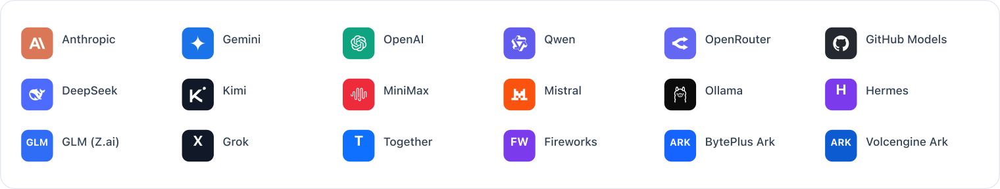
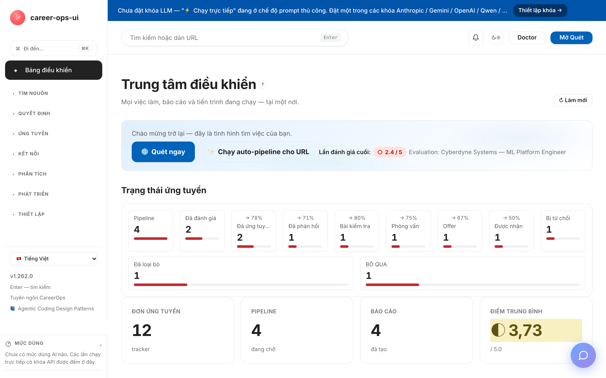
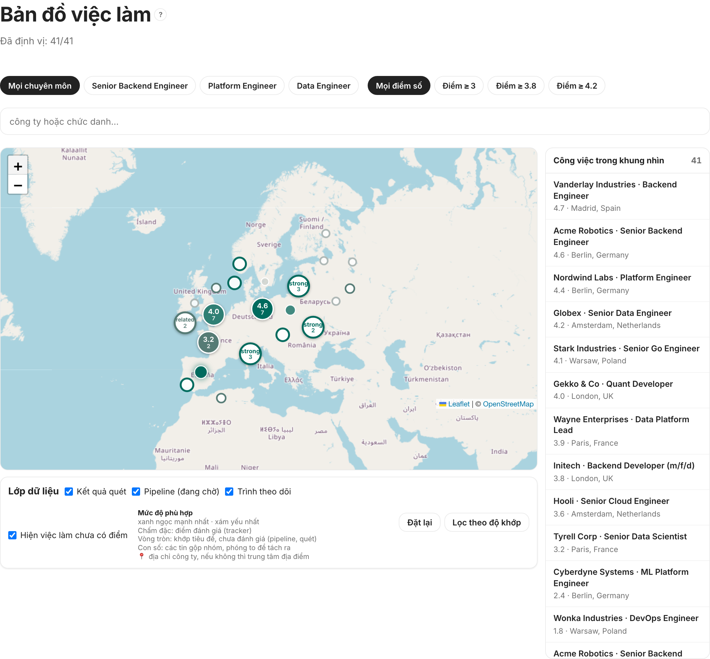

# career-ops-ui

> Giao diện web gọn nhẹ, văn-phong-kỹ-thuật cho pipeline tìm việc AI [career-ops](https://github.com/Fighter90/career-ops).
> Tìm việc, đánh giá, nghiên cứu sâu, ứng tuyển, theo dõi offer — tất cả trong một tab trình duyệt; không chuyển đổi qua lại giữa Claude Code, terminal và các tệp markdown.

**🇻🇳 Tiếng Việt** | [🇬🇧 English](README.md) | [🇪🇸 Español](README.es.md) | [🇧🇷 Português (Brasil)](README.pt-BR.md) | [🇰🇷 한국어](README.ko-KR.md) | [🇯🇵 日本語](README.ja.md) | [🇷🇺 Русский](README.ru.md) | [🇨🇳 简体中文](README.zh-CN.md) | [🇹🇼 繁體中文](README.zh-TW.md) | [🇫🇷 Français](README.fr.md) | [🇵🇱 Polski](README.pl.md) | [🇺🇦 Українська](README.uk.md) | [🇩🇰 Dansk](README.da.md) | [🇸🇦 العربية](README.ar.md) | [🇩🇪 Deutsch](README.de.md) | [🇮🇹 Italiano](README.it.md) | [🇹🇷 Türkçe](README.tr.md) | [🇮🇳 हिन्दी](README.hi.md) | [🇱🇰 தமிழ்](README.ta.md)

_Giao diện không chính thức — không liên kết với career-ops / santifer, cũng không được họ chứng thực._

[](#kiểm-thử)
[](#kiểm-thử)
[](#kiểm-thử)
[](#yêu-cầu)
[](LICENSE)
[](https://github.com/Fighter90/career-ops-ui/releases/tag/v1.269.1)
[](https://mokevnin.github.io/agentic-coding-design-patterns/en/)

<a href="https://www.producthunt.com/products/career-ops-ui?embed=true&amp;utm_source=badge-featured&amp;utm_medium=badge&amp;utm_campaign=badge-career-ops-ui" target="_blank" rel="noopener noreferrer"></a>

> **🆕 Bản phát hành mới nhất — v1.269.2** — lưu báo cáo không race trên CẢ HAI đường (lần thử đầu tiên + loại trùng lặp hậu tố epoch, đều độc quyền qua `wx` trong `server/lib/report-save.mjs::saveReportExclusive`), hợp đồng race được chứng minh theo hành vi; `POST /api/reports` không có `overwrite` ghi độc quyền (`wx`, cùng 409). Test 7699 → 7704.
>
> **Bản trước — v1.269.1** — Help ×19 ghi lại phễu kanban + thống kê chi tiết (cổng H3 129 → 131); xác minh trực tiếp (CAR-239): độ lan tỏa 0.0 qua 19 locale, lặp 0.0 ×3, cache chấm điểm 27/28 lần gọi, ≈$0.006/eval khi nóng; đuôi độ trễ prod (CAR-236) — một lần đọc tracker chia sẻ mỗi mount, phân trang bảng phía máy chủ (`?page&pageSize=200`).

<p align="center"></p>

>
> 📜 Toàn-bộ-lịch-sử-bản-phát-hành: **[CHANGELOG.vi.md](CHANGELOG.vi.md)**.

<!-- DO NOT REVERT: locale-specific dashboard screenshot (dashboard-vi.png). Each README uses its own ./images/dashboard-<locale>.png — never replace with dashboard-en.png. Generated by scripts/capture-dashboard-screenshots.mjs. -->
[](https://youtu.be/LcVPUg9IsDk?si=mrx3oOmOpSAwabOz)

**[▶ Xem bản-dạo-đầu](https://youtu.be/LcVPUg9IsDk?si=mrx3oOmOpSAwabOz)**

### 🗺️ Mới: mọi việc làm trên một bản đồ

Kết quả quét, pipeline và tracker trên cùng một bản-đồ-thế-giới (`#/map`) — các-offer dồn-về-đâu, thành-phố-nào-đáng-đi, thấy-trong-một-cái-nhìn. Chấm-đặc = điểm-đánh-giá-của-bạn; vòng-tròn = độ-khớp-tiêu-đề; được-đặt-tại địa-chỉ-nhà-tuyển-dụng-được-engine-nhận-diện, nếu-không-tại-trung-tâm-thành-phố (geocoding-OpenStreetMap-miễn-phí, không-khóa).



## Về career-ops

[career-ops](https://career-ops.org) là hệ-thống-tìm-việc-mã-nguồn-mở chạy-dưới-dạng-slash-command bên-trong-bất-kỳ-AI-coding-CLI-nào (Claude Code, Cursor, Codex, OpenCode, Antigravity CLI, Grok Build CLI, Qwen Code, Kimi, GitHub Copilot CLI, Gemini CLI (legacy) — các-CLI-tương-thích-Claude-khác-cũng-hoạt-động-qua-cùng-mặt-slash-command). Không-ràng-buộc-mô-hình. Nó đánh-giá-mỗi-tin so-với-CV-của-bạn bằng-một-thang-0.0–5.0-gồm-năm-chiều cộng-một-điểm-tổng-toàn-cục, tạo-các-bản-nháp-PDF-được-điều-chỉnh, và-theo-dõi-mọi-đơn-ứng-tuyển ngay-trên-máy-của-bạn — không-tài-khoản-đám-mây, không-telemetry, không-tự-nộp-đơn.

**Repository này (career-ops-ui)** — giao-diện-web trên career-ops. SPA thêm một-lớp-trình-duyệt-giống-CRM lên-chính những `cv.md` / `data/applications.md` / `reports/` mà các-slash-command đọc-và-viết. Dữ-liệu là-dùng-chung giữa CLI và-SPA.

**Ngưỡng-hành-động-theo-điểm** (xem [career-ops.org/docs](https://career-ops.org/docs)):

| Điểm | Bước tiếp theo |
|---|---|
| **≥ 4.5** | `/career-ops apply` — khớp cao, đẩy ngay |
| **4.0 – 4.4** | Nộp đơn, hay `/career-ops contacto` để được-giới-thiệu-thân-thiện trước |
| **3.5 – 3.9** | `/career-ops deep` — nghiên cứu trước |
| **< 3.5** | Bỏ-qua trừ-khi-bạn-có-lý-do-cá-nhân-cụ-thể |

**Hướng-dẫn-chính-thức** tại [career-ops.org/docs](https://career-ops.org/docs):

- [What is career-ops](https://career-ops.org/docs/introduction/what-is-career-ops)
- [Scan job portals](https://career-ops.org/docs/introduction/guides/scan-job-portals)
- [Apply for a job](https://career-ops.org/docs/introduction/guides/apply-for-a-job)
- [Batch-evaluate offers](https://career-ops.org/docs/introduction/guides/batch-evaluate-offers)
- [Set up Playwright](https://career-ops.org/docs/introduction/guides/set-up-playwright)
- [How career-ops scores job listings — methodology](https://career-ops.org/methodology)

## Chạy từ OpenWorker (đồng-đội-AI)

Thích một-đồng-đội-AI-chạy-trên-desktop hơn-trình-duyệt? Có một **[đồng-đội-OpenWorker](https://github.com/andrewyng/openworker)** điều-hành-toàn-bộ-pipeline này-giúp-bạn — quét-các-bảng-việc, chấm-điểm-khớp-so-với-CV, soạn-CV + cover-letter-có-căn-cứ, theo-dõi-đơn-ứng-tuyển, nháp-các-lượt-follow-up, và thậm-chí **khởi-chạy-chính-bảng-điều-khiển-này** — tất-cả-từ-ứng-dụng-OpenWorker-mã-nguồn-mở-của-Andrew-Ng.

→ **[Fighter90/career-ops-coworker](https://github.com/Fighter90/career-ops-coworker)** — đồng-đội-một-tệp, không-cần-code (đã-kiểm-chứng-cài-được-qua-cả-loader-của-OpenWorker **lẫn-repo-installer** của-nó). Hướng-dẫn-đầy-đủ bằng-[17 ngôn-ngữ](https://github.com/Fighter90/career-ops-coworker/tree/main/help). Xem-thêm [`docs/integrations/openworker.md`](docs/integrations/openworker.md).

**Cài-đặt** — một-lệnh dựng-pipeline-mà-đồng-đội-điều-hành (idempotent — tái-sử-dụng `career-ops` / `web-ui` sẵn-có): `curl -fsSL https://raw.githubusercontent.com/Fighter90/career-ops-coworker/main/install.sh | bash`. Rồi thêm-đồng-đội trong-panel **Install a coworker** của-OpenWorker — qua **GitHub-URL** (`https://github.com/Fighter90/career-ops-coworker`), qua **.zip** (từ-Releases), hay-bằng-cách-**import** `career-ops.md` — cả-ba-cách-đều-chạy.

## Tuyên ngôn CareerOps

career-ops là bản-triển-khai-tham-chiếu-đầu-tiên của [Tuyên-ngôn-CareerOps](https://career-ops.org/manifesto) — thực-hành-chạy-một-cuộc-tìm-việc với-bằng-chứng, với-kỷ-luật, và với-công-cụ-đứng-về-phía-ứng-viên-trên-bàn-đàm-phán. Hãy đọc nó. Nếu nó-nói-lên-niềm-tin-của-bạn, hãy-ký — chữ-ký-của-bạn là một-commit-công-khai. Ứng-dụng liên-kết-nó tại-chân-trang.

Ứng-dụng-này-tự-nó được-dựng bằng-các-coding-agent — theo [Agentic Coding Design Patterns](https://mokevnin.github.io/agentic-coding-design-patterns/en/) ([bản-tiếng-Nga](https://mokevnin.github.io/agentic-coding-design-patterns/ru/)) — các-lan-can-thực-thi-được, các-quy-trình-đóng-gói, từ-điển-miền-dữ-liệu, ADR và các-eval-quy-trình. Trang [Agentic Practices](https://github.com/Fighter90/career-ops-ui/wiki/Agentic-Practices) của wiki kiểm-toán những-pattern-nào-thực-sự-đang-được-áp-dụng.

## Cài một-AI-coding-assistant (cho career-ops-CLI-gốc)

career-ops chạy-dưới-dạng-slash-command **bên-trong** một-AI-coding-assistant — cài **một** cái và-đăng-nhập-trước-khi-tiếp-tục ([Quick-Start-của-gốc](https://career-ops.org/docs)):

| Assistant | Cài-đặt | provider-trong-`#/config` |
|---|---|---|
| **Claude Code** | [code.claude.com → Claude Code](https://code.claude.com/docs) | Anthropic (`ANTHROPIC_API_KEY`) |
| **Gemini CLI** | [github.com/google-gemini/gemini-cli](https://github.com/google-gemini/gemini-cli) | Gemini (`GEMINI_API_KEY`) |
| **Codex** | [github.com/openai/codex](https://github.com/openai/codex) | OpenAI (`OPENAI_API_KEY`) |
| **Qwen Code** | [github.com/QwenLM/qwen-code](https://github.com/QwenLM/qwen-code) | Qwen (`QWEN_API_KEY`) |
| **OpenCode** | [opencode.ai](https://opencode.ai) | bất-kỳ / OpenRouter (`OPENROUTER_API_KEY`) |
| **GitHub Copilot CLI** | [github.com/github/gh-copilot](https://github.com/github/gh-copilot) | GitHub Models (`GITHUB_MODELS_API_KEY`) |
| **Antigravity CLI** | [antigravity.google](https://antigravity.google) | Gemini (`GEMINI_API_KEY`) |

> **web-ui là-lựa-chọn-độc-lập** — không-cần-CLI-nào. Các-tính-năng-⚡-Run-live gọi-thẳng-API-của-provider; đặt **bất-kỳ-một-khóa** trong-`#/config` (hoặc `career-ops-ui init`) là-chạy-được-headless. Nếu-thích-CLI, hãy-chạy-career-ops bên-trong-assistant-bạn-chọn và-dùng-web-ui thuần-làm-bảng-điều-khiển-trên-cùng-những-tệp-ấy.

## Khởi động và init trong một lệnh

> **Quan-trọng — career-ops-ui là một-bảng-điều-khiển cho [`Fighter90/career-ops`](https://github.com/Fighter90/career-ops).** Nó chạy dạng `career-ops/web-ui/` **bên-trong** dự-án-career-ops; nó đọc `cv.md`, `config/`, `data/` của-bạn từ-thư-mục-gốc-qua-`../`. **Nó không-chạy-standalone** — repository-career-ops-gốc là-bắt-buộc. Đừng-clone-một-mình-hay-init-một-mình; dùng-một-trong-hai-lựa-chọn-dưới-đây.

### Lựa chọn 1 — một-lệnh-curl (được-khuyến-nghị: dựng-hết-mọi-thứ)

```bash
curl -fsSL https://raw.githubusercontent.com/Fighter90/career-ops-ui/main/bin/setup.sh | bash
```

Lệnh này clone **cả-hai** repository, dựng bố-cục `career-ops/web-ui/`, cài-dependencies, chạy-doctor, khởi-chạy-máy-chủ tại http://127.0.0.1:4317 — rồi mở-bảng-điều-khiển.

### Lựa chọn 2 — thêm UI vào một-dự-án-career-ops-có-sẵn

```bash
git clone https://github.com/Fighter90/career-ops.git
cd career-ops
git clone https://github.com/Fighter90/career-ops-ui.git web-ui
cd web-ui && npm install
npm start          # → http://127.0.0.1:4317
```

### Các lệnh CLI

```bash
career-ops-ui setup      # dependencies → doctor → máy chủ
career-ops-ui init       # nhà-cung-cấp-LLM + khóa (echo bị-chặn)
career-ops-ui doctor     # kiểm chứng lại bất-cứ-lúc-nào (exit 0 ⇔ mọi-mục-bắt-buộc-xanh)
career-ops-ui run        # khởi-chạy-máy-chủ tại http://127.0.0.1:4317
career-ops-ui open       # mở tab-bảng-điều-khiển và-đưa-lên-trước
```

### Chọn nhà-cung-cấp LLM

**Bất-kỳ** một-khóa-nào-bạn-có-đều-chạy-được (hợp-đồng-HOẶC). Nếu đặt nhiều, `auto` ưu-theo-thứ-tự: Anthropic → Gemini → OpenAI → Qwen → OpenRouter → GitHub Models → Hermes → DeepSeek → GLM (Z.ai) → Kimi (Moonshot) → MiniMax → Mistral → Grok (xAI) → Together → Fireworks → Ollama → BytePlus Ark → Volcengine Ark. Không-khóa-nào thì **Evaluate** đưa-một-prompt-thủ-công-sẵn-sàng-sao-chép — việc-đình-trịch-không-xảy-ra.

### Khắc-phục-sự-cố-init

- Không-thấy-`init` → `cd career-ops/web-ui && npm install && npx career-ops-ui init`.
- Khóa-bị-từ-chối → kiểm-tra-bạn-đã-dán-toàn-bộ-chuỗi (gồm-cả-tiền-tố); `career-ops-ui init` ghi-khóa vào `career-ops/.env` của-dự-án-gốc-qua-cùng-đường-dẫn-đã-xác-thực.
- Thích-thủ-công thì thêm-thẳng-vào-`career-ops/.env` — UI đọc-ngay-lập-tức.

## Vì sao có thứ này

Việc nhảy-đi-nhảy-lại-giữa-Claude-Code và-trình-duyệt là-phần-chậm. SPA này:

- **Hiển-thị** pipeline, tracker, kết-quả-quét và-báo-cáo — với-bộ-lọc/tìm-kiếm/phân-trang;
- Dán-một-URL và **chạy-Evaluate** trực-tiếp (hay nhận-một-prompt-thủ-công);
- Giúp **sửa-`cv.md`** cạnh-nhau (tải-lên, trình-soạn-markdown, tạo-PDF);
- Chạy **pipeline + tracker** không-cần-OCR/ảnh-chụp;
- **Không-lặp-lại-gì-cả** — dữ-liệu là-cùng-những-tệp-ấy, mà CLI-gốc đọc.

## Khởi động nhanh

### 1. Cài career-ops trước

```bash
git clone https://github.com/Fighter90/career-ops.git
cd career-ops
# Thiết-lập cv.md, config/profile.yml, portals.yml (xem README gốc)
```

### 2. Đặt career-ops-ui vào bên trong

```bash
git clone https://github.com/Fighter90/career-ops-ui.git web-ui
cd web-ui && npm install
```

### 3. Chạy

```bash
npm start        # http://127.0.0.1:4317
```

## Lần chạy đầu — trạng thái trắng

Ở-lần-khởi-động-đầu-tiên UI vẫn-mở-kể-cả-khi-chưa-có-dự-án-gốc; trang-Health sẽ-nói-cái-gì-còn-thiếu. Không-gì-được-tạo-tự-động; UI là-lớp-phủ-chỉ-đọc — mọi-thứ-bạn-viết đi-kèm-một-nút-xác-nhận-của-chính-bạn.

## Yêu cầu

- **Node ≥ 18** (khuyến-nghị-22)
- Một-bản-checkout **career-ops** gốc (cùng-cây-thư-mục; UI đọc-qua-`../`)
- Khóa-LLM **tùy-chọn** — không-có-thì-chế-độ-prompt-thủ-công
- Playwright **tùy-chọn** — chỉ cho Generate PDF và-các-lượt-kiểm-tra-liveness

## Tính năng — theo từng trang

| Trang | Làm gì |
|---|---|
| **#/dashboard** | Đơn-ứng-tuyển, pipeline, điểm-trung-bình, luồng-trạng-thái, hành-động-nhanh |
| **#/scan** | ATS + nguồn-khu-vực trong-một-lượt-quét; bộ-lọc, truy-vấn-đã-lưu, yêu-thích |
| **#/pipeline** | Hàng-đợi-URL; xem-trước-ngay-tại-chỗ; đánh-giá-một-cú-bấm |
| **#/evaluate** | Chấm-JD 0–5 theo-A–G; trực-tiếp hay-thủ-công |
| **#/reports** | Các-đánh-giá-đã-lưu; xuất-PDF; bảng điểm → bước-tiếp-theo |
| **#/tracker** | Bảng-CRM; phễu-trạng-thái; kiểm-tra-"Still live?"; ghi-kết-quả |
| **#/deep** | Bản-tóm-tắt-công-ty 7 mục |
| **#/apply** | Danh-mục-kiểm-tra-nộp (không-tự-điền-form) |
| **#/map** | Quét/pipeline/tracker trên-OpenStreetMap |
| **#/help** | Hướng-dẫn-trong-ứng-dụng (bằng-ngôn-ngữ-của-bạn) |
| **#/usage** | Theo-dõi-chi-phí-AI-trực-tiếp (token + USD-ước-tính) |

## Quét

**Quét-một-cú-bấm** chạy-mọi-nguồn-đang-bật: lượt-quét-ATS (Greenhouse / Ashby / Lever / Workable / SmartRecruiters / Workday + nhận-diện-theo-tenant), các-aggregator-opt-in cho-mỗi-mục-`tracked_companies` (RemoteOK / Remotive / Working Nomads / IBM / Arbeitsagentur / Glints / Jobstreet · SEEK), và lượt-quét-khu-vực cho-các-truy-vấn-`russian_portals` (hh.ru + Habr Career + Trudvsem + GetMatch + GeekJob). Bảng-kết-quả-`#/scan` được-phân-trang; các-tín-hiệu-khớp/tăng/tin-cậy hiện-dưới-dạng-biểu-tượng; đi-lại-là-thuần-cục-bộ.

### Adapter RSS

```yaml
tracked_companies:
  - { name: LaraJobs, enabled: true, provider: rss, rss: https://larajobs.com/feed }
```

Bất-kỳ-feed-RSS/Atom nào-cũng-trở-thành-một-nguồn — không-đổi-code; **RSS** xuất-hiện-trong-dropdown-`#/scan`.

## Kiến trúc

```
web-ui/
├── server/                 # Express (API + SSE + proxy LLM)
│   ├── index.mjs           # createApp — cách-lý-CI 100%
│   └── lib/
│       ├── sources/        # 129 nguồn bảng việc làm (124 EN + 5 RU)
│       ├── ru-scanner.mjs  # bộ-điều-phối-khu-vực
│       └── routes/         # help, docs-assistant, config, tracker, …
├── public/
│   ├── index.html          # vỏ-SPA-script-thuần (không-bundler)
│   └── js/
│       ├── app.js          # khởi-động, công-tắc-ngôn-ngữ, giao-diện
│       ├── lib/            # i18n (19 ngôn-ngữ), api, ui, format
│       └── views/          # một-tệp-mỗi-trang
├─ docs/                     # tài-liệu-công-khai: kiến-trúc, API, dòng-dữ-liệu, SDD, quy-ước, các-bản-rà-soát
│  ├─ PROJECT.md             # cái-gì / vì-sao / cho-ai
│  ├─ ROADMAP.md             # cột-mốc-hiện-tại + lịch-sử-hoàn-tất
│  ├─ PRODUCTION-READINESS.md # đánh-gía-trung-thực-các-cổng-triển-khai
│  ├─ sdd/{SDD-GUIDE,CONVENTIONS}.md
│  ├─ architecture/{OVERVIEW,SERVER,FRONTEND,API,DATA-FLOWS}.md
│  └─ reviews/REVIEW-*.md
└─ tests/                    # 7243 unit + 176 Playwright + 23/23 e2e:full + 21 e2e:smoke (baseline @ v1.267.2)
   ├─ parsers.test.mjs       # bộ-phân-tách-markdown / pipeline / báo-cáo (hàm-thuần)
   ├─ api.test.mjs           # mọi-endpoint, máy-chủ-ephemeral, không-mạng
   ├─ {ru,en}-scanner.test.mjs   # fetch-mocked
   ├─ pipeline-preview.test.mjs   # xác-thực-redirect-từng-bước (REVIEW-B1)
   ├─ anthropic.test.mjs     # adapter-SDK + test-bảo-vệ-log (REVIEW-B4)
   ├─ url-validation.test.mjs    # quét-từ-chối-SSRF (FIX-M3 + M6 + M7)
   ├─ cv-xss.test.mjs        # lượt-đi-về-stripDangerousMarkdown
```

## API — tóm-tắt

Mọi-endpoint nằm-dưới-`/api/*`; JSON-vào / JSON-ra trừ-khi-ghi-rõ. Các-nhóm-chính:

| Method | Path | Làm-gì |
|---|---|---|
| GET | `/api/health` | các-lượt-kiểm-tra-setup, version, cảnh-báo |
| GET | `/api/dashboard` | bộ-đếm-tổng-hợp, điểm-trung-bình, đơn-mới-nhất |
| GET/POST | `/api/tracker` | hàng-của-`data/applications.md`; POST có-dedup |
| GET/POST/DELETE | `/api/pipeline` | CRUD-trên-`data/pipeline.md` |
| GET | `/api/pipeline/preview?url=…` | proxy-tải-ở-server (kiểm-SSRF-từng-hop, ≤3 redirect, trần-8 KB) |
| GET | `/api/reports` · `/api/reports/:slug` | danh-sách / nội-dung-báo-cáo |
| GET/PUT | `/api/cv` | đọc / ghi-`cv.md` (strip-XSS, trần-1 MB) |
| POST | `/api/run/doctor` … | chạy-doạt-`doctor` / `verify` / `normalize` / `dedup` / `merge` (trần-60 s) |
| GET | `/api/stream/scan` | SSE-quét-gộp (`source=ats\|regional\|both`) |
| GET | `/api/stream/liveness` · `/api/stream/pdf` | SSE-proxy cho-`check-liveness.mjs` / `generate-pdf.mjs` |
| POST | `/api/evaluate` | chấm-JD (các-mục-A–G theo-`oferta.md`) |
| POST | `/api/deep` | nghiên-cứu-sâu-công-ty |
| POST | `/api/mode/:slug` | các-mode-được-phép: `batch`, `contacto`, `followup`, `interview-prep`, `patterns`, `project`, `training` |
| GET | `/api/scan-results` | lượt-quét-gần-nhất (`en` / `ru`) |

Danh-sách-đầy-đủ-kèm-dạng-request/response nằm-trong-[README.md](README.md) tiếng-Anh (mục-«API reference»).

## Kiểm thử

- `npm test` — bộ-unit đầy-đủ (mock, không-mạng)
- `npm run test:e2e:browser` — các-lượt-quét-trình-duyệt-Playwright (tự-chọn)
- `bash bin/run_all.sh` — mọi-bề-mặt-trong-một-lần-chạy
- CI chạy `npm run test:ci` trên-Node 18/20/22 cho-mỗi-PR

## Cấu hình

Các-biến-môi-trường (đọc-lúc-máy-chủ-khởi-động; tất-cả-tùy-chọn-trừ-mục-ghi-rõ):

| Biến | Mặc-định | Làm-gì |
|---|---|---|
| `PORT` | `4317` | cổng-bind-của-Express |
| `HOST` | `127.0.0.1` | host-bind; CSP-được-đính-khi-ngoài-loopback |
| `CAREER_OPS_ROOT` | `..` | chỗ-nằm-của-`cv.md`, `data/`, `portals.yml`, `modes/` |
| `ANTHROPIC_API_KEY` | trống | bật-`/api/evaluate`, `/api/deep`, `/api/mode/:slug` chạy-trực-tiếp |
| `GEMINI_API_KEY` | trống | fallback-cho-`/api/evaluate` |
| `OPENAI_API_KEY` | trống | eval-trực-tiếp-headless (thứ-3-trong-thứ-tự-`auto`) |
| `QWEN_API_KEY` / `OPENROUTER_API_KEY` | trống | thứ-4 và-thứ-5-trong-thứ-tự-`auto` |

Khối-`portals.yml` mà-UI-này-nhận-thêm — xem-mục-«Quét» ở-trên; các-khối-sẵn-sàng-dán cho-24-công-ty-đã-kiểm-chứng nằm-trong-[`docs/portals-examples.md`](docs/portals-examples.md).

## Lưu-ý-bảo-mật

- Máy-chủ-mặc-định-bind-`127.0.0.1` — không-bao-giờ-mở-ra-internet nếu-không-có-`HOST=0.0.0.0` tường-minh.
- **Làm-sạch-path (v1.21.0)**: mọi-tham-số-route-`:name` / `:slug` đi-qua-`sanitizePathName()` trong-`server/lib/security.mjs` — ký-tự-lạ-bị-bỏ, cap-200-ký-tự.
- **Chống-DNS-rebind (v1.21.0)**: `/api/pipeline/preview` và-`/api/auto-pipeline` đi-qua-`server/lib/safe-fetch.mjs::safeGet` — một-lần-phân-giải-DNS, kết-nối-TCP-được-ghim, redirect-được-kiểm-lại-từng-hop.
- **Mutex-ghi-đồng-thời (v1.21.0)**: đọc–sửa–ghi trên-tracker và-pipeline được-bọc-trong-`withFileLock(path, fn)` — POST-đồng-thời không-còn-làm-rơi-hàng.
- **Rate-limit-LLM (v1.21.0)**: `/api/evaluate`, `/api/deep`, `/api/mode/:slug`, `/api/auto-pipeline` đeo-`llmRateLimit` — no-op-trên-loopback; 10 req/min/IP khi-`HOST=0.0.0.0`; 429 + `Retry-After`.
- **Strip-XSS-cho-CV (v1.22.0)**: `stripDangerousMarkdown` hiểu-HTML-entity — `&lt;script&gt;` và-`java&#115;cript:` không-lọt.
- Tiến-trình-con chạy-qua-`spawn` với-mảng-đối-số — **không-bao-giờ-ghép-shell**.
- Các-endpoint-stream giết-tiến-trình-con khi-client-ngắt-kết-nối — không-sót-scanner-mồ-côi.
- Các-endpoint-ghi chỉ-chạm-những-đường-dẫn-career-ops-đã-biết: `data/`, `jds/`, `cv.md`, `config/`, `portals.yml`, `output/`, `reports/`, `interview-prep/`, `modes/_profile.md`.

## Giới-hạn

Các-mode-chạy-hoàn-toàn-bằng-LLM (`oferta`, `deep`, `contacto`, `apply`, `batch`, `patterns`, `followup`) cần-một-LLM-thực-sự-mới-chạy. web-ui chọn-provider theo-thứ-tự-`auto` **Anthropic → Gemini → OpenAI → Qwen → OpenRouter → GitHub Models → Hermes → DeepSeek → GLM (Z.ai) → Kimi (Moonshot) → MiniMax → Mistral → Grok (xAI) → Together → Fireworks → Ollama → BytePlus Ark → Volcengine Ark** (hoặc-một-provider-được-`LLM_PROVIDER`-ghim):

1. **Anthropic (ưu-tiên)** — đặt-`ANTHROPIC_API_KEY` trong-`.env` của-dự-án-gốc; `cv.md` / `config/profile.yml` / `modes/_shared.md` được-inline-tự-động.
2. **`gemini-eval.mjs` làm-fallback** — chạy-ngay-khi-chỉ-có-`GEMINI_API_KEY`.
3. **OpenAI / Qwen / OpenRouter** — client-tương-thích-OpenAI, không-thêm-dependency. **OpenRouter** linh-hoạt-nhất: một-`OPENROUTER_API_KEY` mở-300+-mô-hình; dropdown-mô-hình-trong-`#/config` nạp-trực-tiếp-từ-`GET /api/openrouter/models`.
4. **Prompt-sao-chép** — khi-chưa-có-khóa-nào, UI sinh-một-prompt-sẵn-sàng cho-Claude-Code / ChatGPT / Gemini-Web.

Luồng-`/career-ops apply` (tự-điền-form-Playwright) bên-trong-Claude-Code vẫn-là-cách-duy-nhất-để-thực-sự-tự-điền-form — *Apply-helper* của-UI sinh-một-danh-mục-kiểm-tra-thay-vì.

## 5 phút đầu — tạo-CV đến-nộp-đơn

1. `bash bin/start.sh` → mở `http://127.0.0.1:4317`.
2. **Health** → mọi-mục-bắt-buộc-xanh (`cv.md`, `config/profile.yml`, `portals.yml`, một-khóa-API).
3. **App settings** → dán-khóa-API → **Save** → **Test Anthropic**.
4. **CV** → dán-hoặc-tải-lên-CV-của-bạn → **Save** → **Generate PDF**.
5. **Scan** → bấm-🌐-Scan-now — kết-quả-đổ-vào-bảng; lọc-theo-chip; mở-tin-trong-tab-mới.
6. Sao-chép-URL → dán-vào **Pipeline** → bấm **Evaluate** — chấm-điểm-0–5-trực-tiếp (Anthropic / Gemini) hay-nhận-prompt-thủ-công.
7. Báo-cáo vào `reports/`, tracker vào `data/applications.md`, nghiên-cứu-sâu vào `interview-prep/` — tất-cả-thấy-trong-UI.

> Bản-dịch-của-hướng-dẫn-này nằm-trong-từng-README-theo-ngôn-ngữ:
> [🇬🇧 English](README.md) · [🇪🇸 Español](README.es.md) · [🇧🇷 Português (Brasil)](README.pt-BR.md) · [🇰🇷 한국어](README.ko-KR.md) · [🇯🇵 日本語](README.ja.md) · [🇷🇺 Русский](README.ru.md) · [🇨🇳 简体中文](README.zh-CN.md) · [🇹🇼 繁體中文](README.zh-TW.md) · [🇫🇷 Français](README.fr.md) · [🇵🇱 Polski](README.pl.md) · [🇺🇦 Українська](README.uk.md) · [🇩🇰 Dansk](README.da.md) · [🇸🇦 العربية](README.ar.md) · [🇩🇪 Deutsch](README.de.md) · [🇮🇹 Italiano](README.it.md) · [🇹🇷 Türkçe](README.tr.md) · [🇮🇳 हिन्दी](README.hi.md) · [🇱🇰 தமிழ்](README.ta.md)

---

## Chạy-toàn-bộ-stack-trên-cloud

career-ops chạy-tốt-nhất-khi **luôn-bật** — quét-trong-khi-bạn-ngủ, chạm-tới-từ-bất-kỳ-trình-duyệt-nào. Để-đặt-toàn-bộ-stack lên-một-máy-chủ-nhỏ — pipeline-gốc **career-ops**, trình-xem **career-ops-ui** này, và **động-cơ** chạy-AI (**gói-đăng-ký-Claude** qua-CLI-Claude-Code, một-gateway-**Hermes** cục-bộ, hay-các-khóa-API) — dựng-một-VPS (Node ≥ 18), cài-gốc + repo-này, chọn-động-cơ, và-phơi-trình-xem-phía-sau-một-**reverse-proxy-HTTPS-có-xác-thực** trong-khi-các-bất-biến-bảo-mật (CSP, guard-SSRF, biên-XSS, không-bí-mật-trong-log) vẫn-nguyên-vẹn.

📖 **Help §31** trong-ứng-dụng («Chạy-toàn-bộ-stack-trên-cloud») dẫn-từng-bước bằng-cả-19-ngôn-ngữ; checklist-operator là-[`docs/integrations/HERMES.md`](docs/integrations/HERMES.md), còn-[trang-wiki-cloud-deployment](https://github.com/Fighter90/career-ops-ui/wiki/Cloud-Deployment) giữ-các-bảng-tham-chiếu.

## Hermes-agent + Telegram

**[Hermes](https://hermes-agent.nousresearch.com/docs)** của-Nous-Research là-một-agent-tự-động-mở (gọi-công-cụ, skills, 20+-kênh-nhắn-tin). Bạn-có-thể-chạy-career-ops-ui trên-**máy-chủ-cloud** và-cầu-những-sự-kiện-của-nó — một-lượt-quét-hoàn-tất, một-báo-cáo-mới, một-follow-up-khẩn — sang-**Telegram-qua-một-Hermes-agent**, để-pipeline-tìm-đến-bạn ở-chỗ-bạn-đang-ở.

> **Đã-nối-rồi (v1.151.0).** Hermes-là-*LLM-provider* đã-chạy: mở-API-Server-tương-thích-OpenAI của-nó (`hermes gateway`) và-đặt-`HERMES_API_KEY` trong-**App-settings** — career-ops-ui sẽ-chấm-điểm-trực-tiếp-qua-Hermes-cục-bộ-của-bạn (cuối-thứ-tự-provider-`auto`).

📖 **Hướng-dẫn-đầy-đủ:** [`docs/integrations/HERMES.md`](docs/integrations/HERMES.md) — hai-dạng-tích-hợp, triển-khai-máy-chủ-cloud (reverse-proxy + HTTPS + systemd), Telegram-qua-Hermes, và-danh-sách-«cái-gì-KHÔNG-được-phơi» trong-mô-hình-đe-dọa.

## Bản-dịch-hệ

UI-mang **19-locale** — `en`, `es`, `pt-BR`, `ko`, `ja`, `ru`, `zh-CN`, `zh-TW`, `fr`, `pl`, `uk`, `da`, `ar`, `de`, `it`, `tr`, `hi`, `ta`, `vi`. Từ-**v1.60.0 (I18N-SPLIT)** bản-dịch nằm-**một-tệp-mỗi-locale** dưới-[`public/js/lib/locales/`](public/js/lib/locales/) — `i18n-dict.<lang>.js`, một-bảng-phẳng-`key → string` — cộng-một-`i18n-dict.aliases.js` dùng-chung. [`i18n-dict.js`](public/js/lib/i18n-dict.js) lắp-chúng-thành-`window.__I18N_DICT`; [`i18n.js`](public/js/lib/i18n.js) phân-giải-`t('key', 'fallback')`. Không-bước-build, không-fetch-runtime — dịch-giả sửa-đúng-một-tệp-ngôn-ngữ.

**Thêm hay-đổi-một-chuỗi:** thêm-cùng-một-key vào-cả-19-tệp-locale (parity-được-gate), dùng-qua-`data-i18n="scan.newButton"` hay-`t('scan.newButton')` trong-JS, rồi-chạy-`npm test`. Để-thêm-một-ngôn-ngữ-mới-hẳn, đăng-ký-trong-`i18n.js` (`LANGS` + `detect()`), assembler, `index.html`, và-công-cụ-đếm-locale.

📖 **Hướng-dẫn-đầy-đủ:** [`docs/LOCALIZATION.md`](docs/LOCALIZATION.md) — bố-cục-theo-locale, cơ-chế-`@alias`, thêm-locale-mới-từng-bước, và-mọi-gate-i18n-của-CI.

## 📘 Repo-này-được-dựng-bằng-agents-như-thế-nào

Phần-lớn-dự-án-này được-viết-bằng-các-coding-agent. Đó là-một-thực-hành có-các-chế-độ-thất-bại-riêng, nên-được-chạy-một-cách-cố-ý, theo-[**Agentic Coding Design Patterns**](https://mokevnin.github.io/agentic-coding-design-patterns/en/) ([bản-tiếng-Nga](https://mokevnin.github.io/agentic-coding-design-patterns/ru/)). Các-tệp-dưới-đây là-thực-hành-ấy được-đem-về-cụ-thể. Không-tệp-nào-chạm-đến-ứng-dụng-đang-chạy — chúng-tồn-tại-để-một-session-mới-nắm-tiếp-nơi-session-trước-dừng, thay-vì-đoán-lại, quyết-lại và-hỏng-lại-cùng-những-thứ-ấy.

| Tệp | Là-gì | Đọc-khi-nào |
|---|---|---|
| **[`CONTEXT.md`](CONTEXT.md)** | Từ-điển-miền: một-tên-được-chấp-nhận-mỗi-khái-niệm, các-biến-thể-bị-loại-được-đánh-dấu-*đừng-dùng*. | **Trước-tiên.** Nó-dẹp-những-lẫn-lộn repo-này-thực-sự-trả-giá — `source` vs `adapter`, `mirror` vs `relay`, `telegram` vs `telegram-channel`. |
| **[`PROGRESS.md`](PROGRESS.md)** | Trạng-thái-làm-việc: đã-làm-gì, bước-tiếp, vấn-đề-đã-biết, và-các-**hướng-đã-bị-bỏ**. | Đầu-mỗi-session. Git-cho-thấy-gì-đổi; tệp-này nói-công-việc-đang-ở-đâu và-cái-gì-đã-thử-và-bị-loại. |
| **[`docs/adr/`](docs/adr/)** | Các-bản-ghi-quyết-định-đánh-số — bối-cảnh, quyết-định, hệ-quả, và-cái-gì-sẽ-khiến-xem-lại. | Trước-khi-đổi-mọi-thứ-một-bản-ghi-đang-bao-phủ. Bản-ghi-quyết-định, không-phải-release-hiện-tại. |
| **[`CLAUDE.md`](CLAUDE.md)** | Một-màn-hình-index-trỏ-về-ba-tệp-trên. | Tự-động, bởi-agent. Cố-ý *không-phải*-cơ-sở-tri-thức — tệp-dài-bị-lướt-rồi-bị-bỏ-quên. |
| **[`evals/workflow/`](evals/workflow/)** | Bộ-task-cố-định với-grader kiểm-hành-vi-của-*pipeline*, không-phải-sản-phẩm. | Trước-và-sau-khi-đổi-skill / prompt / công-cụ. |
| **[`.claude/skills/`](.claude/skills/)** | Các-quy-trình-đóng-gói; `parent-sync` chạy-một-release-parity-nguyên-vẹn qua-9-giai-đoạn-có-gate. | Thay-vì-tự-bổ-trình-một-release. |
| **[`.githooks/pre-commit`](.githooks/pre-commit)** | Lan-can-thực-thi-được — sàn-xác-định-fail-cứng, cộng-một-tầng-AI-tư-vấn-không-bao-giờ-chặn. | Tự-chạy. |

```bash
# Lan-can: hook thuộc-repo, nên-mọi-kiểm-tra-áp-cho-mọi-người, không-chỉ-máy-bạn.
git config core.hooksPath .githooks

# Workflow-evals: chấm-trạng-thái-repo theo-quy-tắc trong-docs/adr/ và-PROGRESS.md.
node evals/workflow/run.mjs              # mọi-grader
node evals/workflow/run.mjs --task qa-prompt-mandatory
```

Mỗi-grader trong-`evals/workflow/tasks.yml` ứng-với-một-lỗi-đã-từng-lên-sản-phẩm — một-attribution-lịch-sử-bị-ghi-đè, một-build-site chạy-giữa-fan-out, một-no-port-bị-sót. Kết-quả và-quỹ-đạo được-chấm-riêng, và-grader-nào-không-thể-quyết-được-từ-repo sẽ-báo-`SKIP` thay-vì-pass-trong-im-lặng: một-kiểm-tra-không-chạy-được không-bao-giờ-được-đọc-là-xanh.

Từ-điển-cũ-tệ-hon-không-có, nên-việc-viết-những-tài-liệu-này là-một-phần-của-chính-release — Phase-0 của-`parent-sync` nạp-chúng và-Phase-8 đưa-lại-cho-chúng-cái-đã-học. Thêm-thuật-ngữ-vào-`CONTEXT.md` trong-cùng-commit-giới-thiệu-khái-niệm; mở-ADR khi-một-lựa-chọn-sẽ-trông-tuỳ-ý-sau-sáu-tháng; ghi-hướng-đã-loại vào-`PROGRESS.md` ngay-lúc-loại-nó.

Những-pattern-nào-từ-sách-thực-sự-được-áp-dụng-ở-đây — và-những-pattern-nào-không — được-kiểm-toán trên-trang-wiki-[Agentic Practices](https://github.com/Fighter90/career-ops-ui/wiki/Agentic-Practices).

## Đóng-góp

Issues và-PR đều-hoan-nghinh. Quy-tắc-nhà:

- Chạy-`npm test` trước-khi-push — **7243-kiểm-tra-xanh** là-mức-sàn (cộng-176-Playwright nếu-đụng-UI).
- Thay-đổi-không-trivial đi-qua-pipeline-GSD: [`docs/sdd/SDD-GUIDE.md`](docs/sdd/SDD-GUIDE.md).
- Đừng-đổi-bất-cứ-gì trong-dự-án-gốc-`career-ops/` từ-trong-repo-này — bản-chất là-một-lớp-phủ-không-xâm-lấn. Các-quy-tắc-cứng nằm-trong-[`CLAUDE.md`](CLAUDE.md).
- Conventional-commits: `feat`, `fix`, `refactor`, `docs`, `test`, `chore`, `perf`, `ci`; scope-tùy-chọn: `feat(scan):`; breaking: `feat!:`.
- Test phải-CI-isolated — dựng-fixture-qua-`mkdtempSync` hay-`CAREER_OPS_ROOT=$(mktemp -d)`.

Điều-hành-repo từ-CLI-khác-Claude (Codex, Aider, Cursor, Gemini)? Đọc-[`AGENTS.md`](AGENTS.md) hay-[`GEMINI.md`](GEMINI.md) — cả-hai shim về-`CLAUDE.md` chuẩn.

---

## Giấy phép

MIT. Xem [LICENSE](LICENSE).

Xây-trên [career-ops](https://github.com/Fighter90/career-ops) của [santifer](https://santifer.io). Cảm-ơn-về-một-pipeline-xuất-sắc.

## Cộng tác viên

Cảm-ơn-mọi-người-đã-giúp-dựng-career-ops-ui. Dự-án do [Fighter90](https://github.com/Fighter90) bảo-trì và được-cộng-đồng-cải-tiến — xem-danh-sách-đầy-đủ trên-[đồ-thị-cộng-tác-viên](https://github.com/Fighter90/career-ops-ui/graphs/contributors).

**[Tất-cả-cộng-tác-viên →](https://github.com/Fighter90/career-ops-ui/graphs/contributors)**
