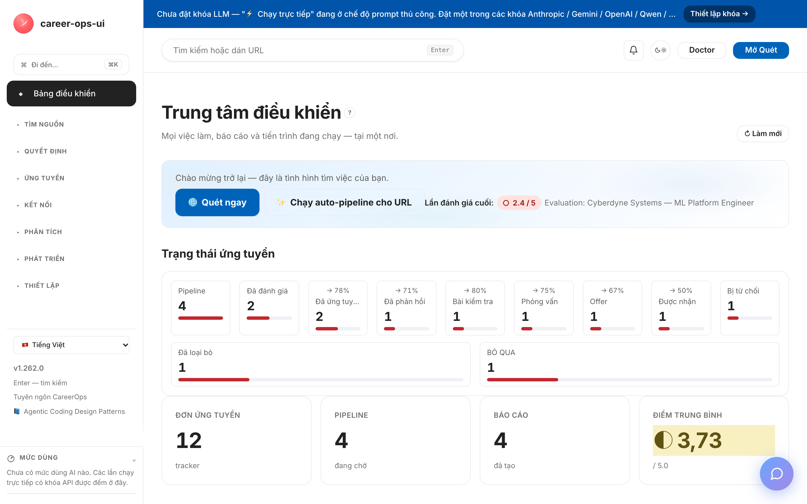

# career-ops-ui

> Giao diện web gọn nhẹ, văn-phong-kỹ-thuật cho pipeline tìm việc AI [career-ops](https://github.com/Fighter90/career-ops).
> Tìm việc, đánh giá, nghiên cứu sâu, ứng tuyển, theo dõi offer — tất cả trong một tab trình duyệt; không chuyển đổi qua lại giữa Claude Code, terminal và các tệp markdown.

**🇻🇳 Tiếng Việt** | [🇬🇧 English](README.md) | [🇪🇸 Español](README.es.md) | [🇧🇷 Português (Brasil)](README.pt-BR.md) | [🇰🇷 한국어](README.ko-KR.md) | [🇯🇵 日本語](README.ja.md) | [🇷🇺 Русский](README.ru.md) | [🇨🇳 简体中文](README.zh-CN.md) | [🇹🇼 繁體中文](README.zh-TW.md) | [🇫🇷 Français](README.fr.md) | [🇵🇱 Polski](README.pl.md) | [🇺🇦 Українська](README.uk.md) | [🇩🇰 Dansk](README.da.md) | [🇸🇦 العربية](README.ar.md) | [🇩🇪 Deutsch](README.de.md) | [🇮🇹 Italiano](README.it.md) | [🇹🇷 Türkçe](README.tr.md) | [🇮🇳 हिन्दी](README.hi.md) | [🇱🇰 தமிழ்](README.ta.md)

_Giao diện không chính thức — không liên kết với career-ops / santifer, cũng không được họ chứng thực._

[](#kiểm-thử)
[](#kiểm-thử)
[](#kiểm-thử)
[](#yêu-cầu)
[](LICENSE)
[](https://github.com/Fighter90/career-ops-ui/releases/tag/v1.264.0)
[](https://mokevnin.github.io/agentic-coding-design-patterns/en/)

<a href="https://www.producthunt.com/products/career-ops-ui?embed=true&amp;utm_source=badge-featured&amp;utm_medium=badge&amp;utm_campaign=badge-career-ops-ui" target="_blank" rel="noopener noreferrer"></a>

> **🆕 Bản phát hành mới nhất — v1.264.1** — **Hai-sửa-do-agent-thực-hiện: các-viên-pill-viền-sidebar cắt-bớt-nhãn-bản-địa-hóa-dài một-cách-duyên-dáng (ellipsis + tooltip-bản-địa-hóa — không-còn-cắt-cứng-chữ-«Профинансированные компании»), và một-trần-đánh-giá-480 s cho-mọi-locale (không-còn-những-lượt-cắt-cụt-300 s-tạm-thời trên es/zh-CN); FAQ-của-cvstart.org giờ-mang số-đếm-nguồn-chính-xác-suy-từ-registry (123 = 118-quốc-tế + 5-Nga). Tests 7041 → 7081.**


>
> **Bản trước — v1.264.0** — **Đợt-củng-cố-sau-phát-hành: trạng-thái-của-mọi-dòng-tracker giờ-sửa-được-ngay-trên-dòng (`set-status.mjs` chính-tắc-của-dự-án-gốc dưới-khóa-`applications.md`), cảnh-báo-server (bắt-tay, trôi-ngôn-ngữ) hiện-thành-một-dải-trên-cả-sáu-trang-AI, nguồn-quét-Trudvsem sống-sót-qua-trang-rỗng và-đi-theo-offset-bản-ghi, tiêu-đề-habr không-thể-hồi-sinh-markup, cổng-hồ-sơ-thô giữ-chặt-dòng-`full_name`, và-các-hint cuối-cùng-nói-thật (`.doc` đã-biến-mất, `gpt-5` và-hai-tier-Anthropic-5-5). Tests 6905 → 7041.**

<p align="center"></p>

>
> 📜 Toàn-bộ-lịch-sử-bản-phát-hành: **[CHANGELOG.vi.md](CHANGELOG.vi.md)**.

<!-- DO NOT REVERT: locale-specific dashboard screenshot (dashboard-vi.png). Each README uses its own ./images/dashboard-<locale>.png — never replace with dashboard-en.png. Generated by scripts/capture-dashboard-screenshots.mjs. -->
[](https://youtu.be/LcVPUg9IsDk?si=mrx3oOmOpSAwabOz)

**[▶ Xem bản-dạo-đầu](https://youtu.be/LcVPUg9IsDk?si=mrx3oOmOpSAwabOz)**

### 🗺️ Mới: mọi việc làm trên một bản đồ

Kết quả quét, pipeline và tracker trên cùng một bản-đồ-thế-giới (`#/map`) — các-offer dồn-về-đâu, thành-phố-nào-đáng-đi, thấy-trong-một-cái-nhìn. Chấm-đặc = điểm-đánh-giá-của-bạn; vòng-tròn = độ-khớp-tiêu-đề; được-đặt-tại địa-chỉ-nhà-tuyển-dụng-được-engine-nhận-diện, nếu-không-tại-trung-tâm-thành-phố (geocoding-OpenStreetMap-miễn-phí, không-khóa).

## Về career-ops

[career-ops](https://career-ops.org) là hệ-thống-tìm-việc-mã-nguồn-mở chạy-dưới-dạng-slash-command bên-trong-bất-kỳ-AI-coding-CLI-nào (Claude Code, Cursor, Codex, OpenCode, Antigravity CLI, Grok Build CLI, Qwen Code, Kimi, GitHub Copilot CLI, Gemini CLI (legacy) — các-CLI-tương-thích-Claude-khác-cũng-hoạt-động-qua-cùng-mặt-slash-command). Không-ràng-buộc-mô-hình. Nó đánh-giá-mỗi-tin so-với-CV-của-bạn bằng-một-thang-0.0–5.0-gồm-năm-chiều cộng-một-điểm-tổng-toàn-cục, tạo-các-bản-nháp-PDF-được-điều-chỉnh, và-theo-dõi-mọi-đơn-ứng-tuyển ngay-trên-máy-của-bạn — không-tài-khoản-đám-mây, không-telemetry, không-tự-nộp-đơn.

**Repository này (career-ops-ui)** — giao-diện-web trên career-ops. SPA thêm một-lớp-trình-duyệt-giống-CRM lên-chính những `cv.md` / `data/applications.md` / `reports/` mà các-slash-command đọc-và-viết. Dữ-liệu là-dùng-chung giữa CLI và-SPA.

**Ngưỡng-hành-động-theo-điểm** (xem [career-ops.org/docs](https://career-ops.org/docs)):

| Điểm | Bước tiếp theo |
|---|---|
| **≥ 4.5** | `/career-ops apply` — khớp cao, đẩy ngay |
| **4.0 – 4.4** | Nộp đơn, hay `/career-ops contacto` để được-giới-thiệu-thân-thiện trước |
| **3.5 – 3.9** | `/career-ops deep` — nghiên cứu trước |
| **< 3.5** | Bỏ-qua trừ-khi-bạn-có-lý-do-cá-nhân-cụ-thể |

**Hướng-dẫn-chính-thức** tại [career-ops.org/docs](https://career-ops.org/docs):

- [What is career-ops](https://career-ops.org/docs/introduction/what-is-career-ops)
- [Scan job portals](https://career-ops.org/docs/introduction/guides/scan-job-portals)
- [Apply for a job](https://career-ops.org/docs/introduction/guides/apply-for-a-job)
- [Batch-evaluate offers](https://career-ops.org/docs/introduction/guides/batch-evaluate-offers)
- [Set up Playwright](https://career-ops.org/docs/introduction/guides/set-up-playwright)
- [How career-ops scores job listings — methodology](https://career-ops.org/methodology)

## Tuyên ngôn CareerOps

career-ops là bản-triển-khai-tham-chiếu-đầu-tiên của [Tuyên-ngôn-CareerOps](https://career-ops.org/manifesto) — thực-hành-chạy-một-cuộc-tìm-việc với-bằng-chứng, với-kỷ-luật, và với-công-cụ-đứng-về-phía-ứng-viên-trên-bàn-đàm-phán. Hãy đọc nó. Nếu nó-nói-lên-niềm-tin-của-bạn, hãy-ký — chữ-ký-của-bạn là một-commit-công-khai. Ứng-dụng liên-kết-nó tại-chân-trang.

Ứng-dụng-này-tự-nó được-dựng bằng-các-coding-agent — theo [Agentic Coding Design Patterns](https://mokevnin.github.io/agentic-coding-design-patterns/en/) ([bản-tiếng-Nga](https://mokevnin.github.io/agentic-coding-design-patterns/ru/)) — các-lan-can-thực-thi-được, các-quy-trình-đóng-gói, từ-điển-miền-dữ-liệu, ADR và các-eval-quy-trình. Trang [Agentic Practices](https://github.com/Fighter90/career-ops-ui/wiki/Agentic-Practices) của wiki kiểm-toán những-pattern-nào-thực-sự-đang-được-áp-dụng.

## Khởi động và init trong một lệnh

> **Quan-trọng — career-ops-ui là một-bảng-điều-khiển cho [`Fighter90/career-ops`](https://github.com/Fighter90/career-ops).** Nó chạy dạng `career-ops/web-ui/` **bên-trong** dự-án-career-ops; nó đọc `cv.md`, `config/`, `data/` của-bạn từ-thư-mục-gốc-qua-`../`. **Nó không-chạy-standalone** — repository-career-ops-gốc là-bắt-buộc. Đừng-clone-một-mình-hay-init-một-mình; dùng-một-trong-hai-lựa-chọn-dưới-đây.

### Lựa chọn 1 — một-lệnh-curl (được-khuyến-nghị: dựng-hết-mọi-thứ)

```bash
curl -fsSL https://raw.githubusercontent.com/Fighter90/career-ops-ui/main/bin/setup.sh | bash
```

Lệnh này clone **cả-hai** repository, dựng bố-cục `career-ops/web-ui/`, cài-dependencies, chạy-doctor, khởi-chạy-máy-chủ tại http://127.0.0.1:4317 — rồi mở-bảng-điều-khiển.

### Lựa chọn 2 — thêm UI vào một-dự-án-career-ops-có-sẵn

```bash
git clone https://github.com/Fighter90/career-ops.git
cd career-ops
git clone https://github.com/Fighter90/career-ops-ui.git web-ui
cd web-ui && npm install
npm start          # → http://127.0.0.1:4317
```

### Các lệnh CLI

```bash
career-ops-ui setup      # dependencies → doctor → máy chủ
career-ops-ui init       # nhà-cung-cấp-LLM + khóa (echo bị-chặn)
career-ops-ui doctor     # kiểm chứng lại bất-cứ-lúc-nào (exit 0 ⇔ mọi-mục-bắt-buộc-xanh)
career-ops-ui run        # khởi-chạy-máy-chủ tại http://127.0.0.1:4317
career-ops-ui open       # mở tab-bảng-điều-khiển và-đưa-lên-trước
```

### Chọn nhà-cung-cấp LLM

**Bất-kỳ** một-khóa-nào-bạn-có-đều-chạy-được (hợp-đồng-HOẶC). Nếu đặt nhiều, `auto` ưu-theo-thứ-tự: Anthropic → Gemini → OpenAI → Qwen → OpenRouter → GitHub Models → Hermes → DeepSeek → GLM (Z.ai) → Kimi (Moonshot) → MiniMax → Mistral → Grok (xAI) → Together → Fireworks → Ollama → BytePlus Ark → Volcengine Ark. Không-khóa-nào thì **Evaluate** đưa-một-prompt-thủ-công-sẵn-sàng-sao-chép — việc-đình-trịch-không-xảy-ra.

### Khắc-phục-sự-cố-init

- Không-thấy-`init` → `cd career-ops/web-ui && npm install && npx career-ops-ui init`.
- Khóa-bị-từ-chối → kiểm-tra-bạn-đã-dán-toàn-bộ-chuỗi (gồm-cả-tiền-tố); `career-ops-ui init` ghi-khóa vào `career-ops/.env` của-dự-án-gốc-qua-cùng-đường-dẫn-đã-xác-thực.
- Thích-thủ-công thì thêm-thẳng-vào-`career-ops/.env` — UI đọc-ngay-lập-tức.

## Vì sao có thứ này

Việc nhảy-đi-nhảy-lại-giữa-Claude-Code và-trình-duyệt là-phần-chậm. SPA này:

- **Hiển-thị** pipeline, tracker, kết-quả-quét và-báo-cáo — với-bộ-lọc/tìm-kiếm/phân-trang;
- Dán-một-URL và **chạy-Evaluate** trực-tiếp (hay nhận-một-prompt-thủ-công);
- Giúp **sửa-`cv.md`** cạnh-nhau (tải-lên, trình-soạn-markdown, tạo-PDF);
- Chạy **pipeline + tracker** không-cần-OCR/ảnh-chụp;
- **Không-lặp-lại-gì-cả** — dữ-liệu là-cùng-những-tệp-ấy, mà CLI-gốc đọc.

## Khởi động nhanh

### 1. Cài career-ops trước

```bash
git clone https://github.com/Fighter90/career-ops.git
cd career-ops
# Thiết-lập cv.md, config/profile.yml, portals.yml (xem README gốc)
```

### 2. Đặt career-ops-ui vào bên trong

```bash
git clone https://github.com/Fighter90/career-ops-ui.git web-ui
cd web-ui && npm install
```

### 3. Chạy

```bash
npm start        # http://127.0.0.1:4317
```

## Lần chạy đầu — trạng thái trắng

Ở-lần-khởi-động-đầu-tiên UI vẫn-mở-kể-cả-khi-chưa-có-dự-án-gốc; trang-Health sẽ-nói-cái-gì-còn-thiếu. Không-gì-được-tạo-tự-động; UI là-lớp-phủ-chỉ-đọc — mọi-thứ-bạn-viết đi-kèm-một-nút-xác-nhận-của-chính-bạn.

## Yêu cầu

- **Node ≥ 18** (khuyến-nghị-22)
- Một-bản-checkout **career-ops** gốc (cùng-cây-thư-mục; UI đọc-qua-`../`)
- Khóa-LLM **tùy-chọn** — không-có-thì-chế-độ-prompt-thủ-công
- Playwright **tùy-chọn** — chỉ cho Generate PDF và-các-lượt-kiểm-tra-liveness

## Tính năng — theo từng trang

| Trang | Làm gì |
|---|---|
| **#/dashboard** | Đơn-ứng-tuyển, pipeline, điểm-trung-bình, luồng-trạng-thái, hành-động-nhanh |
| **#/scan** | ATS + nguồn-khu-vực trong-một-lượt-quét; bộ-lọc, truy-vấn-đã-lưu, yêu-thích |
| **#/pipeline** | Hàng-đợi-URL; xem-trước-ngay-tại-chỗ; đánh-giá-một-cú-bấm |
| **#/evaluate** | Chấm-JD 0–5 theo-A–F; trực-tiếp hay-thủ-công |
| **#/reports** | Các-đánh-giá-đã-lưu; xuất-PDF; bảng điểm → bước-tiếp-theo |
| **#/tracker** | Bảng-CRM; phễu-trạng-thái; kiểm-tra-"Still live?"; ghi-kết-quả |
| **#/deep** | Bản-tóm-tắt-công-ty 7 mục |
| **#/apply** | Danh-mục-kiểm-tra-nộp (không-tự-điền-form) |
| **#/map** | Quét/pipeline/tracker trên-OpenStreetMap |
| **#/help** | Hướng-dẫn-trong-ứng-dụng (bằng-ngôn-ngữ-của-bạn) |
| **#/usage** | Theo-dõi-chi-phí-AI-trực-tiếp (token + USD-ước-tính) |

## Quét

**Quét-một-cú-bấm** chạy-mọi-nguồn-đang-bật: lượt-quét-ATS (Greenhouse / Ashby / Lever / Workable / SmartRecruiters / Workday + nhận-diện-theo-tenant), các-aggregator-opt-in cho-mỗi-mục-`tracked_companies` (RemoteOK / Remotive / Working Nomads / IBM / Arbeitsagentur / Glints / Jobstreet · SEEK), và lượt-quét-khu-vực cho-các-truy-vấn-`russian_portals` (hh.ru + Habr Career + Trudvsem + GetMatch + GeekJob). Bảng-kết-quả-`#/scan` được-phân-trang; các-tín-hiệu-khớp/tăng/tin-cậy hiện-dưới-dạng-biểu-tượng; đi-lại-là-thuần-cục-bộ.

### Adapter RSS

```yaml
tracked_companies:
  - { name: LaraJobs, enabled: true, provider: rss, rss: https://larajobs.com/feed }
```

Bất-kỳ-feed-RSS/Atom nào-cũng-trở-thành-một-nguồn — không-đổi-code; **RSS** xuất-hiện-trong-dropdown-`#/scan`.

## Kiến trúc

```
web-ui/
├── server/                 # Express (API + SSE + proxy LLM)
│   ├── index.mjs           # createApp — cách-lý-CI 100%
│   └── lib/
│       ├── sources/        # 123 nguồn bảng việc làm (118 EN + 5 RU)
│       ├── ru-scanner.mjs  # bộ-điều-phối-khu-vực
│       └── routes/         # help, docs-assistant, config, tracker, …
├── public/
│   ├── index.html          # vỏ-SPA-script-thuần (không-bundler)
│   └── js/
│       ├── app.js          # khởi-động, công-tắc-ngôn-ngữ, giao-diện
│       ├── lib/            # i18n (19 ngôn-ngữ), api, ui, format
│       └── views/          # một-tệp-mỗi-trang
├─ docs/                     # tài-liệu-công-khai: kiến-trúc, API, dòng-dữ-liệu, SDD, quy-ước, các-bản-rà-soát
│  ├─ PROJECT.md             # cái-gì / vì-sao / cho-ai
│  ├─ ROADMAP.md             # cột-mốc-hiện-tại + lịch-sử-hoàn-tất
│  ├─ PRODUCTION-READINESS.md # đánh-gía-trung-thực-các-cổng-triển-khai
│  ├─ sdd/{SDD-GUIDE,CONVENTIONS}.md
│  ├─ architecture/{OVERVIEW,SERVER,FRONTEND,API,DATA-FLOWS}.md
│  └─ reviews/REVIEW-*.md
└─ tests/                    # 7041 unit + 176 Playwright + 23/23 e2e:full + 21 e2e:smoke (baseline @ v1.264.0)
   ├─ parsers.test.mjs       # bộ-phân-tách-markdown / pipeline / báo-cáo (hàm-thuần)
   ├─ api.test.mjs           # mọi-endpoint, máy-chủ-ephemeral, không-mạng
   ├─ {ru,en}-scanner.test.mjs   # fetch-mocked
   ├─ pipeline-preview.test.mjs   # xác-thực-redirect-từng-bước (REVIEW-B1)
   ├─ anthropic.test.mjs     # adapter-SDK + test-bảo-vệ-log (REVIEW-B4)
   ├─ url-validation.test.mjs    # quét-từ-chối-SSRF (FIX-M3 + M6 + M7)
   ├─ cv-xss.test.mjs        # lượt-đi-về-stripDangerousMarkdown
```

## Kiểm thử

- `npm test` — bộ-unit đầy-đủ (mock, không-mạng)
- `npm run test:e2e:browser` — các-lượt-quét-trình-duyệt-Playwright (tự-chọn)
- `bash bin/run_all.sh` — mọi-bề-mặt-trong-một-lần-chạy
- CI chạy `npm run test:ci` trên-Node 18/20/22 cho-mỗi-PR

## 5 phút đầu — tạo-CV đến-nộp-đơn

1. `bash bin/start.sh` → mở `http://127.0.0.1:4317`.
2. **Health** → mọi-mục-bắt-buộc-xanh (`cv.md`, `config/profile.yml`, `portals.yml`, một-khóa-API).
3. **App settings** → dán-khóa-API → **Save** → **Test Anthropic**.
4. **CV** → dán-hoặc-tải-lên-CV-của-bạn → **Save** → **Generate PDF**.
5. **Scan** → bấm-🌐-Scan-now — kết-quả-đổ-vào-bảng; lọc-theo-chip; mở-tin-trong-tab-mới.
6. Sao-chép-URL → dán-vào **Pipeline** → bấm **Evaluate** — chấm-điểm-0–5-trực-tiếp (Anthropic / Gemini) hay-nhận-prompt-thủ-công.
7. Báo-cáo vào `reports/`, tracker vào `data/applications.md`, nghiên-cứu-sâu vào `interview-prep/` — tất-cả-thấy-trong-UI.

> Bản-dịch-của-hướng-dẫn-này nằm-trong-từng-README-theo-ngôn-ngữ:
> [🇬🇧 English](README.md) · [🇪🇸 Español](README.es.md) · [🇧🇷 Português (Brasil)](README.pt-BR.md) · [🇰🇷 한국어](README.ko-KR.md) · [🇯🇵 日本語](README.ja.md) · [🇷🇺 Русский](README.ru.md) · [🇨🇳 简体中文](README.zh-CN.md) · [🇹🇼 繁體中文](README.zh-TW.md) · [🇫🇷 Français](README.fr.md) · [🇵🇱 Polski](README.pl.md) · [🇺🇦 Українська](README.uk.md) · [🇩🇰 Dansk](README.da.md) · [🇸🇦 العربية](README.ar.md) · [🇩🇪 Deutsch](README.de.md) · [🇮🇹 Italiano](README.it.md) · [🇹🇷 Türkçe](README.tr.md) · [🇮🇳 हिन्दी](README.hi.md) · [🇱🇰 தமிழ்](README.ta.md)

---

## Giấy phép

MIT. Xem [LICENSE](LICENSE).

Xây-trên [career-ops](https://github.com/Fighter90/career-ops) của [santifer](https://santifer.io). Cảm-ơn-về-một-pipeline-xuất-sắc.

## Cộng tác viên

Cảm-ơn-mọi-người-đã-giúp-dựng-career-ops-ui. Dự-án do [Fighter90](https://github.com/Fighter90) bảo-trì và được-cộng-đồng-cải-tiến — xem-danh-sách-đầy-đủ trên-[đồ-thị-cộng-tác-viên](https://github.com/Fighter90/career-ops-ui/graphs/contributors).

**[Tất-cả-cộng-tác-viên →](https://github.com/Fighter90/career-ops-ui/graphs/contributors)**
